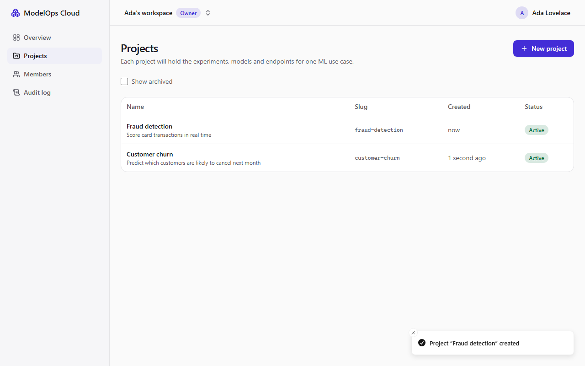

# ModelOps Cloud

A self-service platform to **train → register → validate → deploy → serve → monitor → safely release** machine-learning models, running entirely on a laptop at zero cost.

> **Status: Milestone 2 of 12.** Working today: accounts, organizations with roles, invitations, projects, an append-only audit log, and the local infrastructure stack. **No ML features yet**: experiments and the model registry arrive in M3. See [`PROGRESS.md`](PROGRESS.md) for exactly what is done. This README only describes implemented features.



## What problem does it solve?

Data scientists can train good models, but getting one into production reliably means hand-writing APIs, packaging dependencies, provisioning infrastructure, and wiring up monitoring. The result is unrepeatable releases, unsafe artifacts such as pickle files, no rollback, and models that silently decay as data drifts. ModelOps Cloud makes that path a governed, repeatable pipeline: experiments tracked in MLflow, immutable validated ONNX artifacts, durable idempotent deployments into isolated containers, an authenticated inference gateway, canary releases with rollback, and drift and performance monitoring.

## Quickstart

Prerequisites: Docker Desktop, Node 24, pnpm 12. Everything is free.

```bash
pnpm install
pnpm env:init      # generates .env with random secrets
pnpm dev:up        # Postgres, Redis, SeaweedFS (S3), MLflow, all health-checked
pnpm db:deploy     # apply database migrations
pnpm dev           # web http://127.0.0.1:3300 · API http://127.0.0.1:4000 (Swagger at /api/docs)
pnpm dev:clean     # remove containers and volumes
```

## What works today

| Area | Implemented |
|---|---|
| Identity | Email + password (Argon2id), server-side sessions in HttpOnly cookies, CSRF tokens, login rate limiting |
| Tenancy | Organizations with Owner / Admin / ML Engineer / Viewer roles; other tenants' data returns 404 |
| Team | One-time, email-bound invitation links; role changes; "last Owner" protection |
| Projects | Create, rename (optimistic UI), archive, paginated lists |
| Audit | Append-only log (enforced by a database trigger), filterable in the UI |
| API contract | OpenAPI generated from the NestJS code → typed web client; CI fails on drift |

## Tests

```bash
pnpm test               # unit + component (33 API, 27 web)
pnpm test:integration   # 88 tests against real Postgres + Redis (throwaway database)
pnpm test:e2e           # Playwright user journeys + axe accessibility checks
pnpm test:smoke         # 17 environment checks
```

Results and details: [M1](docs/milestones/m1-local-environment.md) · [M2](docs/milestones/m2-auth-orgs-projects.md) · [local development guide](docs/10-local-development.md).

## Design

Start with the [design index](docs/README.md). Key documents:
- [System architecture](docs/02-system-architecture.md)
- [Deployment lifecycle & state machine](docs/05-deployment-lifecycle.md)
- [Security & artifact strategy](docs/06-security.md)
- [Roadmap](docs/08-roadmap.md)

## Stack

Next.js · React · TypeScript · Tailwind · shadcn/ui · TanStack Query · NestJS · Prisma · PostgreSQL · Redis · BullMQ · Python · FastAPI · ONNX Runtime · scikit-learn · PyTorch · MLflow · Evidently · SeaweedFS (S3) · Docker Compose · kind · Prometheus · Grafana · OpenTelemetry · GitHub Actions · Terraform (validate-only).

## License

MIT (to be added in M1).
