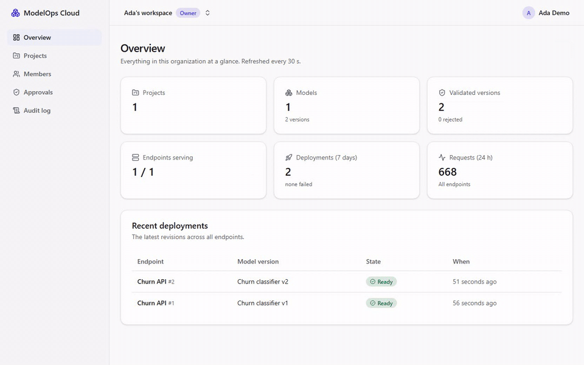
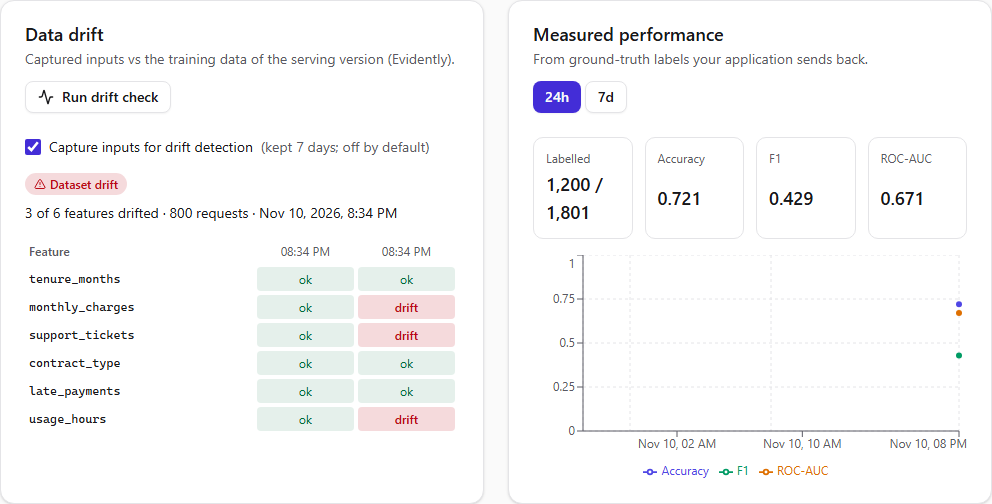

# ModelOps Cloud

A self-service platform to **train → register → validate → deploy → serve → monitor → safely release** machine-learning models, running entirely on a laptop at zero cost.



> **Status: all 12 milestones built.** Milestones 1–8 are on `main` with green CI; 9–12 (reliability and security, Kubernetes and tracing, CI/CD and Terraform, benchmarks) are verified locally and not yet pushed. [`PROGRESS.md`](PROGRESS.md) says exactly what is done and how it was checked. This README only describes what exists.

## What problem does it solve?

Data scientists can train good models, but getting one into production reliably means hand-writing APIs, packaging dependencies, provisioning infrastructure and wiring up monitoring. The result is unrepeatable releases, unsafe artifacts such as pickle files, no rollback, and models that silently decay as data drifts. ModelOps Cloud makes that path a governed, repeatable pipeline: experiments tracked in MLflow, immutable validated ONNX artifacts, durable idempotent deployments into isolated containers, an authenticated inference gateway, canary releases with automatic analysis and rollback, and drift and performance monitoring.

## Measured

On one laptop that also runs the database, queues, object storage, MLflow, another project and the load generator; one model server at its default limits (0.5 CPU, 512 MiB). The benchmark ran three times; every run is shown, linked to its raw files (the three links in each row are runs 1, 2 and 3). Method, environment and the full tables: the [benchmark report](docs/benchmarks/report.md), generated by `pnpm bench:report` from those files, which `pnpm bench` wrote.

| What | Runs 1 / 2 / 3 | Raw results |
|---|---|---|
| 50 req/s for 3 minutes through the gateway | 0 failed in every run (9000–9001 requests each); p95 4.68 / 23.1 / 34.6 ms. The slow tails were the model server stalling on the busy laptop (it was fast when called directly minutes later), not the gateway | steady.json [1](benchmarks/results/2026-11-11T1023/steady.json) [2](benchmarks/results/2026-11-11T1715/steady.json) [3](benchmarks/results/2026-11-11T1745/steady.json) |
| What the gateway adds (API key, rate limit, routing, input validation, proxy hop), vs calling the model server directly, at p50 | 1.45 / 3.27 / 3.48 ms | direct.json [1](benchmarks/results/2026-11-11T1023/direct.json) [2](benchmarks/results/2026-11-11T1715/direct.json) [3](benchmarks/results/2026-11-11T1745/direct.json) |
| Highest rate one default-sized model server sustained (no errors, p95 < 100 ms) | 100 / 50 / 200 req/s | ramp.json [1](benchmarks/results/2026-11-11T1023/ramp.json) [2](benchmarks/results/2026-11-11T1715/ramp.json) [3](benchmarks/results/2026-11-11T1745/ramp.json) |
| Canary configured at 10 % (6001 responses each) | 9.88 / 10.58 / 10.56 % | canary.json [1](benchmarks/results/2026-11-11T1023/canary.json) [2](benchmarks/results/2026-11-11T1715/canary.json) [3](benchmarks/results/2026-11-11T1745/canary.json) |
| Rollback to the previous (warm) revision, request to the gateway serving it, median of 10 | 54.0 / 113.8 / 61.6 ms (slowest single rollback 145.4 ms) | rollback.json [1](benchmarks/results/2026-11-11T1023/rollback.json) [2](benchmarks/results/2026-11-11T1715/rollback.json) [3](benchmarks/results/2026-11-11T1745/rollback.json) |
| Memory of the whole container stack with two model servers | 2.15 / 2.45 / 2.80 GiB | footprint.json [1](benchmarks/results/2026-11-11T1023/footprint.json) [2](benchmarks/results/2026-11-11T1715/footprint.json) [3](benchmarks/results/2026-11-11T1745/footprint.json) |

**Found by the benchmark, then fixed:** under overload the reconciler mistook a saturated model server for a dead one and restarted it, which removed capacity exactly when it was needed. A running server now has to fail 3 health checks in a row first. The same overload ramp, run back to back with the old rule and the fixed one: restarts 2 → 0, requests answered 9831 → 11036 ([old](benchmarks/results/2026-11-11T1734/ramp.json), [fixed](benchmarks/results/2026-11-11T1740/ramp.json), [events old](benchmarks/results/2026-11-11T1734/events.json), [events fixed](benchmarks/results/2026-11-11T1740/events.json)). Details: the [report](docs/benchmarks/report.md) and the [M12 doc](docs/milestones/m12-benchmarks-demo.md).

## Quickstart

Prerequisites: Docker Desktop, Node 24, pnpm 12, uv. Everything is free.

```bash
pnpm install
pnpm env:init      # generates .env with random secrets
pnpm dev:up        # Postgres, Redis, S3, MLflow, validator, gateway, Docker proxy, Prometheus (health-checked)
pnpm db:deploy     # apply database migrations
uv sync --directory ml   # Python training environment (CPU-only PyTorch)
pnpm dev           # web http://127.0.0.1:3300 · API http://127.0.0.1:4000 (Swagger at /api/docs) · worker
pnpm dev:clean     # remove containers and volumes
```

Tracing and Grafana (`http://127.0.0.1:13001`): `pnpm dev:obs`. The whole platform on a local Kubernetes cluster instead (needs [kind](https://kind.sigs.k8s.io/)): `pnpm kind:up`, then `pnpm kind:smoke`. Details: [local development guide](docs/10-local-development.md). A guided tour: the [3-minute demo script](docs/demo-script.md).

Then create a project in the web app and train both demo models into it (the project page shows the exact command):

```bash
pnpm ml:train --experiment modelops/<org-slug>/<project-slug>
```

Register a run as a version (it is validated automatically), create an endpoint, click **Deploy**, create an API key, and call it. The endpoint page shows this exact command with your model's features:

```bash
curl -X POST http://127.0.0.1:18088/v1/endpoints/<endpoint-slug>/predict \
  -H "Authorization: Bearer $MODELOPS_API_KEY" -H "Content-Type: application/json" \
  -d '{"inputs":[{"tenure_months":14,"monthly_charges":72.5,"support_tickets":3,"contract_type":1,"late_payments":0,"usage_hours":41.2}]}'
```

Or skip curl: the endpoint page has a playground, and `pnpm demo:traffic --endpoint <slug> --key <key>` sends steady k6 traffic so the dashboard has something to show. To see drift, turn on **Capture inputs** on the endpoint and run `pnpm demo:drift --endpoint <slug> --key <key> --phase normal|data|concept`, then press **Run drift check**.

## What it does



| Area | Implemented |
|---|---|
| Identity & tenancy | Email + password (Argon2id), server-side sessions in HttpOnly cookies, CSRF tokens, login rate limiting; organizations with Owner / Admin / ML Engineer / Viewer roles; other tenants' data returns 404; email-bound invitations |
| Training & experiments | Seeded synthetic churn data → scikit-learn and PyTorch models → parity-checked ONNX bundles (no pickle) → MLflow; per-project experiments, run comparison with charts |
| Registry & validation | Immutable numbered versions with signature, metrics and dataset lineage (SHA-256); content-addressed artifact storage; a sandboxed validator rejects pickles, external data, unknown operators, signature mismatches, golden-example drift, slow models and tampered bytes, shown as a live checklist |
| Deployment | One hardened container per revision (non-root, read-only, no capabilities, internal network only); durable requests (transactional outbox + Idempotency-Key); a state machine with compare-and-set and deadlines; checksum-verified loading; a golden-example check before any traffic; blue/green switch; a self-healing reconciler with a restart budget |
| Inference | Gateway with project-scoped API keys (stored as HMACs, revocable in seconds), per-key rate limits, input validation against the model signature, a circuit breaker and Prometheus metrics by model version |
| Releases | Canaries on 0–50 % of traffic with sticky routing; automatic canary analysis (error rate and p95 against stable) that aborts a failing canary; promotion only after a passing check; one-click rollback; four-eyes approvals for production, enforced by the API and the database |
| Monitoring | Playground generated from the model signature; per-endpoint dashboard; opt-in input capture with 7-day retention; Evidently data-drift checks; ground-truth feedback and measured accuracy / F1 / ROC-AUC; an evaluation gate that is the only way to crown a `champion` |
| Kubernetes | `pnpm kind:up` runs the platform on a local kind cluster (Kustomize); each revision becomes a hardened Pod + Service + NetworkPolicy; the same lifecycle tests pass on Docker and Kubernetes |
| Observability | OpenTelemetry from the gateway into the model server (one prediction is one trace), Tempo, provisioned Grafana dashboards, alert rules with runbooks |
| Reliability & security | A chaos suite with real faults (killed worker, flushed Redis, paused Postgres, killed model server); a hash-chained audit log verified in the app; every container checked for non-root, read-only, no capabilities and limits; every security test (SEC-1…SEC-16) automated |
| CI/CD & AWS | One GitHub Actions pipeline with path filters, a single required check, actions pinned by SHA and images by digest, Dependabot with a 7-day cooldown, a migrations check on a Postgres service container, images scanned and published with SBOM and provenance; the AWS deployment (ECS Fargate, RDS, S3, least-privilege IAM, GitHub OIDC) as Terraform that is linted and policy-checked but never applied, with a [cost estimate](infra/terraform/envs/demo/cost.md) |

## Tests and checks

```bash
pnpm test                 # unit + component tests (API, gateway, web)
pnpm ml:test              # dataset determinism, drift scenarios, ONNX parity
pnpm test:integration     # against real Postgres, Redis, MLflow, S3, ml-worker, Docker, Prometheus, Tempo
pnpm --filter @modelops/api test:k8s   # the same lifecycle suite on kind, with NetworkPolicy probes
pnpm test:chaos           # real faults during deployments
pnpm test:e2e             # Playwright journeys (real model training) with axe accessibility checks
pnpm test:smoke           # environment checks
pnpm check:hardening      # what Docker actually applied to every container
pnpm tf:check             # the AWS Terraform: fmt, validate, tflint, checkov (never applied)
pnpm bench && pnpm bench:report   # the numbers above
```

What each milestone tested and the results: [M1](docs/milestones/m1-local-environment.md) · [M2](docs/milestones/m2-auth-orgs-projects.md) · [M3](docs/milestones/m3-experiments-registry.md) · [M4](docs/milestones/m4-validation-artifacts.md) · [M5](docs/milestones/m5-deployment-pipeline.md) · [M6](docs/milestones/m6-playground-dashboard.md) · [M7](docs/milestones/m7-drift-evaluation.md) · [M8](docs/milestones/m8-canary-rollback.md) · [M9](docs/milestones/m9-reliability-security.md) · [M10](docs/milestones/m10-kind-observability.md) · [M11](docs/milestones/m11-cicd-terraform.md) · [M12](docs/milestones/m12-benchmarks-demo.md).

## Design

Start with the [design index](docs/README.md). Key documents:
- [System architecture](docs/02-system-architecture.md)
- [Deployment lifecycle & state machine](docs/05-deployment-lifecycle.md)
- [Security & artifact strategy](docs/06-security.md)
- [Benchmark report](docs/benchmarks/report.md)
- [Roadmap](docs/08-roadmap.md)

## Stack

Next.js · React · TypeScript · Tailwind · shadcn/ui · TanStack Query · NestJS · Prisma · PostgreSQL · Redis · BullMQ · Python · FastAPI · ONNX Runtime · scikit-learn · PyTorch · MLflow · Evidently · SeaweedFS (S3) · Docker Compose · Kubernetes (kind) · Prometheus · Grafana · OpenTelemetry · Tempo · k6 · GitHub Actions · Terraform (validate-only).

## License

[MIT](LICENSE).
