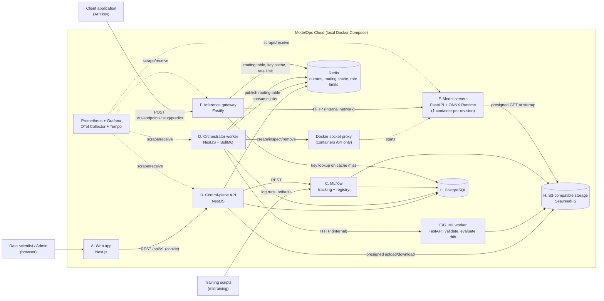
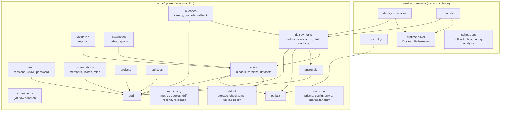
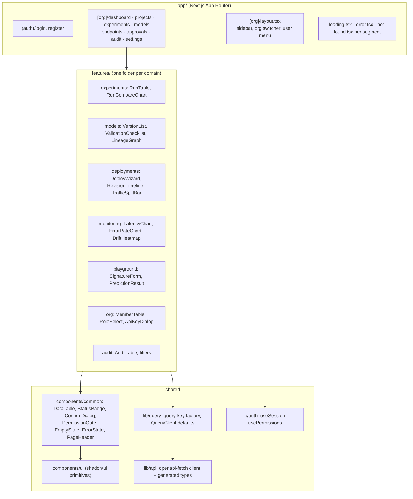

# 02 — System Architecture

> Status: **Design (Phase 0)**. Decisions are recorded as ADRs in [`adr/`](adr/).

## 1. Guiding principles

1. **Control plane ≠ data plane.** The management API can be down while inference keeps serving. Inference never depends on the NestJS API being up.
2. **Postgres is the single source of truth.** Redis, the routing table, and running containers are *derived* state that can always be rebuilt from Postgres.
3. **Declare desired state, then reconcile.** The API records *intent*. Workers and a reconciler converge reality toward it, which is the same idea Kubernetes controllers use.
4. **At-least-once delivery + idempotent handlers.** We never claim exactly-once. Duplicates are expected and made harmless.
5. **No untrusted code in the serving path.** Only validated ONNX graphs from an allow-listed operator set are served.
6. **Modular monolith first.** One NestJS codebase with strict module boundaries and two entrypoints (`api`, `worker`). The only separately deployed Node component is the inference gateway, because it is the data plane ([ADR-0001](adr/0001-modular-monolith-control-plane.md)).

## 2. System context



## 3. Components and ownership

| # | Component | Tech | Owns (writes) | Reads | Deployed as |
|---|---|---|---|---|---|
| A | **Web app** | Next.js 16, React 19, TS strict, Tailwind 4, shadcn/ui, TanStack Query, Recharts | Nothing (stateless UI) | API only | 1 container |
| B | **Control-plane API** | NestJS 12, Prisma, class-validator, @nestjs/swagger | Users, orgs, projects, models, endpoints, revisions (intent), approvals, API keys, audit, outbox | MLflow, Prometheus (allow-listed queries) | 1 container (`node dist/main`) |
| C | **MLflow** | MLflow 3 server | Experiments, runs, registry (own DB `mlflow`) | — | 1 container |
| D | **Orchestrator worker** | Same NestJS codebase, `worker` entrypoint, BullMQ | Revision *actual* state, events, routing table in Redis, Prometheus target file | Postgres, Docker API | 1 container (`node dist/worker`) |
| E | **ML worker – validation & evaluation** | Python, FastAPI (internal only), onnx, onnxruntime | Validation and evaluation reports (returned to D, which persists them) | S3 artifacts, datasets | 1 container |
| F | **Inference gateway** | Node 24, Fastify | Prediction records (opt-in), metrics | Redis routing table, API-key cache | 1 container |
| F | **Model server** | Python, FastAPI, ONNX Runtime | Nothing persistent | One artifact via presigned URL | 1 container **per revision**, CPU/memory-limited, non-root, read-only filesystem |
| G | **ML worker – drift** | Same Python service, Evidently | Drift reports (returned to D) | Captured inputs + reference dataset in S3 | (same container as E) |
| H | **Postgres / S3 storage** | PostgreSQL 18, SeaweedFS | — | — | 1 container each |

**Ownership rule:** each table has exactly one writing module (see §6). Python services never write to Postgres directly. They return results to the Node worker, which persists them. This keeps a single schema owner (Prisma migrations) and a single place for transactions.

## 4. Synchronous vs asynchronous communication

| Interaction | Style | Why |
|---|---|---|
| Browser → API | Sync REST (JSON) | User actions need an immediate yes/no (validation, authorization) |
| API → MLflow | Sync REST | Read-mostly queries; result shown to the user |
| API → worker | **Async**: Postgres row + outbox → BullMQ | Deployments take tens of seconds and can fail half-way. The request must survive crashes |
| Worker → ML worker | Sync HTTP *inside* an async job | Validation, evaluation, and drift are CPU work in Python. The job (retries, idempotency) stays owned by Node |
| Worker → Docker | Sync calls via socket proxy, polled for readiness | Driver interface `ensure / inspect / remove` |
| Worker → gateway | **Async**: routing table in Redis + pub/sub invalidation | Gateway hot path never calls the API |
| Client → gateway → model server | Sync HTTP | Online inference |
| Gateway → drift pipeline | **Async**: Redis Stream → worker batches → S3 JSONL | Never slow down predictions to record them |
| Reconciler | **Periodic loop** (every 15 s) | Repairs anything a crash or lost message left behind |

### The transactional outbox (why the deploy request can't get lost)

```text
API transaction:  INSERT deployment_revision(state=REQUESTED)
                  INSERT outbox_message(type=DEPLOY, aggregate_id=revision.id)
                  COMMIT                         ← intent is now durable
Outbox relay:     SELECT undispatched outbox rows (FOR UPDATE SKIP LOCKED)
                  queue.add('deploy', payload, { jobId: `deploy:${revisionId}` })   ← dedup by jobId
                  UPDATE outbox_message SET dispatched_at = now()
```

If the process crashes after `queue.add` but before the `UPDATE`, the relay re-adds the same `jobId`. BullMQ ignores a duplicate jobId while that job still exists. If the job is already gone, the handler's compare-and-set on the revision state makes the second execution a no-op.

## 5. Failure modes and behaviour

| Failure | Effect | Why the system stays correct | Recovery |
|---|---|---|---|
| API crashes mid-request | Client gets an error; transaction rolled back | Intent is written atomically with its outbox row, or not at all | Client retries with the **same Idempotency-Key** and gets the same result |
| Worker crashes mid-deploy | Job lock expires; BullMQ marks it stalled and re-delivers | Every step is idempotent: deterministic container name `mo-rev-<id>`, state CAS | Next attempt continues from the current state |
| Redis restarts (data lost) | Queues, routing cache, rate-limit counters lost | Postgres holds the truth. Outbox rows marked dispatched but whose jobs vanished are caught by the reconciler | Reconciler re-enqueues stuck revisions and rebuilds the routing table. Gateway keeps its last in-memory table meanwhile |
| Postgres down | API returns 503; deployments pause | No writes accepted, so nothing becomes inconsistent | Gateway keeps serving from its cached routing table and key cache (bounded TTL) |
| Model server crashes | Gateway gets connection errors for that revision | Gateway circuit breaker stops routing to it. Canary traffic falls back to stable | Reconciler restarts it (max 3 restarts in 10 min), then marks it `FAILED` and auto-reverts traffic |
| Bad model (wrong predictions) | — | Blocked at validation (golden examples) and verification (functional check) | Never reaches `READY` |
| Canary degrades | Error rate or p95 up for X% of traffic | Analysis compares canary against stable over a minimum sample | Auto-abort sets canary weight to 0 |
| Validation service down | Validation jobs fail and retry with backoff | Version stays `VALIDATING`, so it cannot be deployed | Bounded retries, then `REJECTED (VALIDATOR_UNAVAILABLE)`. User can re-run |
| Stuck in a state | — | Every non-terminal state has a deadline | Reconciler fails it with `TIMEOUT` and cleans up the container |
| MLflow down | Experiment pages show an error state | Registry *copies* artifacts into platform storage at registration, so serving never depends on MLflow | Retry later |

## 6. Backend module boundaries (NestJS)



Rules:
- A module exposes a **service**, never its Prisma model access. Other modules call the service.
- Tenancy is enforced in `common/tenancy`: an `OrgMemberGuard` resolves `orgId` from the route plus the user's membership, and repositories take `orgId` as a required argument.
- State transitions of a revision happen **only** through `DeploymentStateMachine.transition(id, from, to)`, which does the compare-and-set and writes the event and audit rows in one transaction.

| Module | Owns tables | Key responsibilities |
|---|---|---|
| auth | users, sessions | Register, login, logout, session rotation, CSRF token |
| organizations | organizations, memberships, invitations | Role management, invites |
| projects | projects | CRUD, MLflow experiment linkage |
| api-keys | api_keys | Create (show once), hash, revoke, scope |
| experiments | — (MLflow) | Proxy and shape MLflow runs, compare |
| registry | registered_models, model_versions, dataset_versions | Registration, lineage, MLflow alias sync |
| artifacts | — (S3) | Upload policy, presigned URLs, SHA-256, content addressing |
| validation | validation_reports | Enqueue, persist results, status transitions |
| evaluation | evaluation_reports | Candidate vs baseline, gate policy |
| deployments | endpoints, deployment_revisions, deployment_events | Intent, state machine, history |
| approvals | approvals | Four-eyes rule for production |
| releases | (endpoints traffic fields) | Canary weight, promote, rollback |
| monitoring | drift_reports, prediction_records, prediction_feedback | Metrics read API, drift, performance |
| audit | audit_events | Append-only log |
| outbox | outbox_messages, idempotency_keys | Durable async hand-off, idempotency |

## 7. Frontend component architecture



Key frontend decisions:
- **Typed client from OpenAPI.** The API emits `openapi.json`. `openapi-typescript` generates types, and `openapi-fetch` is the client. CI fails if the committed spec is out of date.
- **Data fetching.** TanStack Query everywhere. Query keys come from a factory (`qk.endpoints.detail(orgId, id)`). Non-terminal revisions poll every 2 s, and polling stops at a terminal state.
- **Optimistic updates only where reversal is harmless.** Renaming a project and revoking a key are optimistic. **Deploy, promote, and rollback are never optimistic**: the UI shows only server-confirmed state, because showing "deployed" before it is true is exactly the bug this platform exists to prevent.
- **Permissions in the UI are cosmetic.** `PermissionGate` hides buttons, but the API is the enforcement point.
- **Accessibility.** Radix primitives (via shadcn), visible focus, `aria-live="polite"` on the deployment timeline, status badges with text and icon (not colour alone), axe checks in Playwright.
- **Same-origin API.** Next.js rewrites `/api/*` to the NestJS API. Cookies stay first-party and no CORS setup is needed.

## 8. Runtime isolation (model servers)

Each revision runs in its own container created by the orchestrator through a **Docker socket proxy** that only exposes the containers, images, and networks endpoints ([ADR-0005](adr/0005-runtime-driver-abstraction.md)):

- `--cpus 0.5 --memory 512m --pids-limit 128` (defaults; per-revision override within org limits)
- runs as a non-root user, read-only root filesystem, `tmpfs /tmp`, `no-new-privileges`, all Linux capabilities dropped
- attached only to the internal `inference` Docker network (`internal: true`). Only the gateway and the object storage share it, so there is no internet egress and no path to Postgres or Redis
- receives a short-lived **presigned URL** for exactly one artifact plus its expected SHA-256, so it holds no storage credentials
- verifies the checksum before loading, and refuses to start on mismatch

In M10 the same driver interface gets a Kubernetes implementation (Deployment + Service + resource limits + NetworkPolicy) on kind.
