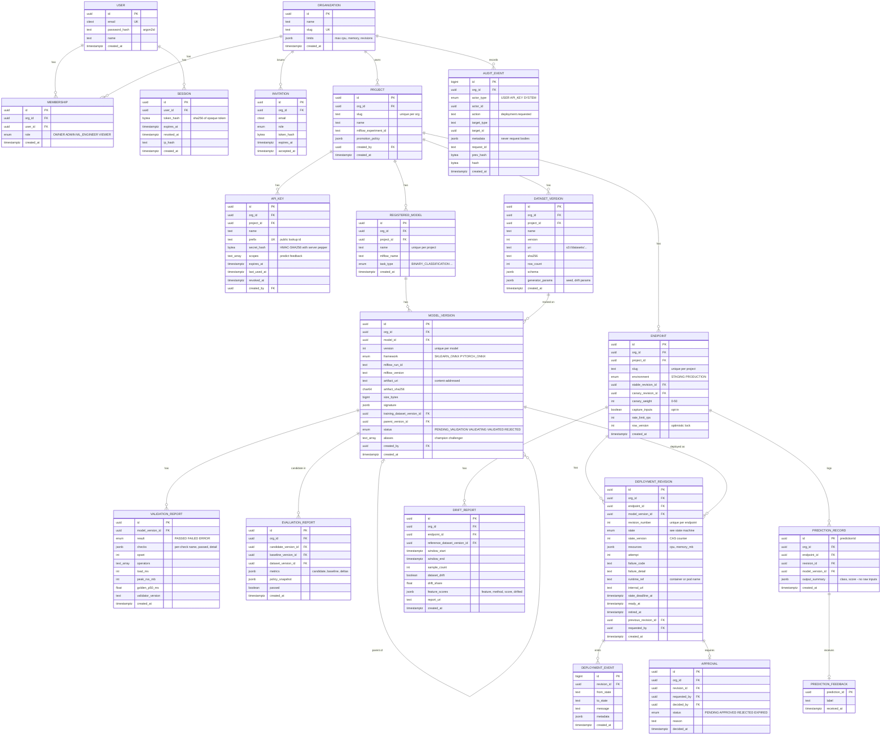

# 03 — Data Model (Entity-Relationship Diagram)

> Status: **Design (Phase 0)**. The Prisma schema in `apps/api/prisma/schema.prisma` (M2+) is the executable version of this document. MLflow keeps its own tables in a separate database (`mlflow`), which the platform never writes to directly.

## 1. ERD



Two infrastructure tables are not drawn above to keep the diagram readable:

| Table | Columns | Purpose |
|---|---|---|
| `outbox_messages` | `id`, `type`, `aggregate_type`, `aggregate_id`, `payload jsonb`, `created_at`, `dispatched_at`, `attempts`, `last_error` | Durable hand-off from a DB transaction to BullMQ |
| `idempotency_keys` | `org_id`, `key`, `request_hash`, `status_code`, `response_body jsonb`, `created_at`, `expires_at` (PK `org_id, key`) | Replays the stored response for a retried `POST` |

## 2. Invariants (enforced by the database, not just code)

| Invariant | Enforcement |
|---|---|
| One membership per user per org | `UNIQUE(org_id, user_id)` |
| Slugs unique within their parent | `UNIQUE(org_id, slug)` on projects; `UNIQUE(project_id, slug)` on endpoints |
| Model versions are numbered without gaps per model | `UNIQUE(model_id, version)`; number assigned in a transaction with `SELECT … FOR UPDATE` on the parent model |
| At most **one in-progress** (not yet `READY`) revision per endpoint, which stops two concurrent deploys racing | Partial unique index: `UNIQUE(endpoint_id) WHERE state IN ('REQUESTED','AWAITING_APPROVAL','QUEUED','PROVISIONING','LOADING','VERIFYING')` |
| Revisions can only reference a validated model version | API check + worker re-check + trigger that rejects insert when `model_versions.status <> 'VALIDATED'` |
| Canary weight in range | `CHECK (canary_weight BETWEEN 0 AND 50)` |
| `canary_weight > 0` only if a canary revision is set | `CHECK (canary_weight = 0 OR canary_revision_id IS NOT NULL)` |
| Audit log is append-only | `BEFORE UPDATE OR DELETE` trigger raising an exception; app DB role has no `UPDATE/DELETE` grant on `audit_events` |
| Idempotency keys unique per tenant | `PRIMARY KEY (org_id, key)` |
| Artifacts are immutable | `artifact_sha256` is never updated (trigger); storage keys are content-addressed `sha256/<hash>/model.onnx` |

## 3. Tenancy

- Every tenant-owned table carries `org_id`, **denormalised** even where it could be derived through a join. This makes every query filterable by org with a single index and enables Postgres Row-Level Security in M9 (Tier 3).
- Composite indexes start with `org_id`, e.g. `(org_id, project_id, created_at DESC)`.
- Cross-tenant lookups return "not found", never "forbidden", so ids cannot be probed.

## 4. Data retention

| Data | Retention (default) | Reason |
|---|---|---|
| Prediction records | 7 days | Needed only to join with late feedback labels |
| Captured inputs (S3 JSONL) | 7 days | Drift windows; privacy |
| Deployment events | Forever | Debugging and history (small) |
| Audit events | Forever | Accountability |
| Idempotency keys | 24 hours | Retry window |
| Sessions | 7 days sliding, 30 days absolute | Security |

A scheduled worker job (`retention`) enforces these limits.

## 5. Storage layout (S3-compatible)

```text
mlflow-artifacts/              ← owned by MLflow
model-artifacts/sha256/<hash>/model.onnx
model-artifacts/sha256/<hash>/signature.json
model-artifacts/sha256/<hash>/golden_examples.json
datasets/<org>/<project>/<name>/v<version>/data.parquet
drift-captures/<org>/<endpoint>/<yyyy-mm-dd>/<batch-id>.jsonl.gz
reports/<org>/drift/<report-id>.html|json
uploads-staging/<org>/<upload-id>/...   ← 24 h lifecycle; never served
```
