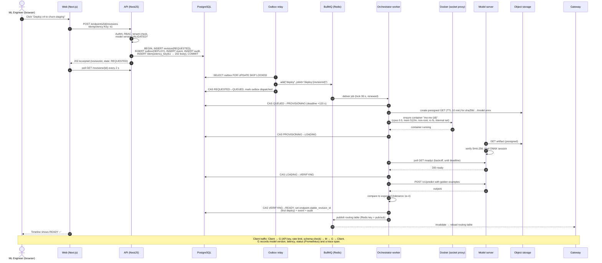
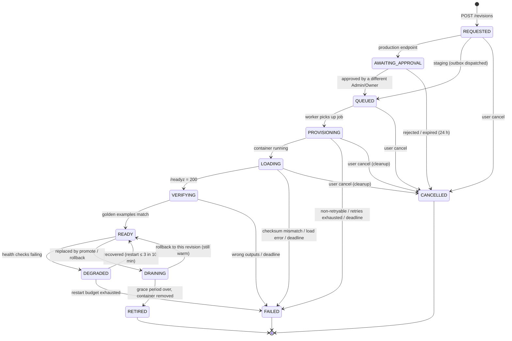
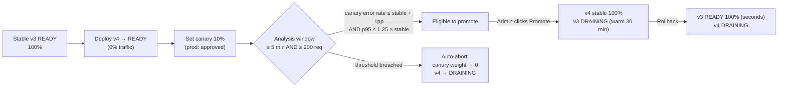

# 05 — Deployment Lifecycle, State Machine and Reliability

> Status: **Design (Phase 0)**. This is the most interview-relevant document in the repo. Every claim here is meant to become a test in M5, M8 and M9.

## 1. End-to-end deployment sequence

The diagram shows the Docker runtime. On Kubernetes (M10) step D is the `KubernetesDriver`: one Pod + Service + NetworkPolicy per revision instead of one container. The states, retries, deadlines, restart budget and reconciler below are the same code, and the same lifecycle test suite passes on both ([ADR-0005 addendum](adr/0005-runtime-driver-abstraction.md#addendum--m10-implementation-2026-11-11)).



## 2. Revision state machine



### Transition rules

| From | To | Triggered by | Guard | Side effects |
|---|---|---|---|---|
| — | REQUESTED | API | Model version `VALIDATED`; no other in-progress revision on endpoint (DB partial unique index); caller role | Outbox row, event, audit, idempotency record |
| REQUESTED | AWAITING_APPROVAL | API (same tx) | `endpoint.environment = PRODUCTION` | Approval row (PENDING) |
| AWAITING_APPROVAL | QUEUED | Approval module | `decided_by ≠ requested_by`; approver is O or A | Outbox row |
| REQUESTED | QUEUED | Outbox relay | Job added | — |
| QUEUED | PROVISIONING | Worker | Revision still `QUEUED` (CAS) | Deadline = now + 120 s |
| PROVISIONING | LOADING | Worker | Container exists and is running | Deadline = now + 120 s |
| LOADING | VERIFYING | Worker | `/readyz` 200 | Deadline = now + 60 s |
| VERIFYING | READY | Worker | Every golden example within tolerance | Routing table update; first deploy sets stable |
| READY | DEGRADED | Reconciler | Container exited or missing; **or** a running container failed 3 consecutive health checks (`UNHEALTHY_STREAK`, M12: until then a busy server keeps serving) | Remove from routing; restart container |
| DEGRADED | FAILED | Reconciler | > 3 restarts in 10 min | If it was canary: weight → 0. If stable with a warm previous: auto-rollback |
| READY | DRAINING | Releases | Another revision promoted / rolled back to | Removed from routing; grace 30 min (configurable) |
| DRAINING | READY | Releases (rollback) | Container still healthy | Routing update (fast rollback) |
| DRAINING | RETIRED | Reconciler | Grace period elapsed | Container removed |
| any non-terminal | FAILED | Worker / reconciler | Non-retryable error, attempts exhausted, or `state_deadline_at < now()` | `failure_code` + detail; container cleanup |
| pre-READY | CANCELLED | API | Caller is requester or O/A | Cleanup job |

**Terminal states:** `FAILED`, `CANCELLED`, `RETIRED`. A terminal revision is never reused. Retrying means creating a new revision, which keeps the history honest.

### Compare-and-set (the core correctness primitive)

```sql
UPDATE deployment_revisions
SET    state = $to, state_version = state_version + 1, state_deadline_at = $deadline, updated_at = now()
WHERE  id = $id AND state = $from AND state_version = $expectedVersion
RETURNING *;
-- 0 rows → someone else already moved it → handler stops (no-op), does NOT error-loop.
```

The CAS, the `deployment_events` insert, and the `audit_events` insert happen in **one transaction**.

## 3. Failure classification and retries

| Error class | Examples | Action |
|---|---|---|
| **Retryable** | Docker API timeout, storage 5xx, container not yet running, `/readyz` not yet ready | BullMQ retry: up to 5 attempts, exponential backoff `2s × 2^n` + jitter, capped at 60 s, always bounded by the state deadline |
| **Non-retryable** | Checksum mismatch, model not validated, golden-example mismatch, image missing, resource request above org limit | Immediately `FAILED` with a specific `failure_code` |
| **Deadline exceeded** | Stuck in any state past `state_deadline_at` | Reconciler → `FAILED (TIMEOUT)` + cleanup |

Failure codes: `ARTIFACT_CHECKSUM_MISMATCH`, `MODEL_LOAD_ERROR`, `FUNCTIONAL_CHECK_FAILED`, `RUNTIME_START_FAILED`, `RESOURCE_LIMIT_EXCEEDED`, `TIMEOUT`, `RESTART_BUDGET_EXHAUSTED`, `CANCELLED_BY_USER`.

## 4. Idempotency at every layer

| Layer | Mechanism | Duplicate it absorbs |
|---|---|---|
| HTTP | `Idempotency-Key` table, replays stored response | Double-click, client retry after timeout |
| Domain | Partial unique index (one in-progress revision per endpoint) | Two different users deploying at once |
| Queue | Deterministic `jobId = deploy:{revisionId}` | Outbox relay re-dispatch |
| Handler | State CAS; steps check current state before acting | Stalled-job redelivery, at-least-once delivery |
| Runtime | Deterministic container name `mo-rev-{revisionId}` + labels; `ensure()` inspects before creating | Worker crash between "create" and "record" |
| Routing | Routing table is a **full snapshot** keyed by version, not deltas | Out-of-order pub/sub messages |

## 5. Reconciliation loop (desired state vs actual state)

Runs in the worker every 15 s, guarded by a Redis lock (`SET reconciler:lock NX PX 14000`) so only one instance acts at a time. Correctness never depends on the lock, because every action is idempotent. The lock only avoids wasted work.

```text
desired = Postgres: revisions in {QUEUED..VERIFYING, READY, DEGRADED, DRAINING}
actual  = driver.list(label=modelops.managed=true)

for each desired revision:
  if state past deadline                  → FAILED(TIMEOUT), cleanup
  if QUEUED and no job in queue           → re-enqueue (lost on Redis restart)
  if READY and container missing/exited      → DEGRADED, restart (budget 3 / 10 min)
  if READY, running, health check fails      → count it; 3 in a row → DEGRADED, restart
                                               (a passing check resets the count; M12 finding)
  if DRAINING and grace elapsed           → remove container, RETIRED
for each actual container with no desired revision (orphan) → remove
rebuild routing snapshot from Postgres; if hash differs from Redis → publish
write Prometheus file_sd targets for READY/DEGRADED/DRAINING containers
```

## 6. Canary, promotion and rollback



- **Routing:** `bucket = fnv1a(routingKey ?? requestId) mod 100`. Requests with `bucket < weight` go to canary. With a routing key the assignment is sticky, so a given customer always sees the same model during the canary.
- **Fallback:** if the canary revision is unavailable (circuit open), the gateway routes to stable and counts `canary_fallback_total`, so a broken canary never causes client errors on its own.
- **Analysis** uses gateway metrics in Prometheus, evaluated by the worker's `canary-analysis` scheduler. Thresholds are per-project policy.
- **Rollback (fast path):** the previous revision is still `DRAINING` and warm. One transaction moves it to `READY`, makes it stable, moves the current revision to `DRAINING`, and publishes the routing snapshot. Target: under 10 s from click to traffic shift (to be measured).
- **Rollback (slow path):** if the previous revision is already `RETIRED`, a new revision is created from the same validated model version and deployed through the normal pipeline.

### As built (M8)

- **Strategy per deploy:** `IMMEDIATE` (default, the M5 blue/green switch) or `CANARY` with an initial share of 0–50 %. A canary becomes `READY` *next to* the stable revision (`endpoints.canary_revision_id`, `canary_weight`). One canary at a time, and it must accept the same input features as stable.
- **Weights 0–50 %** (CHECK constraints). 0 keeps the canary warm without traffic. More than half the traffic is a promotion, not a canary.
- **Analysis:** `minRequests` 200, `minDurationSeconds` 300, `maxErrorRateIncrease` 0.01, `maxLatencyRatio` 1.25 (per project, `projects.canary_policy`, snapshotted into each `canary_checks` row). It uses exact counts (counter differences, as in M6) for `source="api"` traffic since the canary started, plus p95 from the latency histogram. Canary fallbacks count as canary failures. **Bad news acts fast:** with `minRequests`, a breach FAILS at once and aborts the canary. **Good news needs patience:** a PASS also needs `minDurationSeconds`. Promote requires the latest check to be a PASS.
- **Release actions use `If-Match`** on the endpoint (not an Idempotency-Key). Each is one transaction that locks the endpoint row, moves revisions by CAS and bumps `row_version`; then the full snapshot is published.
- **Rollback targets** are revisions that served as *stable* (`stable_at`), newest first. An aborted canary never qualifies. Measured fast path: **85–87 ms** from the request to the gateway answering with the old revision (integration test, local Docker). That is far under the 10 s target.
- **Approvals:** see §2. A production revision skips `AWAITING_APPROVAL` only for a slow rollback of a version that already served there (`rollback_of_id`, checked by a trigger). Undecided approvals expire after 24 h (`CANCELLED`, `APPROVAL_EXPIRED`).

## 7. Consistency guarantees (what we promise, and what we don't)

| Guarantee | Statement |
|---|---|
| **Durability of intent** | Once the API returns `202`, the deployment request survives any single process crash or Redis loss. |
| **Delivery** | Jobs are delivered **at least once**. We do **not** claim exactly-once. |
| **Effect** | State transitions are **effectively once**: duplicates are rejected by CAS, and runtime actions are idempotent. |
| **Safety** | A revision receives traffic **only** if Postgres records it as `READY` (or `DRAINING` during a fast rollback) **and** the gateway's health view agrees. An unvalidated artifact cannot reach `READY` because validation is checked by the API, by a DB trigger, and again by the worker. |
| **Routing consistency** | Eventually consistent. After a traffic change, gateways converge within the pub/sub latency (milliseconds) and are always bounded by the 15 s reconciler. During convergence a request may hit the old split, which is acceptable because both revisions are healthy. |
| **Liveness** | Every non-terminal state has a deadline, so no revision can stay in progress forever. |
| **Infrastructure faults** (M9) | A database outage is retried, never recorded as the revision's failure; the deadline still bounds it. Measured under real faults (`pnpm test:chaos`): a killed worker, a flushed or restarted Redis, a paused Postgres and a killed model server all end in the correct state within their deadlines, and the data plane keeps answering through Redis and Postgres outages (M9 reliability report). |
| **Predictions** | Each request is served at most once by one revision. Predictions are pure functions, but the gateway does **not** retry automatically, so error metrics stay truthful. |
| **What we do not guarantee** | Zero dropped in-flight requests during a model-server crash, cross-region failover, or ordering of audit events across different organizations. |
