# 08 — Twelve-Milestone Implementation Roadmap

> Each milestone ends with **green tests + a demo you can show**. No milestone starts until the previous one meets its acceptance criteria. Progress is tracked in [`PROGRESS.md`](../PROGRESS.md).
>
> Every milestone write-up follows: A. Problem · B. Architecture decisions · C. Dependencies · D. Repo changes · E. File paths · F. Code · G. Setup commands · H. Tests · I. Expected behaviour · J. Debugging · K. Acceptance criteria · L. Checklist.

## Vertical slice first

```mermaid
flowchart LR
  P0["Phase 0<br/>Design"] --> M1["M1<br/>Repo + local env"] --> M2["M2<br/>Auth, orgs, projects,<br/>UI shell"] --> M3["M3<br/>MLflow, experiments,<br/>registry"] --> M4["M4<br/>Validation +<br/>artifacts"] --> M5["M5<br/>Deploy pipeline<br/>+ gateway"]
  M5 --> M6["M6<br/>Playground +<br/>ops dashboard"] --> M7["M7<br/>Drift +<br/>evaluation gates"] --> M8["M8<br/>Canary +<br/>rollback"] --> M9["M9<br/>Reliability +<br/>security hardening"]
  M9 --> M10["M10<br/>kind + observability"] --> M11["M11<br/>CI/CD + Terraform<br/>(validate-only)"] --> M12["M12<br/>Benchmarks, docs,<br/>demo"]
  classDef slice fill:#dbeafe,stroke:#2563eb,color:#1e3a8a;
  class M1,M2,M3,M4,M5,M6 slice;
```

Blue = **Tier 1 vertical slice**. After M6 the project is already a complete, demonstrable product. Everything after it is depth.

---

### M1 — Architecture, repository and local environment
- **Problem:** No repo, no reproducible environment.
- **Build:** monorepo skeleton (pnpm + uv), `.editorconfig`/`.gitattributes` (LF), `.env.example` + `init-env` script, Compose with **Postgres 18, Redis 8, SeaweedFS (S3), MLflow 3** with healthchecks, `postgres/init.sql` (two DBs, two roles), bucket bootstrap, a hello-world NestJS `/health/ready` and Next.js page wired via rewrite, `scripts/dev` + `scripts/cleanup`, first CI workflow (lint + typecheck + unit).
- **Tests:** smoke test script, i.e. Compose up → all healthchecks green → MLflow UI 200 → S3 put/get round trip → API `/health/ready` 200 → web page 200.
- **Acceptance:** fresh clone + `pnpm env:init && pnpm dev:up` reaches all-green on Windows (Docker Desktop) and Linux (CI).

### M2 — Authentication, organizations, projects, frontend foundation
- **Build:** Prisma schema + migrations (users, sessions, orgs, memberships, invitations, projects, audit, outbox, idempotency); auth module (Argon2id, sessions, CSRF); tenancy guard + permissions map; projects CRUD; problem+json errors; OpenAPI emit + typed client; web: login/register, org layout, sidebar, project list/detail, error/loading boundaries.
- **Tests:** auth unit tests, permission matrix tests (every role × every route), cross-tenant 404 tests, Vitest component tests (forms, PermissionGate), first Playwright flow (register → create project).
- **Acceptance:** two orgs seeded; org B cannot see org A in API or UI; contract-drift check passes in CI.

### M3 — MLflow integration, model registry and experiments
- **Build:** `ml/datasets/churn.py` (seeded, hashed); `train_sklearn.py` and `train_pytorch.py` logging params/metrics/dataset hash/signature/ONNX to MLflow; ONNX-vs-native parity check in training; experiments module (runs list, compare); registry module (models, versions, lineage, MLflow alias sync); UI: runs table, compare chart, model registry pages.
- **Tests:** dataset determinism (same seed → same SHA-256); ONNX parity (max abs diff < 1e-5); MLflow adapter integration test; compare endpoint test.
- **Acceptance:** both models trained with one command; their runs and metrics are visible and comparable in the UI.

### M4 — Model validation and artifact storage
- **Build:** presigned upload, server-side SHA-256, content-addressed copy, import-from-MLflow; ml-worker `/validate` with V1–V11 in a sandboxed child process; validation queue + persistence; UI validation checklist.
- **Tests:** one test per check; adversarial SEC-1…SEC-6 artifacts generated at test time; DB trigger test (cannot deploy unvalidated).
- **Acceptance:** good models → `VALIDATED`; every malicious or broken artifact → `REJECTED` with the correct check, and none is ever executed.

### M5 — Working inference deployment pipeline ⭐
- **Build:** endpoints + revisions + state machine with CAS; Idempotency-Key; outbox relay; BullMQ deploy processor; RuntimeDriver + Docker driver via socket proxy; model-server image (checksum verify, `/readyz`, `/v1/predict`); functional golden check; reconciler; gateway (API-key auth with cache, rate limit, signature validation, routing snapshot, proxy, Prometheus metrics); API keys UI.
- **Tests:** state-machine unit tests (every valid and invalid transition); lifecycle integration test (request → READY); duplicate submit (same key ×10 concurrent → one revision, one container); worker-kill-mid-deploy test; inference correctness (gateway output == local ONNX Runtime output); deadline/timeout test.
- **Acceptance:** click Deploy → READY → `curl` with API key returns the correct prediction tagged with the model version.

### M6 — Prediction playground and operational dashboard
- **Build:** signature-driven playground form; deployment timeline with live polling; Prometheus queries behind allow-listed series; dashboard cards + Recharts (rps, p50/p95/p99, error rate, traffic by version); audit history page; org overview dashboard.
- **Tests:** component tests (timeline states, signature form validation); Playwright full slice (login → deploy → playground predict); metrics API allow-list test (SEC-15).
- **Acceptance:** dashboard numbers move when `scripts/demo-traffic` runs, and match k6's own counts within tolerance.

### M7 — Drift monitoring and model evaluation
- **Build:** opt-in input capture (gateway → Redis Stream → worker → S3 JSONL); ml-worker `/drift` (Evidently DataDriftPreset vs training dataset version); `/evaluate` candidate vs baseline; promotion policy + gate; feedback endpoint + measured performance; UI drift heatmap, performance chart, evaluation report.
- **Tests:** drift detects injected shift and does not fire on a same-distribution sample (seeded, both directions); evaluation gate pass/fail cases; concept-drift scenario lowers measured accuracy while data drift stays low.
- **Acceptance:** demo shows data drift and concept drift as **separate** signals, and `champion` cannot be set without a passed gate.

### M8 — Canary deployment and rollback
- **Build:** canary weight with ETag/If-Match; sticky hashing; canary analysis scheduler + auto-abort; promote; fast and slow rollback; approvals (four-eyes) for production; UI traffic split bar, approvals queue, rollback button with confirm dialog.
- **Tests:** split accuracy (10 000 requests at 10% → 10% ± 1.5%); stickiness; auto-abort with a deliberately broken canary (error-injecting test model); rollback timing; self-approval blocked.
- **Acceptance:** a bad canary is rolled back automatically with no client-visible errors beyond the canary share.

### M9 — Reliability testing and security hardening
- **Build:** chaos scripts (kill worker, restart Redis, pause Postgres, kill a model server); remaining adversarial tests; container hardening checklist; gitleaks, Trivy, `pnpm audit`, `pip-audit` in CI; audit hash chain; Postgres RLS (Tier 3); threat model review.
- **Tests:** every chaos scenario ends in a correct terminal state within its deadline; SEC-1…SEC-16 green.
- **Acceptance:** written reliability report with real outputs from the chaos runs.

### M10 — Local Kubernetes (kind) and observability
- **Build:** kind cluster config; Kustomize manifests; Kubernetes RuntimeDriver (Deployment + Service + NetworkPolicy + resources); OpenTelemetry in API, gateway and model server → Collector → Tempo; Grafana dashboards (platform, endpoint, drift); alert rules; runbooks.
- **Tests:** the same lifecycle test suite passes against the Kubernetes driver; a trace spans gateway → model server.
- **Acceptance:** `scripts/kind-up` deploys the platform; a model deploys as a Pod with limits; Grafana shows live data.

### M11 — CI/CD and optional AWS infrastructure
- **Build:** full GitHub Actions pipeline (path filters, caching, service containers, Playwright with traces as artifacts, image build + scan, GHCR publish for the public repo — free); Terraform modules (network, IAM least privilege, ECR, S3, ECS Fargate service, CloudWatch logging) with `fmt`/`validate`/`tflint`/`checkov`; written cost estimate + teardown runbook.
- **Zero-cost rule:** **no `terraform apply`, no AWS account required.** CI only validates.
- **Acceptance:** the PR pipeline is green end-to-end; Terraform validates with zero high-severity checkov findings (or documented exceptions).

### M12 — Benchmarking, documentation, demonstration, portfolio
- **Build:** k6 scenarios (steady 50 rps, ramp, canary split); benchmark report generated from raw results; screenshots; demo GIF; final README; 3-minute demo script; resume bullets backed by numbers in the report.
- **Acceptance:** every number in the README links to a results file produced by a script in the repo.
