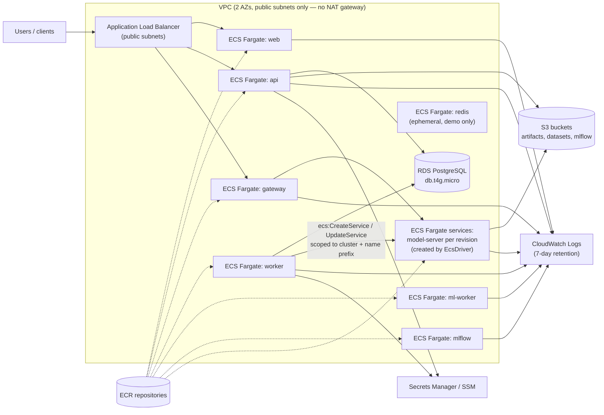

# 11 — Optional AWS Architecture and Cost Considerations

> **Zero-cost policy: this design is written and validated, but never deployed.**
> M11 delivers Terraform that passes `terraform fmt -check`, `terraform validate`, `tflint` and `checkov` in CI, with **no AWS account and no credentials**. No `terraform apply` is ever run on this design: at ~$0.29/hour it would spend the AWS free plan's whole allowance in about a month.
>
> **For a live deployment at no cost, see [docs/14](14-aws-free-plan.md)** (ADR-0009): the same platform on one EC2 server inside the AWS free plan.

## 1. Why include AWS at all?

To show you can **map a local architecture onto managed cloud services**, reason about IAM least privilege, and estimate and control cost. These are interview skills. The local system is the product; AWS is a documented, validated deployment target.

## 2. Target architecture (minimal, short-lived demo)



### Service mapping

| Local | AWS | Notes |
|---|---|---|
| Docker Compose services | ECS Fargate services | No EC2 to manage; pay per vCPU-second |
| Docker driver (model servers) | `EcsDriver` → ECS services with `mo-rev-<id>` names | Same `RuntimeDriver` interface |
| PostgreSQL container | RDS PostgreSQL `db.t4g.micro`, single-AZ | Multi-AZ doubles cost; not needed for a demo |
| Redis container | Redis as a Fargate task (demo) or ElastiCache | Redis state is rebuildable by design, so ephemeral Redis is acceptable |
| SeaweedFS | S3 | Same S3 API, so only the endpoint config changes |
| Image registry | ECR | Lifecycle policy keeps the last 5 images |
| Prometheus/Grafana | CloudWatch metrics/logs (or self-hosted Prometheus task) | Keep it minimal |
| `.env` | Secrets Manager / SSM Parameter Store | Task roles read only their own secrets |

### Rejected options
- **EKS**: the control plane alone costs about $0.10/hour (~$73/month) before any node. That is unjustified for a demo; kind covers the Kubernetes learning goal for free.
- **NAT gateway**: about $0.045/hour plus data charges. Tasks use public subnets with security groups instead (acceptable for a short-lived demo, documented trade-off).
- **SageMaker endpoints**: would hide exactly the serving and orchestration logic this project exists to demonstrate.

## 3. IAM (least privilege)

| Role | Allowed |
|---|---|
| `ecsTaskExecutionRole` | Pull from ECR, write to its own log group, read its own secrets |
| `api-task-role` | S3 `GetObject/PutObject` on `model-artifacts/*`, `uploads-staging/*`; read SSM params under `/modelops/api/*` |
| `worker-task-role` | Same S3 read + `ecs:CreateService/UpdateService/DeleteService/DescribeServices` with condition on the cluster ARN, and `iam:PassRole` only for `model-server-task-role` |
| `model-server-task-role` | **No** S3 permissions (uses presigned URLs), no secrets |
| CI (GitHub OIDC) | Would use `ecr:PutImage` on project repos only. Defined in Terraform, never created |

## 4. Cost estimate (indicative only)

> Approximate **us-east-1 on-demand list prices** known at design time. **Re-check with the AWS Pricing Calculator before any real use.** This project will not incur them.

| Item | Size | Approx. unit price | Per hour |
|---|---|---|---|
| Fargate vCPU | 2.0 vCPU total (8 small tasks) | ~$0.0405 / vCPU-h | ~$0.081 |
| Fargate memory | 4.5 GB total | ~$0.0044 / GB-h | ~$0.020 |
| ALB | 1 | ~$0.0225 / h + LCU | ~$0.03 |
| RDS PostgreSQL | db.t4g.micro + 20 GB | ~$0.016 / h + storage | ~$0.02 |
| Public IPv4 addresses | ~10 (tasks + ALB) | ~$0.005 / IP-h | ~$0.05 |
| S3, ECR, CloudWatch Logs | < 5 GB | cents per GB-month | ~$0.01 |
| **Total** | | | **≈ $0.20–0.25 / hour** |

- A **4-hour demo** would cost roughly **$1**.
- **Always-on** would cost roughly **$150–180/month**, which is why the design is short-lived by default.

### Cost controls (built into the Terraform design)
- `desired_count = 0` by default: no task runs unless explicitly scaled up. **Correction (M11):** the load balancer, the database and the load balancer's public addresses still bill by the hour, about $40/month idle, so only `terraform destroy` stops the cost ([cost.md](../infra/terraform/envs/demo/cost.md)).
- AWS Budgets alarm resource at $5 (defined, not applied).
- CloudWatch log retention 7 days; ECR lifecycle policy; S3 lifecycle on staging and capture prefixes.
- Tags `project=modelops-cloud`, `ttl=<date>` on every resource.
- A documented teardown: `terraform destroy` + checklist (ECR images, S3 versions, RDS final snapshot disabled).

## 5. What CI does instead of deploying

```bash
terraform -chdir=infra/terraform/envs/demo init -backend=false
terraform -chdir=infra/terraform/envs/demo fmt -check -recursive
terraform -chdir=infra/terraform/envs/demo validate
tflint --recursive
checkov -d infra/terraform --quiet
```

All of these run offline against provider schemas and require no AWS credentials.

## 6. As built (M11, 2026-11-11)

The design above is now Terraform in [`infra/terraform/`](../infra/terraform/): seven modules (`network`, `logging`, `ecr`, `s3`, `iam`, `database`, `ecs`) and one environment, `envs/demo`, which also holds the budget alarm. `pnpm tf:check` runs `terraform fmt`, `validate`, `tflint` (AWS ruleset) and `checkov` in pinned containers, locally and in the CI job `terraform`, with no account and no credentials. Nothing is ever applied.

Changes from the design while building it:

- **HTTPS only.** The load balancer has no port-80 listener at all (instead of an HTTP→HTTPS redirect), so it needs an ACM certificate and a domain. Paths route to services: `/api/*` → api, `/v1/*` → gateway, everything else → web.
- **Secrets never in Terraform state.** Components read SSM SecureString parameters under `/modelops/<env>/<component>/`, created out of band; each execution role can read only its own path. The database master password is generated and kept by RDS in Secrets Manager.
- **Service discovery** through a Cloud Map private namespace (`api.modelops.internal`, and `mo-rev-<id>.modelops.internal` for model servers: the gateway's `MO_MODEL_SERVER_DOMAIN`, as on Kubernetes).
- **IAM is per component:** separate execution and task roles for each of the eight components; only the API, worker, ml-worker and MLflow task roles have any permission (S3, scoped to buckets); the worker's ECS permissions are limited to `mo-rev-*` services in this cluster and to passing the model-server roles. The CI role trusts only GitHub's OIDC tokens for this repository's `main` branch.
- **Every checkov finding is fixed or skipped inline with its reason** (cost, or a static-analysis limit): 449 passed, 0 failed. The skips are listed in the [M11 doc](milestones/m11-cicd-terraform.md).
- **Two application changes are needed before this could really run:** an `EcsDriver`, and S3 access through the task role instead of static keys. Both are listed in the [teardown runbook](runbooks/aws-teardown.md).
