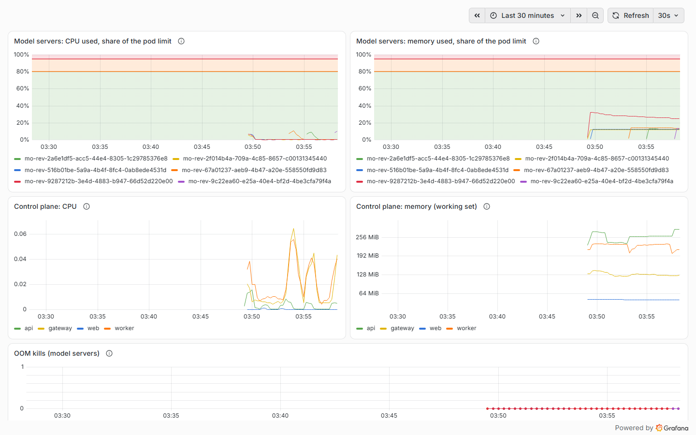
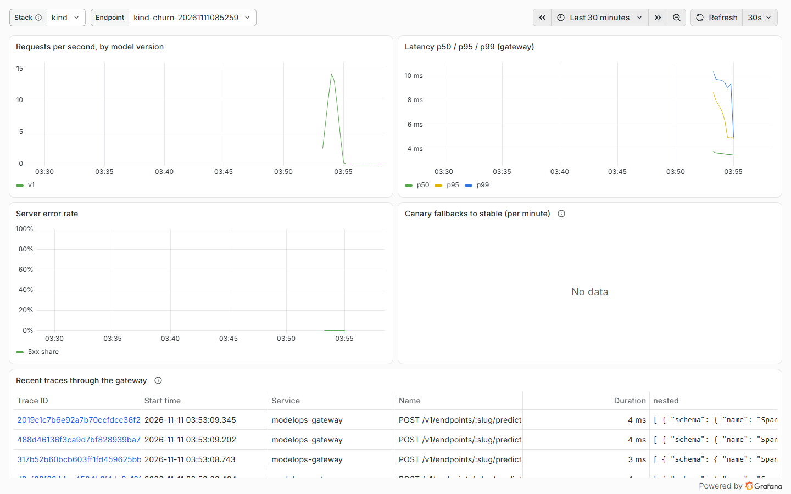
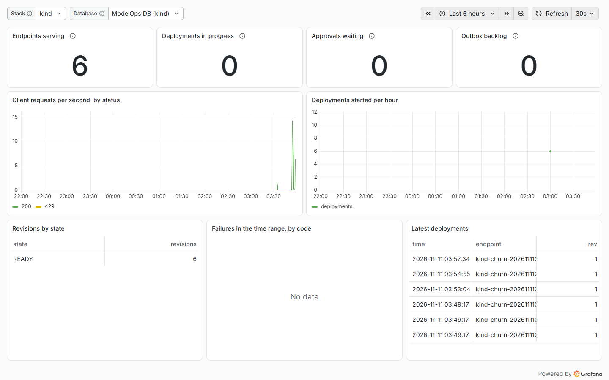

# Milestone 10 — Local Kubernetes (kind) and Observability

> **Status: done.** Verified locally on 2026-11-11 (Windows 11), then on Linux in CI, including the new `kind` job: [run 43080634686](https://github.com/Kartavya1905/modelops-cloud/actions/runs/43080634686) (green). The first run, [run 43076921779](https://github.com/Kartavya1905/modelops-cloud/actions/runs/43076921779), failed only in `kind` (CPU requests on a 4-CPU runner; see the M12 doc).



## A. Problem being solved

Up to M9 every model server was a Docker container, started through a socket proxy that is root-equivalent on the host (ADR-0005 accepted that for local development only). And when a prediction was slow, nothing showed *where* the time went: Prometheus had gateway counters, but no request could be followed into the model server.

M10 asks two questions:

1. **Does the deployment engine really not care what runs the model?** The roadmap's test: the *same* lifecycle test suite must pass against a Kubernetes driver, with model servers as pods that have limits and are isolated by NetworkPolicy, and the whole control plane must run on a local cluster from one command.
2. **Can one prediction be followed end to end, and can an operator see the platform at a glance?** One trace from the gateway into the model server; provisioned Grafana dashboards with live data; alert rules with runbooks.

## B. Architecture decisions

| Decision | Why |
|---|---|
| **KubernetesDriver behind the existing `RuntimeDriver` interface** (`MO_RUNTIME_DRIVER=kubernetes`). The deploy processor, reconciler, restart budget and state machine are unchanged | ADR-0005's promise. The proof is the lifecycle suite running unchanged on both drivers (section H) |
| **One bare Pod per revision (`restartPolicy: Never`) + a Service `mo-rev-<id>` + a NetworkPolicy**, not a Deployment | A ReplicaSet would restart a crashing model forever and hide its exit code (3 = checksum mismatch, 4 = load error). Restarts stay with the reconciler and its budget (3 in 10 minutes, then FAILED), exactly as on Docker. See the [ADR-0005 addendum](../adr/0005-runtime-driver-abstraction.md#addendum--m10-implementation-2026-11-11) |
| **Same semantics as Docker:** `ensure` waits (≤ 60 s) until the pod leaves Pending; `remove` returns only once the pod object is gone; a terminating pod reports `exited` and `ensure` refuses to reuse it | Found by the lifecycle tests (section H, bugs 2–3). Without it, a restart (remove, then ensure) found the old terminating pod and never recreated it |
| **NetworkPolicy per revision:** ingress only from pods labelled `app.kubernetes.io/name=gateway` on 8000; egress only to kube-dns and `MO_K8S_EGRESS` = `cidr:port` pairs (S3 8333, collector 4318). The model namespace is default-deny | Pods resolve compose services to their *backend*-network addresses, where Postgres and Redis also live, so a CIDR alone would have opened the databases. Port-scoped rules keep the Docker guarantee: no path to Postgres or Redis |
| **Only the worker has Kubernetes credentials:** a ServiceAccount bound to a Role in `modelops-models` (pods, services, networkpolicies: get/list/create/delete; pods/log: get). No exec, no secrets, no other namespace. Both namespaces enforce the `restricted` Pod Security Standard | Replaces the root-equivalent Docker socket on this path |
| **Stateful services stay in Docker Compose; the kind node joins the compose networks** (`modelops-backend`, `modelops-inference`) | Pods reach Postgres, Redis, SeaweedFS, MLflow, the ml-worker and the collector by name. One copy of the data services, no in-cluster databases to operate on a laptop |
| **The kind platform is a second, separate instance:** database `modelops_kind`, Redis DB 1, instance id `kind`, its own gateway on 18188 | It runs next to the Docker platform without either reconciler touching the other's model servers |
| **`pnpm kind:up` (`scripts/kind.mjs`)** instead of a shell `scripts/kind-up`: tools check → cluster from `infra/kind/cluster.yaml` → attach networks → build + `kind load` 4 images → database + migrations + Grafana grant → generated `config.env`/`secrets.env` (gitignored) → `kubectl apply -k infra/k8s/overlays/kind` → rollout → URLs | Works the same on Windows and Linux (CI). Idempotent: re-running it reuses the cluster and restarts the deployments onto new images |
| **OpenTelemetry**: the gateway (ESM, so explicit spans) starts a SERVER span and a CLIENT span for the upstream call, sends W3C `traceparent`, returns `X-Trace-Id`; the model server continues the trace (FastAPI instrumentation); API and worker use the Node SDK's auto-instrumentation (HTTP, undici, pg, ioredis). OTLP/HTTP → Collector (memory limiter, batch) → Tempo (24 h) | One prediction = one trace across two services and two languages, with no vendor and no cost |
| **Grafana provisioned from files:** Platform, Endpoint, Drift, Kubernetes pods. `Stack` (dev/kind) and `Database` pickers. Postgres panels use a read-only role (`grafana_ro`) with SELECT on 13 operational tables only | Dashboards are code, reviewed like code. No users, sessions, API keys, audit events or prediction data are readable from Grafana |
| **Container CPU/memory from the kubelet's cAdvisor endpoint**, scraped by the compose Prometheus through the kubelet read-only port (local-only exception, docs/06) and kept to ModelOps namespaces and six series | Shows "a pod with limits" as live data: each model server's CPU and memory as a share of its own limit |
| **Six alert rules with runbooks** (`infra/compose/prometheus/rules.yml`, [`docs/runbooks/`](../runbooks/README.md)), unit-tested with `promtool test rules` (CI) | An alert without a runbook is noise; a rule without a test is a guess |

### Deviations from the roadmap (honest list)

- **A Pod, not a Deployment,** per revision (reason above).
- **The script is `pnpm kind:up`**, a Node script, not `scripts/kind-up` (shell). Same job, works on Windows.
- **The control-plane namespace restricts ingress only.** Its egress stays open because the API and worker talk to six compose services and the worker to the Kubernetes API. The model namespace, where untrusted code runs, is default-deny both ways.
- **Container CPU/memory panels cover kind only.** The Docker runtime has no cAdvisor; adding one would need the Docker socket and `/sys` mounted into another container, which M9 worked to avoid.
- **NetworkPolicy enforcement starts once kindnet has seen a new pod's IP.** A manual probe found that connections in a pod's first second of life were not yet filtered (5 s later they were). Model servers' only early connections are to S3, which is allowed anyway; the isolation tests wait 5 s. A production CNI (Cilium, Calico) applies policy before the pod's network is ready.
- **The M9 chaos suite still runs against Docker only.** On kind, the lifecycle suite covers crash → restart within the budget → FAILED, and recreating the cluster showed the reconciler re-creating the missing pods of READY revisions (restart 1/3). Killing the worker pod or pausing Postgres under kind is not automated.
- **No Alertmanager:** rules fire in Prometheus and show in Grafana; there is nowhere free and local to send notifications to.
- **The web image is 1.06 GB** (full `node_modules`). Next.js standalone output would shrink it; that belongs with M11's image work.

## C. Dependencies

| Where | Added (all ≥ 7 days old, ADR-0007) |
|---|---|
| API | `@kubernetes/client-node` 2.0.2; `@opentelemetry/api` 1.10.0, `sdk-node` / `exporter-trace-otlp-http` / `instrumentation-http` 0.300.0, `instrumentation-undici` 0.34.0, `instrumentation-pg` 0.77.0, `instrumentation-ioredis` 0.72.0, `resources` 3.0.0, `semantic-conventions` 1.44.0 |
| Gateway | the same OTel set without pg/ioredis; dev: `@opentelemetry/sdk-trace` 3.0.0 |
| Model server | `opentelemetry-sdk` 1.45.2, `opentelemetry-exporter-otlp-proto-http` 1.45.2, `opentelemetry-instrumentation-fastapi` 0.66b2 |
| Images | `otel/opentelemetry-collector:0.164.0`, `grafana/tempo:3.1.1`, `grafana/grafana:13.3.0`, `kindest/node:v1.37.0` |
| Tools | kind 0.33.0 (CI: downloaded and SHA-256 checked) |

## D/E. Repository changes and file paths

```text
apps/api/src/modules/deployments/runtime/kubernetes.driver.ts   Pod + Service + NetworkPolicy per revision
apps/api/src/modules/deployments/deployments.module.ts          driver chosen by MO_RUNTIME_DRIVER
apps/api/src/config/config.ts                                   MO_RUNTIME_DRIVER, MO_K8S_*, MO_K8S_EGRESS (cidr:port)
apps/api/src/tracing.ts, apps/gateway/src/tracing.ts            OpenTelemetry set-up
apps/gateway/src/app.ts, config.ts                              spans, traceparent, X-Trace-Id, MO_MODEL_SERVER_DOMAIN
services/model-server/model_server/tracing.py                   continues the gateway's trace
apps/api/Dockerfile, apps/web/Dockerfile (+ .dockerignore)      images for the cluster
infra/kind/cluster.yaml                                         one node, NodePorts on 127.0.0.1, kubelet settings
infra/k8s/base/                                                 namespaces, policies, api, worker + RBAC, web, gateway
infra/k8s/overlays/kind/                                        ConfigMap + Secret generated from .env
infra/compose/docker-compose.yml                                `obs` profile: otel-collector, tempo, grafana
infra/compose/{otel,tempo,grafana}/                             collector, Tempo, datasources, 4 dashboards
infra/compose/prometheus/{rules.yml,rules.test.yml}             6 alerts + promtool tests; kind + kubelet targets
infra/compose/postgres/init/02-grafana.sh                       read-only role (any database)
scripts/kind.mjs, scripts/kind-smoke.mjs                        pnpm kind:up / kind:down / kind:smoke
scripts/hardening.mjs                                           2 documented exceptions (distroless images)
apps/api/test/integration/kind-runtime.ts                       test data plane on kind (namespace, gateway pod, probes)
apps/api/test/integration/deployments.int.spec.ts               runtime-neutral + NetworkPolicy probes on kind
apps/api/test/integration/tracing.int.spec.ts                   one trace, gateway -> model server, read from Tempo
apps/api/test/unit/kubernetes.driver.spec.ts                    driver objects, state mapping, errors (fake API)
apps/api/vitest.k8s.config.mts                                  pnpm --filter @modelops/api test:k8s
tests/e2e/grafana-shots.ts                                      the screenshots on this page
.github/workflows/ci.yml                                        obs profile + promtool in `stack`; new `kind` job
docs/runbooks/                                                  one runbook per alert
```

## G. Setup commands

```bash
pnpm dev:up && pnpm db:deploy && pnpm dev:obs   # compose stack + tracing + Grafana (http://127.0.0.1:13001)
pnpm kind:up                                     # ~5 min the first time (image builds), ~1.5 min with --no-build
pnpm kind:smoke                                  # acceptance, 12 checks
pnpm --filter @modelops/api test:k8s             # lifecycle suite on Kubernetes
pnpm kind:down
```

## H. Results (real outputs, 2026-11-11, Windows 11, Docker Desktop, 31 GB RAM)

**Same lifecycle suite, two runtimes.** `deployments.int.spec.ts` + `tracing.int.spec.ts`:

| Runtime | Result | Notes |
|---|---|---|
| Docker (`pnpm test:integration`) | 13/13 + tracing 1/1 (the Kubernetes-only isolation test is skipped) | Full integration run: 340 passed, 1 failed, 1 skipped of 342. The failure was `ML worker unreachable: fetch failed` on the validator's host port while the ml-worker container stayed healthy with no restarts (a Docker Desktop port-forwarding blip seen before in this project); the file re-ran 13/13 |
| Kubernetes (`test:k8s`, fresh cluster) | **15/15 in 135 s** | Deploy → READY → exact golden predictions; blue/green redeploy and retire; idempotent submits; checksum mismatch → FAILED with cleanup; deadline → TIMEOUT; crash → DEGRADED → restarted → READY, budget exhausted → FAILED; cancel; API-key revocation at the gateway; routing URL `mo-rev-<id>.<ns>.svc.cluster.local:8000`; **NetworkPolicy probes** (below); one trace gateway → model server |

**NetworkPolicy, probed from real pods** (`network isolation on Kubernetes`):

| From | To | Result |
|---|---|---|
| pod labelled as a gateway, other namespace | model server :8000 | OPEN |
| any other pod, other namespace | model server :8000 | BLOCKED |
| model server | SeaweedFS :8333 | OPEN |
| model server | Postgres :5432 | BLOCKED |
| model server | Redis :6379 | BLOCKED |

**Acceptance (`pnpm kind:smoke`)**, against the deployed platform only:

```text
  ok   the worker pod validated the upload: VALIDATED
  ok   revision READY
  ok   pod mo-rev-516b01be… is Running: modelops-control-plane
  ok   requests = limits: {"cpu":"500m","memory":"512Mi"}
  ok   restartPolicy Never (restarts are the reconciler’s)
  ok   hardened: uid 10001, read-only root, no capabilities, no escalation
  ok   prediction through the kind gateway: HTTP 200
  ok   same label as the golden example
  ok   60 more predictions: 60 x 200
  ok   Prometheus scraped the kind gateway: 61 requests for this endpoint
  ok   Tempo has trace d964e9c05bd16c66ffdc16fa3ff20937: modelops-model-server -> modelops-gateway
  ok   Grafana reads the kind database: 3 READY revision(s)
kind-smoke: all checks passed
```

**One prediction, one trace** (from the Kubernetes run): `modelops-gateway: POST /v1/endpoints/:slug/predict` → `modelops-gateway: model-server POST /v1/predict` (CLIENT) → `modelops-model-server: POST /v1/predict` (SERVER) → its ASGI receive/send spans. The test asserts the parent links, not just the names.

**`pnpm kind:up`:** 4 min 59 s from no cluster, including building the four images; 1 min 38 s with `--no-build`. After a cluster was recreated, the reconciler found the READY revisions' pods missing and recreated them (`restarted container … (1/3)`), with no manual step.

**Memory** (`docker stats`, platform on kind with 5 model servers): kind node 2.91 GiB in total; Tempo 390 MiB, Grafana 299 MiB, collector 80 MiB. Model servers used 12–26 % of their 512 MiB limit (Prometheus, cAdvisor).

**Everything else, same day:** unit tests 292 API (10 new for the driver) + 25 gateway + 50 web; model server 16; chaos 5/5 (157 s); smoke 25/25; `pnpm check:hardening` no unexpected gaps (2 new documented exceptions); `promtool test rules` SUCCESS, `promtool check config` SUCCESS (6 rules); format, lint and typecheck clean. **E2E:** 8/10 in the full run, with the kind platform, the `obs` profile and six model servers running on the same machine; the two failures were the two heaviest journeys (real model training, 2.3 min; drift check, 3.2 min) timing out on a UI wait. Run alone they passed in 59 s and 45 s. The same two did the same under load in M9; CI runs e2e without kind.





### Bugs and problems found during M10 (all fixed)

1. **Predictions on kind returned 502 "Bad upstream".** The gateway image in use had been built before `MO_MODEL_SERVER_DOMAIN` existed, so it refused cluster DNS names. Rebuilt; `pnpm kind:up` builds images by default so a stale image can't sneak in.
2. **Every deploy on kind looped on "container is created".** `docker start` returns a running container; a pod is scheduled and started asynchronously. `ensure` now waits (bounded) until the pod leaves Pending.
3. **Self-healing would not have healed on kind.** Pod deletion is graceful, so the reconciler's restart (remove, then ensure) found the old pod still terminating and returned it instead of creating a new one. `remove` now waits until the pod is gone; `ensure` refuses a terminating pod with a retryable error.
4. **The planned egress rule would have opened the databases.** From a pod, compose names resolve to backend-network addresses (checked with a probe pod), the same network as Postgres and Redis. `MO_K8S_EGRESS_CIDRS` became `MO_K8S_EGRESS` with mandatory ports.
5. **NetworkPolicy looked unenforced** in the first probe: the probe connected within its first second, before kindnet had the pod's IP. With a 5 s delay the policy blocks as specified. Documented (section B) and the probes wait.
6. **The tracing integration test would have failed in CI:** it needs Tempo, and the CI stack job never started the `obs` profile. Added; the alert-rule tests that the runbooks README said ran in CI now actually do.
7. **Dashboards:** the canary-fallback panel ignored the selected stack and endpoint (it summed every gateway), and every Prometheus query was pinned to `stack="dev"`. Fixed; `Stack` and `Database` pickers added.
8. **Tempo and Grafana were at 76 % and 78 % of their memory limits** after a few hours. Raised to 1 GiB and 640 MiB.
9. **`kind:smoke` saw 11 of 60 predictions answered 429:** the endpoint's 50 req/s rate limit, working as designed against a tight loop. The smoke paces at about 20 req/s.

## I. Expected behaviour

- `pnpm kind:up` ends with the web console on 13400, the API on 14400 and the gateway on 18188, all on 127.0.0.1.
- Deploying from the kind web console creates `mo-rev-<id>` in `modelops-models` (`kubectl --context kind-modelops -n modelops-models get pods,svc,networkpolicy`).
- Every prediction response carries `X-Trace-Id`; `http://127.0.0.1:13200/api/traces/<id>` (or Grafana → Explore → Tempo) shows the gateway and model-server spans.
- Grafana: **Stack** dev or kind, **Database** for the Postgres panels. The Kubernetes dashboard shows each model server's CPU and memory as a share of its limit.

## J. Debugging

| Symptom | Check |
|---|---|
| A revision stays PROVISIONING on kind | `kubectl -n modelops-models describe pod mo-rev-<id>` (image not loaded → `pnpm kind:up` loads it; Pod Security rejection shows in events) |
| Pods cannot resolve `postgres` / `seaweedfs` | the kind node lost a compose network: `pnpm kind:up --no-build` re-attaches |
| 502 "Bad upstream" from the kind gateway | `MO_MODEL_SERVER_DOMAIN` missing or a stale gateway image: rebuild (`pnpm kind:up`) |
| No traces | `pnpm dev:obs` running? `docker logs modelops-otel-collector-1`; the model server only traces when `OTEL_EXPORTER_OTLP_ENDPOINT` is set (the worker passes `MO_MODEL_SERVER_OTLP_ENDPOINT`) |
| Kubernetes dashboard empty | Prometheus → Status → Targets: `kubelet-cadvisor` must be up (kind cluster created with the current `infra/kind/cluster.yaml`) |
| An alert fires | its runbook: [docs/runbooks/](../runbooks/README.md) |

## K. Acceptance criteria (roadmap M10)

| Criterion | Evidence |
|---|---|
| kind cluster config; Kustomize manifests | `infra/kind/cluster.yaml`, `infra/k8s/` (applied by `pnpm kind:up`) ✅ |
| Kubernetes RuntimeDriver (Service + NetworkPolicy + resources) | `kubernetes.driver.ts`; a Pod instead of a Deployment, by design ✅ |
| OpenTelemetry in API, gateway, model server → Collector → Tempo | `tracing.int.spec.ts` on Docker and on kind ✅ |
| Grafana dashboards (platform, endpoint, drift), alert rules, runbooks | 4 provisioned dashboards, 6 rules (promtool-tested), 6 runbooks ✅ |
| The same lifecycle suite passes against the Kubernetes driver | `test:k8s` 15/15 ✅ |
| A trace spans gateway → model server | asserted by parent span ids ✅ |
| `kind-up` deploys the platform | `pnpm kind:up` from no cluster ✅ |
| A model deploys as a Pod with limits | `kind:smoke`: requests = limits, `restartPolicy: Never`, hardened ✅ |
| Grafana shows live data | `kind:smoke` queries Grafana's kind datasource; screenshots on this page ✅ |

## L. Completion checklist

- [x] Unit, integration (Docker), Kubernetes lifecycle, chaos, smoke, hardening, promtool: all green locally (section H)
- [x] E2E (Playwright): 8/10 under full load, the other 2 green when re-run alone (section H)
- [x] Docs: ADR-0005 addendum, docs/02 §8–9, docs/05, docs/06, docs/07, docs/10, docs/13, runbooks, README, PROGRESS
- [x] CI: the stack job (obs profile, promtool) and the new kind job are green: [run 43080634686](https://github.com/Kartavya1905/modelops-cloud/actions/runs/43080634686)
- [x] Committed and pushed with M9, M11 and M12 (2ba30c3, a874bd7)
