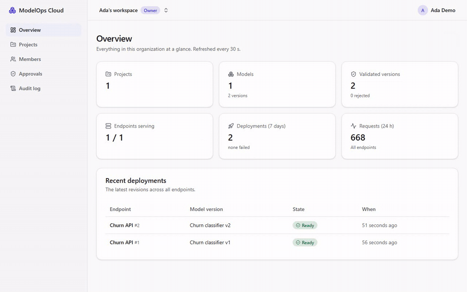

# Milestone 12 — Benchmarks, Documentation, Demo

> **Status: implemented locally (2026-11-11, Windows 11).** Nothing from M9–M12 is committed yet, so no number here has been reproduced on CI; every number comes from a raw result file in this repository, produced by a script in this repository.



## A. Problem being solved

Eleven milestones built and tested the platform, but "it works" is not "it performs", and claims without data are not worth making (NFR-13: *no benchmark or test result in docs without a script that produced it*). M12 measures the platform under load, writes the results down where anyone can regenerate them, and turns the project into something a person can understand in three minutes.

## B. Architecture decisions

| Decision | Why |
|---|---|
| **k6 in a container on the compose network**, calling the gateway container directly | Windows' Docker Desktop port forwarding adds its own latency and has dropped connections during this project; measuring through it would measure the laptop, not the platform |
| **Six scenarios** (`pnpm bench`): steady 50 req/s; the same load **straight to the model server** (no gateway); a **ramp** of constant-rate steps; a **10 % canary**; the **memory footprint**; **10 rollbacks** | Steady and direct together give the gateway's own cost, the comparison docs/09 defined for NFR-3. The ramp finds where a default-sized model server saturates and what the platform does then. Canary and rollback measure the release features with real traffic |
| **Setup through the public API only** (a fresh account, two validated versions, a STAGING endpoint, an API key) | The benchmark exercises the product, not test shortcuts. The endpoint's rate limit is raised to 1000 req/s so the limiter is not what the ramp measures |
| **Raw results are the source of truth**: full k6 summaries, the Prometheus queries with their answers, each rollback trial, the machine (`meta.json`). `pnpm bench:report` turns a run into [docs/benchmarks/report.md](../benchmarks/report.md) and `summary.json` | Every number can be traced to a file and regenerated; nothing is typed in by hand |
| **Demo recorded by a script** (`tests/e2e/demo-recording.ts`, Playwright video → `scripts/make-gif.mjs`, ffmpeg in a pinned container) | Reproducible, and free |

## C. Dependencies

No product dependencies. Tools: `grafana/k6:2.3.0` and `linuxserver/ffmpeg:9.0.2-cli-ls88`, both pinned by digest and run in containers.

## D/E. Repository changes and file paths

```text
tests/load/bench.js                        k6 scenarios: steady, direct, ramp, canary
scripts/bench.mjs                          pnpm bench: setup through the API, scenarios, raw results
scripts/bench-report.mjs                   pnpm bench:report: report.md + summary.json from raw files only
benchmarks/results/2026-11-11T1023/        the raw results of the run quoted everywhere
docs/benchmarks/report.md                  the generated report
tests/e2e/demo-recording.ts, scripts/make-gif.mjs   docs/images/demo.gif
docs/demo-script.md, docs/resume-bullets.md
README.md                                  rewritten: demo, measured numbers with their raw files
infra/compose/docker-compose.yml           Grafana memory limit 1 GiB (measured 507 MiB)
apps/api/src/modules/deployments/reconciler.ts   the restart rule (finding 1)
apps/api/prisma/migrations/20261111200000_health_failure_streak/   health_failures
apps/api/src/config/config.ts               MO_UNHEALTHY_STREAK (default 3)
apps/api/test/integration/deployments.int.spec.ts   busy-vs-hung test (Docker and kind)
```

## G. Setup commands

```bash
pnpm dev:up && pnpm db:deploy && pnpm dev:obs && pnpm dev
pnpm bench                       # ~15 min, everything
pnpm bench --only steady,direct  # some scenarios
pnpm bench --into <stamp> --only direct,footprint,events   # add to an earlier run
pnpm bench:report
pnpm --filter @modelops/e2e demo:record && node scripts/make-gif.mjs
```

## H. Results

Everything is in the [benchmark report](../benchmarks/report.md), generated from the latest full run (`2026-11-11T1745`) and listing every full run. Three full runs (`…T1023` with the old restart rule, `…T1715` and `…T1745` with the fix), against the targets set in Phase 0 (docs/01):

| Target | Set | Runs 1 / 2 / 3 | Met |
|---|---|---|---|
| End-to-end p95 at 50 req/s (NFR-3) | ≤ 25 ms | 4.68 / 23.1 / 34.6 ms | 2 of 3 |
| Gateway overhead p95 (NFR-3) | ≤ 10 ms | 1.86 / 16.8 / 31.7 ms (median: 1.45 / 3.27 / 3.48 ms) | 1 of 3 |
| Rollback to a warm revision (FR-31) | < 10 s | slowest of 10: 68.8 / 145.4 / 83.2 ms | 3 of 3 |
| Core stack memory with 2 revisions (NFR-2) | ≤ 6 GB | 2.15 / 2.45 / 2.80 GiB (containers; API, worker and web ran on the host) | 3 of 3 |

**Why the p95 targets were missed in two runs.** No request failed in any run, and the gateway's median cost stayed at 1.5–3.5 ms. The tails came from the model server itself stalling during the steady window: the gateway's own histogram puts the upstream p99 at 50 ms and 311 ms in those runs, while the same model server called directly a few minutes later had a p95 of 6.3 and 2.9 ms. The laptop was loaded (another project's 18 containers, each earlier run's model servers still running, 1.7–3.4 GiB free memory). On this machine the p95 is a property of the laptop's load as much as of the code; the medians are stable. A dedicated, quiet machine would be the next step for publishable tail latencies.

### What the benchmarks found

1. **Overload restarted a healthy model server (fixed in M12, see below).** At 200 req/s and above, one 0.5-CPU model server cannot keep up; its health check fails ("Health check failed: container running"), the reconciler marks the revision DEGRADED (out of routing) and restarts the container. It happened twice during the three overloaded ramp steps, 89 s apart ([events.json](../../benchmarks/results/2026-11-11T1023/events.json)); a third time within 10 minutes would have failed the revision. The right behaviour is to keep a busy but alive server running and shed load at the gateway (which already times out and has a circuit breaker), restarting only when the container has exited or stays unhealthy for longer. docs/05 had specified "3 consecutive failed health checks"; the code restarted on the first one.

   **The fix.** A crashed or missing container is still restarted at once. A *running* one that fails a health check keeps serving and its streak is counted (`deployment_revisions.health_failures`, new migration); only `MO_UNHEALTHY_STREAK` failures in a row (default 3: at the 15 s reconcile interval, a restart comes 30 s after the first failed check at the earliest) mean hung: DEGRADED, then a restart within the budget. One passing check resets the streak. A new lifecycle test (Docker 14/14, kind 16/16) holds a running server's checks failing: it stays READY and serving through 2 misses, a pass resets the count, 3 misses in a row degrade and restart it, and it recovers.

   **Measured, old rule against the fix, ramped back to back on the same machine** (`MO_UNHEALTHY_STREAK=1` reproduces the old behaviour; [old](../../benchmarks/results/2026-11-11T1734/), [fixed](../../benchmarks/results/2026-11-11T1740/)):

   | | Old rule | Fixed |
   |---|---|---|
   | DEGRADED / restarts during the ramp | 2 / 2 | 0 / 0 |
   | Requests answered (200) of ~46,400 sent (k6) | 9,831 | 11,036 (+12.3 %) |
   | p95 at 100 req/s | 326 ms | 55 ms |
   | Failed at 200 req/s | 74.6 % | 62.0 % |
   | 502s, connections cut by a restart (gateway, approximate) | 287 | 0 |

   The overloaded steps still fail: one 0.5-CPU server is still saturated. The fix stops the platform from making it worse.
2. **Grafana outgrew its memory limit** (507 MiB of 640 MiB): raised to 1 GiB.
3. **The README's earlier "85 ms rollback" is superseded** by measured values with raw files (rollback median 54–114 ms across three runs).
4. **Results depend heavily on the laptop's load** (see "Why the p95 targets were missed"): every full run is kept and shown, none is picked.

### Problems while building M12

- The first run died at its first API call: the dev server was restarting (connection reset). The runner now retries dropped connections, never HTTP errors.
- The ramp's p95 and p99 at ~2 000 ms needed an explanation from data, not a guess: the run now records the gateway's status codes over the ramp window (`ramp-codes.json`) and the platform's own state changes (`events.json`), which is how finding 1 was found.
- The demo video started with a blank frame and showed a 1-hour chart with one minute of data: the recorder now records when the first page is ready (the GIF starts there) and switches the chart to 15 minutes.
- **First CI run of the M9–M12 push** ([run 43076921779](https://github.com/Kartavya1905/modelops-cloud/actions/runs/43076921779)): every job green except `kind`, where the API-key and tracing tests got 503. The lifecycle suite leaves its revisions running, each model-server pod reserved its full 0.5 CPU, and a 4-CPU runner fits about six of them next to the system pods; the new restart test added one more, so the last two tests' pods could not be scheduled (locally the kind node has 10 CPUs). Fix: `MO_K8S_CPU_REQUEST` (default empty = request equals limit, unchanged); the kind test run requests 100m while limits stay 0.5 CPU. The kind job's failure diagnostics now print the node's allocated resources and scheduling failures.

## I. Expected behaviour

`pnpm bench` prints one line per phase and ends with `done: benchmarks/results/<stamp>`; `pnpm bench:report` rewrites `docs/benchmarks/report.md` and prints the headline numbers. Re-running both on another machine gives other numbers and the same report structure.

## J. Debugging

| Symptom | Check |
|---|---|
| `fetch failed` at setup | the API dev server (`pnpm dev`) is not up; the runner retries dropped connections for ~10 s |
| k6 exits non-zero | a real error (the always-true thresholds never fail); its stderr is in the message |
| `direct` cannot resolve `mo-rev-…` | the revision is gone (retired): run `direct` right after a full run, or in the same run |
| Very different latencies | other load on the machine: `meta.json` lists how many containers were running |

## K. Acceptance criteria (roadmap M12)

| Criterion | Evidence |
|---|---|
| k6 scenarios: steady 50 req/s, ramp, canary split | `tests/load/bench.js`, results in `benchmarks/results/2026-11-11T1023/` ✅ |
| Benchmark report generated from raw results | `pnpm bench:report` → `docs/benchmarks/report.md` ✅ |
| Screenshots, demo GIF | `docs/images/` (M2–M10 screenshots, `demo.gif`) ✅ |
| Final README, 3-minute demo script, résumé bullets backed by numbers in the report | `README.md`, `docs/demo-script.md`, `docs/resume-bullets.md` ✅ |
| Every number in the README links to a results file produced by a script in the repo | every measured number in README "Measured" links its raw file; counts that had no results file were removed from the README ✅ |

## L. Completion checklist

- [x] Benchmarks run; report generated; the finding fixed and re-measured
- [x] Demo GIF, demo script, résumé bullets, README
- [x] Fix finding 1 (reconciler restarted busy model servers): fixed, tested, measured A/B
- [ ] Commit M9–M12 and record the CI runs
