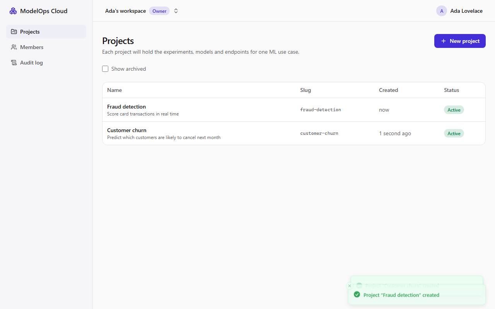

# Milestone 2 — Authentication, Organizations, Projects and Frontend Foundation

> **Status: done locally on Windows 11 (2026-11-04).** CI has been extended to run every suite below, but that run happens on the next push. Until it is green on Linux, PROGRESS.md marks M2 as 🚧.



## A. Problem being solved

Every later feature (models, deployments, approvals) needs to answer three questions:
1. **who** is calling
2. **which organization's** data they may touch
3. **what** their role allows

M2 builds that foundation and the web app shell around it:
- secure sessions
- tenant isolation that cannot be bypassed by guessing ids
- one permission table that drives the API, the tests and the UI
- an append-only audit log
- a typed contract between API and web, so they cannot silently drift apart

## B. Architecture decisions

| Decision | Why |
|---|---|
| **Server-side sessions**: opaque 256-bit token in an `HttpOnly; SameSite=Lax` cookie; DB stores only SHA-256(token) | Instant revocation, nothing useful in a leaked DB, no token in JS-readable storage ([ADR-0006](../adr/0006-sessions-and-api-keys.md)) |
| **CSRF token = HMAC(pepper, sessionId)**, required in `X-CSRF-Token` on every state-changing request | Nothing extra to store, changes with the session, and a cross-site page can't read it. SameSite=Lax is the second layer |
| **Argon2id** (19 MiB, t=2, p=1) + a dummy-hash verify for unknown emails | OWASP minimum; "no such user" and "wrong password" take similar time and get identical responses |
| **Login limiter: 5 failures/min per (IP, email)**, Redis, **fails open** | Brute-force protection without letting a Redis outage lock everyone out (Argon2's cost still slows guessing). Keys are HMACs, so Redis never holds emails or IPs |
| **`OrgAccessGuard`**: `:orgId` must be your org → else **404**; route must declare a permission → else **403** | Cross-tenant ids are indistinguishable from non-existent ones (SEC-7). Deny-by-default catches a forgotten decorator |
| **One permission table** (`apps/api/src/common/authz/permissions.ts`) | The guard enforces it, `/auth/me` sends it to the UI, and the integration test **generates its role × route matrix from it** |
| **Owner rules in a transaction with `SELECT … FOR UPDATE` on the org** | Two owners demoting each other concurrently can never leave zero owners (tested) |
| **Invitations bound to an email, single-use by compare-and-set** | A leaked link is useless to anyone else; double-clicks or races can't create two memberships (tested). No email is sent (zero cost): the UI shows a one-time link |
| **Audit log append-only in Postgres** (trigger rejects UPDATE/DELETE/TRUNCATE) and written **inside the same transaction** as the change | History can't be rewritten even by a buggy script; an audit row exists if and only if the change committed |
| **RFC 9457 problem+json for every error**, including unknown 500s (no stack traces) | One error shape for UI and API clients; `requestId` ties a user-visible error to server logs |
| **OpenAPI generated from DTOs → committed → TS types generated** (`openapi-typescript` + `openapi-fetch`) | The web app's API calls are type-checked against the real API; CI fails if the committed contract is stale |
| **Prisma 7.10.1** (risk R4) with the `pg` driver adapter; client generated into `src/generated` (gitignored, regenerated on install) | 8.0 is still a release candidate |
| **shadcn/ui-style components written into the repo** (Radix via `radix-ui`, `cva`, `tailwind-merge`) | Same ownership model as shadcn's generator, without its CLI pulling just-published package versions that pnpm's release-age policy rejects |
| **Optimistic updates only for project rename** | Instantly reversible. Lifecycle actions in later milestones will be confirmed-state only |
| **Next.js 16 `proxy.ts`** only redirects when no session cookie exists | Next's own docs: Proxy is for optimistic checks; the API enforces everything |

### Deviations from the roadmap (honest list)
- `outbox_messages` and `idempotency_keys` tables are **deferred to M5**, where they are first used. Creating unused tables now would be untested schema.
- shadcn components were **hand-written in shadcn's style** rather than generated by its CLI (reason above).

## C. Dependencies added (all ≥ 7 days old at install, see the ADR-0007 addendum)

- **API:** `@prisma/client` / `prisma` / `@prisma/adapter-pg` 7.10.1, `argon2` 0.45.1, `cookie-parser` 1.4.7, `class-validator` 0.15.1, `class-transformer` 0.5.1, `@nestjs/swagger` 12.0.5.
- **Web:** `@tanstack/react-query` 5.105.0, `openapi-fetch` 0.17.0, `radix-ui` 1.8.1, `lucide-react` 1.62.0, `sonner` 2.0.8, `clsx`, `tailwind-merge`, `class-variance-authority`, `tw-animate-css`; tests: Testing Library, `jsdom` 30, `@vitejs/plugin-react` 6.1.2.
- **Contract:** `openapi-typescript` 7.13.0 (peer `typescript ^5` explicitly allowed for TS 6 after verifying generation and typecheck).
- **E2E:** `@playwright/test` 1.64.1, `@axe-core/playwright` 4.14.0.
- **Install scripts:** `argon2`, `prisma`, `@prisma/engines` approved. **`@scarf/scarf` denied**: install-time telemetry pulled in by Swagger UI.

## D/E. Repository changes and file paths

```text
apps/api/prisma.config.ts, prisma/schema.prisma, prisma/migrations/*_init/migration.sql (+ append-only trigger)
apps/api/src/common/      prisma/, redis/, errors/ (AppError, ProblemFilter), request-context/, authz/
                          (permissions.ts, org-access.guard.ts), rate-limit/, crypto.ts, pagination.ts,
                          slug.ts, validation.ts
apps/api/src/modules/     auth/ (sessions, CSRF, Argon2, limiter), organizations/ (orgs, members,
                          invitations), projects/, audit/
apps/api/src/openapi/     document.ts, emit.ts (preview mode: no DB needed)
apps/api/test/unit/       config, health, permissions (static deny-by-default check)
apps/api/test/integration/ global-setup (throwaway DB + migrations), helpers, auth, tenancy,
                          permissions matrix, members/invitations, projects + audit
packages/api-contract/    openapi.json (committed), src/schema.d.ts (generated), src/index.ts
apps/web/src/proxy.ts     optimistic sign-in redirect
apps/web/src/app/         (auth)/login, (auth)/register, orgs/[orgId]/{projects,projects/[id],members,audit},
                          invite/[token], status, error/not-found/loading boundaries
apps/web/src/components/  ui/ (button, primitives, dialog, dropdown-menu, select), common/, providers
apps/web/src/features/    auth/, org/ (shell, members, accept-invite), projects/, audit/
apps/web/src/lib/         api/client.ts (typed client + CSRF + problem errors), auth/session.ts, query/keys.ts
apps/web/test/            permission gate, login form, projects page
tests/e2e/                Playwright config, specs/m2-identity-projects.spec.ts, screenshots.ts
.github/workflows/ci.yml  + contract drift check, migrations, integration, Playwright
```

## G. Setup commands

```bash
pnpm install          # also generates the Prisma client
pnpm env:init         # adds the new MO_API_SESSION_PEPPER / MO_COOKIE_SECURE / MO_WEB_URL keys
pnpm dev:up
pnpm db:deploy        # apply migrations (use `pnpm db:migrate` when changing the schema)
pnpm dev              # API :4000 (Swagger UI at /api/docs) · web :3300
```

Open http://127.0.0.1:3300, create an account, and you land in your personal workspace.

## H. Tests

| Suite | Count | Highlights | Run |
|---|---|---|---|
| API unit | 33 | Config validation, health, permission table (roles strictly nested), **every org-scoped handler declares a permission** (static scan) | `pnpm --filter @modelops/api test` |
| API integration (real Postgres + Redis) | 87 | Listed below | `pnpm test:integration` |
| Web component | 27 | Permission gate; login validation, 401, 429, success redirect, **open-redirect rejection**; projects empty/list/error states; slug-conflict shown on the field; CSRF header sent | `pnpm --filter @modelops/web test` |
| Browser end-to-end (Playwright) | 4 | Full multi-user journey; signed-out redirect; generic login error; **axe: no serious/critical WCAG A/AA violations** on login and projects | `pnpm test:e2e` |
| Smoke | 17 | Unchanged from M1, still green with M2 code | `pnpm test:smoke` |

Integration highlights (security test IDs from [docs/06](../06-security.md#7-adversarial-security-tests-to-implement-in-m4m9)):
- **SEC-7 (cross-tenant IDOR):** every read and write on another org → 404, including id swaps under your own org path, and malformed or random ids.
- **SEC-8 (role escalation):** the full role × route matrix (4 roles × 11 routes). An Admin can't grant, change or remove an Owner.
- **SEC-12 (CSRF):** a missing or altered token → 403.
- **SEC-16 (brute force):** the 6th failure → 429 with `Retry-After`, and even the right password is blocked during the window.
- **Concurrency:**
  - two owners demoting each other → exactly one 200, one 409, ≥ 1 owner left
  - two simultaneous accepts of one invite → exactly one membership
- **Data protection:** the password is stored as Argon2id; the cookie token appears in the DB only as its SHA-256; audit rows contain no passwords, tokens or raw IPs.
- **Audit integrity:** raw `UPDATE`, `DELETE` and `TRUNCATE` on `audit_events` are rejected by the database.
- **Contract hygiene:** unknown body fields → 400 (mass assignment); a tampered pagination cursor → 400; keyset pagination returns no duplicates and no gaps.

### Actual results (2026-11-04, Windows 11)

```text
API unit           Test Files 4 passed (4)   Tests 33 passed (33)
Web component      Test Files 4 passed (4)   Tests 27 passed (27)
API integration    Test Files 5 passed (5)   Tests 87 passed (87)   Duration 12.72s
E2E (Playwright)   4 passed (9.8s)
Smoke              17/17 checks passed
Lint (strict, type-aware), Prettier, tsc for api/web/contract/e2e, `next build`, contract regenerates byte-identical: all pass
```

### Bugs the tests caught during M2 (all fixed)

| Found by | Bug | Fix |
|---|---|---|
| Live API check | Problem documents led with `instance`/`requestId` | Stable RFC 9457 field order |
| Typecheck vs generated contract | `limit`/`includeArchived` documented as empty objects (initializer without type → `design:type Object`) | Explicit types in DTO + `@ApiPropertyOptional({ type })` |
| Web tests | `openapi-fetch` captured `fetch` at import, so requests bypassed mocks and hit jsdom's `localhost:3000` (this machine's Grafana answered 401) | Resolve `fetch` at call time |
| E2E | Clicking "Create account" before hydration made the browser submit the form natively | Submit disabled until hydrated; `method="post"` so fields can never go into a URL |
| E2E | Dev assets blocked for `127.0.0.1` (Next 16 dev-origin protection), so React never hydrated | `allowedDevOrigins: ['127.0.0.1']` (dev only) |
| E2E | "Create one" on the login page dropped `?next=`, so an invitee who signed up lost the invite | Link keeps `next`; the e2e test asserts it |
| Dev experience | API dev server restarted on any repo file change (`--watch-path` on Windows) | `node --watch` follows the import graph only |

## I. Expected behaviour

- `/` → `/login` when signed out; after sign-in → `/orgs/<first org>/projects`.
- Registering creates "<first name>'s workspace" with you as Owner.
- A Viewer sees projects and members but no "New project", no member controls, no audit log.
- An invite link opened while signed out goes through login or sign-up and comes back to the invite.
- Visiting an organization you don't belong to shows "Not found" (same as the API's 404).
- Swagger UI at http://127.0.0.1:4000/api/docs (dev only; disable with `MO_API_DOCS=false`).

## J. Debugging

| Symptom | Cause → fix |
|---|---|
| API exits with `MO_API_SESSION_PEPPER: must be at least 32 characters` | Old `.env`. Run `pnpm env:init` (adds missing keys, keeps the existing ones) |
| `relation "users" does not exist` | Migrations not applied. Run `pnpm db:deploy` |
| `Cannot find module '../generated/prisma/client'` | Client not generated. Run `pnpm install` or `pnpm --filter @modelops/api prisma:generate` |
| Every mutation → 403 `CSRF_TOKEN_INVALID` | The client lost the in-memory token (e.g. manual `fetch`). Use `api` from `lib/api/client.ts`, or re-read `/auth/me` |
| Login → 429 while testing | 5 failures/min per IP + email. Wait for `Retry-After`, or `docker exec modelops-redis-1 redis-cli --scan --pattern 'rl:login:*'` |
| Web page loads but buttons do nothing (dev) | Check the browser console for blocked `/_next/*` assets. Add your hostname to `allowedDevOrigins` |
| CI: "packages/api-contract is stale" | Run `pnpm contract` and commit the result |
| Integration tests can't create a database | The `MO_DB_APP_USER` role lacks CREATEDB. It is created with it by `postgres/init`; recreate the volume with `pnpm dev:clean` |

## K. Acceptance criteria (roadmap M2)

| Criterion | Status |
|---|---|
| Two orgs; org B cannot see org A in API or UI | ✅ API: tenancy suite (11 tests). UI: e2e step 5 ("Not found") |
| Permission matrix for every role × route | ✅ generated from `permissions.ts` |
| Contract-drift check | ✅ locally (byte-identical regeneration); ⏳ in CI on next push |
| Register → create project in a real browser | ✅ e2e |
| Lint, typecheck, unit, integration, e2e, build | ✅ locally; ⏳ CI on next push |

## L. Completion checklist

- [x] Prisma schema, migration and append-only audit trigger
- [x] Sessions, CSRF, Argon2id, login rate limiting
- [x] Orgs, members, invitations, owner rules
- [x] Permission table, OrgAccessGuard (404 for other tenants, deny by default)
- [x] Projects CRUD + archive, keyset pagination
- [x] Audit log API + UI
- [x] RFC 9457 errors, request ids
- [x] OpenAPI emit, contract package, typed client
- [x] Web: auth pages, org shell, projects, project detail, members + invites, audit, invite acceptance, boundaries
- [x] Unit, integration, component, e2e + axe tests
- [x] CI extended
- [ ] Push and get a green CI run ← next action
