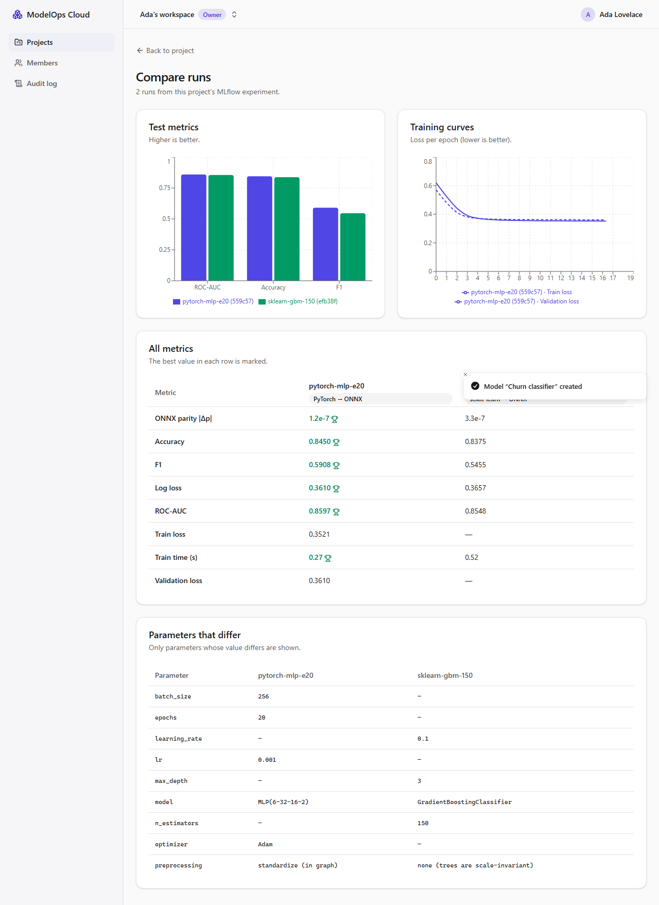

# Milestone 3 — MLflow Integration, Experiments and Model Registry

> **Status: done locally on Windows 11 (2026-11-04).** CI (now with a Python job and real training inside the browser test) runs on the next push. PROGRESS.md marks M3 as 🚧 until it is green on Linux.



## A. Problem being solved

Data scientists need to train models, track what they tried, compare results, and hand a specific model over for deployment, with a record of exactly which code and data produced it. M3 builds that first half of the lifecycle:
- trusted training code that produces portable, pickle-free ONNX bundles
- a project-scoped view of MLflow experiments
- run comparison
- a registry of immutable, numbered versions with lineage

## B. Architecture decisions

| Decision | Why |
|---|---|
| **Seeded synthetic churn dataset** with separate *data-drift* and *concept-drift* knobs | Free, no licence or privacy issues, and M7 needs to inject both kinds of drift on purpose. Byte-identical on any OS: the SHA-256 is pinned in a test and checked on Linux in CI |
| **Every model ships the same 3-file bundle** (`model.onnx`, `signature.json`, `golden_examples.json`) | One serving runtime for all frameworks (ADR-0002). Golden examples let M4/M5 prove a deployed model behaves exactly like the trained one |
| **Two model families, same signature**: scikit-learn GradientBoosting and a PyTorch MLP | They can be compared now and canaried/rolled back against each other in M8 |
| **Parity check at export time** (ONNX vs native, max abs diff ≤ 1e-5) | The export can't silently change predictions. It caught a real bug (below) |
| **Deterministic ONNX bytes** (fixed graph names) | Same training → same SHA-256, so the hash identifies content, not an export accident |
| **One MLflow experiment per project**: `modelops/<org-slug>/<project-slug>`, created on first use and tagged with the project id | Tenant isolation: every run lookup checks `run.experiment_id == project.mlflowExperimentId`, so a run id from another project is 404, like other tenants' data |
| **Postgres is the registry's source of truth; MLflow's Model Registry is a mirror** | Transactions, tenancy and audit live in one place. If the mirror call fails, the version still exists and the response says `mlflowSyncError` (never hidden) |
| **Registered model created in MLflow first (idempotent by tag), version created in Postgres first** | A model name collision is caught before any DB write. A version number is assigned under a row lock (`SELECT … FOR UPDATE`), so concurrent imports never share a number (tested) |
| **Strict `signature.json` schema** (zod, `.strict()`, name regex, rank ≤ 8, feature-count = width) | It is untrusted input from a run, and later drives gateway request validation (M5) and the playground form (M6) |
| **Framework allow-list** (`SKLEARN_ONNX`, `PYTORCH_ONNX`) from the run's tag | A run tagged with anything else (e.g. `SKLEARN_PICKLE`) is refused (422) |
| **Versions start `PENDING_VALIDATION`** | Nothing registered in M3 can be deployed. The M4 validator moves versions on |
| **uv with `exclude-newer`** for Python, CPU-only PyTorch index | Same "≥ 7 days old" supply-chain rule as pnpm, including transitive deps; a ~200 MB CPU wheel instead of ~2.5 GB with CUDA |

### Deviations from the roadmap (honest list)
- **MLflow aliases (`champion` / `challenger`) are deferred to M7.** The design ties `champion` to a passed evaluation gate, which doesn't exist yet. Setting aliases without the gate would be a half feature.
- **No automatic retry of a failed MLflow mirror yet.** The version records `mlflowVersion = null` and the API reports the error. The M5 reconciler is where retries belong.

## C. Dependencies (all ≥ 7 days old at install)

- **Python** (`ml/pyproject.toml`, locked in `ml/uv.lock`, `exclude-newer = 2026-10-28`): numpy 2.5.4, pandas 3.1.0, scikit-learn 1.9.1, skl2onnx 1.20.0, onnx 1.23.2, onnxruntime 1.31.1, onnxscript 0.7.2, **torch 2.14.1+cpu** (2.15.0 was 6 days old), mlflow-skinny 3.17.2 (matches the server), pytest 9.2.0, ruff 0.17.3.
- **Web:** recharts 3.10.1.
- **API:** no new packages. The MLflow client uses Node's `fetch` with timeouts.

## D/E. Repository changes and file paths

```text
ml/pyproject.toml, uv.lock                  Python project (uv), CPU torch index, exclude-newer
ml/modelops_ml/datasets.py                  seeded churn generator, canonical CSV + SHA-256, drift knobs
ml/modelops_ml/bundle.py                    signature, golden examples, ONNX checks, deterministic bundle
ml/modelops_ml/common.py                    split, metrics, parity, lineage tags, MLflow logging, CLI
ml/modelops_ml/train_sklearn.py             GradientBoosting -> ONNX (skl2onnx)
ml/modelops_ml/train_pytorch.py             MLP (normalization in forward) -> ONNX (torch.export)
ml/tests/test_datasets.py, test_training.py 32 tests
apps/api/prisma/migrations/*_registry       dataset_versions, registered_models, model_versions, projects.mlflow_experiment_id
apps/api/src/modules/mlflow/                typed MLflow REST client (timeouts, error mapping, bounded downloads)
apps/api/src/modules/experiments/           project experiment, runs list/detail/compare (project-scoped)
apps/api/src/modules/registry/              models, version import, signature schema, datasets
apps/api/test/integration/registry.int.spec.ts, mlflow-fixtures.ts   real MLflow runs, incl. broken ones
apps/web/src/features/ml/                   runs section, compare page (Recharts), models, register dialog, version page
tests/e2e/specs/m3-experiments-registry.spec.ts   browser test that runs the real training scripts
tests/e2e/support/a11y.ts                   shared axe check (waits for animations to settle)
scripts/train-all.mjs                       `pnpm ml:train --experiment …` (both models)
.github/workflows/ci.yml                    + `ml` job (ruff, pytest); stack job installs the ML env for e2e
```

## G. Setup commands

```bash
winget install astral-sh.uv          # once (already installed on this machine)
uv sync --directory ml               # ~0.9 GB venv; CPU-only PyTorch
pnpm db:deploy                       # applies the registry migration
pnpm dev
# In the web app: open a project. It shows the exact experiment name. Then:
pnpm ml:train --experiment modelops/<org-slug>/<project-slug>
```

## H. Tests

| Suite | Count | Highlights | Run |
|---|---|---|---|
| ML (pytest) | 32 | Dataset determinism + **pinned SHA-256**; drift knobs (data drift moves inputs; concept drift flips the tickets→churn relationship and leaves inputs byte-identical); both models: parity ≤ 1e-5, AUC > 0.75, signature ↔ graph, golden replay, no external data, allowed domains only, batch 1 and 500, lineage tags, ONNX metadata, sklearn byte-reproducibility | `pnpm ml:test` |
| API unit | 54 (+21) | Signature parser rejects unknown keys, bad dtypes, path-like names, feature/width mismatch, duplicate names, absurd ranks; every new handler declares a permission | `pnpm --filter @modelops/api test` |
| API integration (real Postgres, Redis, **MLflow**) | 142 (+54) | Listed below | `pnpm test:integration` |
| Web component | 35 (+8) | Best-value selection (higher/lower is better), compare table marks best for screen readers, empty state shows the training command, Viewer has no Register, Compare enabled only for 2–5 runs | `pnpm --filter @modelops/web test` |
| E2E (Playwright + axe) | 5 (+1) | **Trains both models for real** with `uv`, then compares, registers and inspects lineage in the browser; axe on project, compare and version pages | `pnpm test:e2e` |

Integration highlights:
- **Tenant isolation:**
  - another project's run → 404, as do malformed and deleted run ids
  - another org sees none of the models, versions, runs or experiment → 404
  - the matrix grew from 44 to 84 role × route checks (10 new routes)
- **Experiment:** one per project, idempotent, stored on the project, tagged with the project id in MLflow.
- **Registry:**
  - versions numbered 1, 2, 3 under concurrency
  - same run twice → 409 `RUN_ALREADY_REGISTERED`; unfinished run → 409
  - missing bundle file → 422 `BUNDLE_INCOMPLETE` (naming the file); invalid signature → 422 with the exact field path
  - pickle or untagged framework → 422; archived project → 409
  - dataset rows shared by SHA-256; MLflow mirror holds the version; audit row written

### Actual results (2026-11-04, Windows 11)

```text
ML (pytest)        32 passed
API unit           54 passed
Web component      35 passed
API integration   142 passed (3 consecutive runs; 23.2 s)
E2E (Playwright)    5 passed (3 consecutive runs; ~35 s, includes real training)
Smoke              17/17
Lint (ESLint strict + ruff), Prettier + ruff format, tsc ×4, next build, contract byte-identical: all pass
```

**Measured model quality** (from the screenshot run: 8,000 rows, seed 7, test split 20%):

| Model | ROC-AUC | Accuracy | F1 | Log loss | ONNX parity (max \|Δp\|) | Train time | Bundle |
|---|---|---|---|---|---|---|---|
| scikit-learn GBM (150 trees, depth 3) | 0.8548 | 0.8375 | 0.5455 | 0.3657 | 3.3e-7 | 0.53 s | 83 KB* |
| PyTorch MLP 6-32-16-2 (20 epochs) | 0.8597 | 0.8450 | 0.5908 | 0.3610 | 1.2e-7 | 0.26 s | 15 KB* |

\* bundle sizes measured on the 6,000-row run. The two families perform almost identically by design, so M8 can canary one against the other.

### Bugs and problems found during M3 (all fixed)

| Found by | Problem | Fix |
|---|---|---|
| Parity check | `StandardScaler → GBM` export differed by **4.3e-2** on 2 of 1,200 rows: ONNX scales in float32, scikit-learn in float64, so samples crossed split thresholds (risk R6) | Removed the scaler (trees are scale-invariant) → parity 3e-7; tolerance tightened to 1e-5 |
| Reproducibility test | skl2onnx gives every graph a random UUID name, so identical training gave different SHA-256s | Fixed graph names |
| Windows run | PyTorch's exporter prints emoji, which crash a cp1252 console | Package reconfigures stdout/stderr to UTF-8 |
| Shell automation | MLflow prints its own "View run" lines to stdout | `--summary-json PATH` for machine-readable output |
| `prisma migrate dev` | Refuses to run non-interactively when a migration has a warning | Migration generated with `prisma migrate diff`, applied with `migrate deploy` |
| Contract generation | `MetricPointDto` only referenced via raw `$ref`, so the schema was missing | `@ApiExtraModels(MetricPointDto)` |
| axe (e2e) | Sonner `richColors` success toasts: green-on-green below 4.5:1 | Neutral toasts |
| axe (e2e) | Stacked toasts are dimmed behind the newest | One visible toast at a time |
| axe (e2e) | Amber "Awaiting validation" badge at **3.27:1** | Darker light-mode `--warning` (4.5:1) |
| axe (e2e, flaky) | Contrast measured on a toast mid-fade | Shared helper waits for animations to settle before scanning |
| Me | `pnpm format` (Prettier) ran over `ml/.venv`, i.e. third-party package files | `.venv` ignored by Prettier and ESLint; venv rebuilt cleanly from the lockfile |
| Screenshot review | Compare chart legend listed loss curves for the GBM run, which has none; axis label clipped | Lines only where a series exists; label removed |

## I. Expected behaviour

- A new project shows "No training runs yet" with copyable commands containing its experiment name.
- After `pnpm ml:train --experiment …` and **Refresh**, both runs appear with framework, AUC, accuracy and dataset version.
- Selecting 2–5 runs enables **Compare**: bar chart of test metrics, loss curves (PyTorch only), all metrics with the best marked, and only the differing params.
- **Register** on a finished run creates the next version, opens its page ("Awaiting validation", lineage, signature), and the run shows a "Model vN" badge. The model also appears in MLflow's Model Registry UI (http://127.0.0.1:15000).

## J. Debugging

| Symptom | Cause → fix |
|---|---|
| `uv: command not found` | `winget install astral-sh.uv`, then open a new terminal |
| Training: `ConnectionError` to MLflow | Stack not running (`pnpm dev:up`), or a different port: pass `--tracking-uri` or set `MO_MLFLOW_URL` |
| Runs list empty after training | Wrong `--experiment` name. Copy it from the project page; it must be exactly `modelops/<org-slug>/<project-slug>` |
| `RuntimeError: ONNX export differs …` | The parity check caught a real export difference. Don't loosen the tolerance; find the float32/float64 mismatch |
| 422 `BUNDLE_INCOMPLETE` | The run has no `model/` artifacts (e.g. logged by another script). Use the provided training scripts |
| 502 `MLFLOW_UNAVAILABLE` | MLflow container down. Check `pnpm dev:ps`; the API times out after `MO_MLFLOW_TIMEOUT_MS` (10 s) |
| Version shows "Registry mirror: pending" | The mirror call failed (reported as `mlflowSyncError` at import). Retries arrive with the M5 reconciler |
| `test_known_hash_is_stable_across_machines` fails after an upgrade | numpy/pandas changed the generated bytes. Bump `GENERATOR_VERSION` and re-pin the hash deliberately |

## K. Acceptance criteria (roadmap M3)

| Criterion | Status |
|---|---|
| Both models trained with one command; runs and metrics visible and comparable in the UI | ✅ `pnpm ml:train`; e2e trains both and compares |
| Dataset determinism (same seed → same SHA-256) | ✅ pinned hash test (Linux check in CI ⏳) |
| ONNX parity (max abs diff < 1e-5) | ✅ both models |
| MLflow adapter integration test; compare endpoint test | ✅ 54 new integration tests against real MLflow |
| Model registry with versions and lineage | ✅ (aliases deferred to M7, see deviations) |
| CI green on Linux | ⏳ next push |

## L. Completion checklist

- [x] Seeded dataset with drift knobs + pinned hash
- [x] Two training scripts → identical-signature ONNX bundles, parity-checked, logged to MLflow
- [x] Project ↔ experiment mapping with tenant checks
- [x] Runs list, detail (curves), compare
- [x] Models + versions + datasets, MLflow mirror, strict signature validation
- [x] Web: runs, compare charts, models, register dialog, version page
- [x] Python, unit, integration, component, e2e (real training) + axe tests
- [x] CI: `ml` job + ML env in the stack job
- [ ] Green CI run on Linux ← next action
