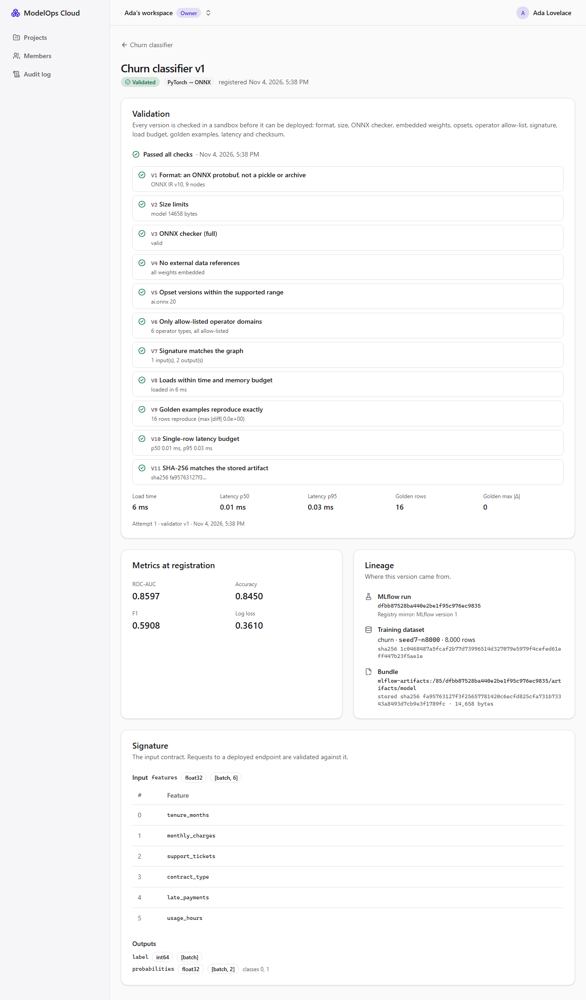

# Milestone 4 — Model Validation and Artifact Storage

> **Status: done (2026-11-04).** Verified locally on Windows 11 and in CI on Linux: [run 41886510397](https://github.com/Kartavya1905/modelops-cloud/actions/runs/41886510397). All four jobs passed, including the new validator job, where the sandbox's memory and CPU limits are real.



## A. Problem being solved

A registered model is just bytes someone handed the platform. Before anything serves it, the platform has to answer four questions and record the answers:

1. **Is it safe to load?** A `.pickle` renamed to `.onnx` runs arbitrary code the moment it is unpickled.
2. **Is it well formed?** That means a valid ONNX graph, embedded weights, supported opsets and only allow-listed operators.
3. **Does it behave as claimed?** The signature has to match the graph, and the model must reproduce its own golden examples within budget.
4. **Are these the bytes we checked?** Storage can be changed after the fact.

M4 adds a content-addressed artifact store, a sandboxed validator service (checks V1–V11), a durable validation pipeline, a direct upload path, and the UI checklist. Only a `VALIDATED` version can be deployed in M5.

## B. Architecture decisions

| Decision | Why |
|---|---|
| **Separate validator service** (`services/ml-worker`, FastAPI) | ONNX and ONNX Runtime are Python-native. A separate process keeps hostile input away from the API, with its own resource limits and its own read-only storage identity |
| **Static checks before any runtime** (V11 → V2 → V1/V3–V7, then the sandbox for V8–V10) | Magic-byte sniffing rejects pickle and zip before parsing. Protobuf is parsed with `onnx.ModelProto.FromString` (no external-data loading). ONNX Runtime only ever sees a graph that already passed every static check |
| **Sandboxed child process** (spawn; rlimits of 2 GiB address space and 30 s CPU; 30 s wall clock; killed on timeout) | A bomb model (huge allocation, endless loop) kills only the child. On Linux the limits are real and tested; Windows skips the rlimit test (no `resource` module) |
| **Container hardening**: read-only root filesystem, `tmpfs /tmp`, `cap_drop: ALL`, non-root user 10001, 1 CPU / 1.5 GB | Defence in depth around the sandbox |
| **Read-only S3 identity for the validator** (`Read:model-artifacts` only) | Even a compromised validator cannot write, overwrite, delete, or read other buckets. Verified by the smoke test (403 on each) |
| **Content-addressed storage**: `model-artifacts/blobs/sha256/<hash>`, put-if-absent, never overwritten | The key *is* the checksum, so identical bytes are stored once and any change is detectable |
| **Platform hashes everything itself** | The SHA-256 a training run reports is only compared (mismatch → V11 at ingest). It is never trusted as the hash |
| **V11 runs again inside the validator** on the hashes recorded at ingest | Bytes swapped in storage between ingest and validation are caught before anything is parsed (tested by overwriting a blob) |
| **Pipeline**: claim (CAS `PENDING_VALIDATION → VALIDATING` + lease) → ingest → validate → finalize (one transaction: report + status + audit) | Every step is idempotent. A duplicate job finds nothing to claim. A result from a lost lease is dropped by the CAS in `finalize` |
| **Retry policy**: infrastructure errors (`RetryableError`) release the claim and BullMQ retries with exponential backoff; the last attempt records `ERROR`; model failures are final | A model that *fails* a check fails deterministically, so re-running is pointless. One that couldn't be checked (`ERROR`) can be re-run from the UI |
| **Sweeper** (worker, every 15 s): expired leases → `PENDING_VALIDATION`; every pending version → enqueue (dedup by job id `validate-<id>`) | Recovers crashed workers and lost Redis jobs. Tested both ways, including with the real BullMQ worker |
| **DB trigger `model_versions_guard`** | Once set, artifact hashes are immutable, and `VALIDATED` is final, even if the API is bypassed (tested) |
| **One validator version string** (`validatorVersion` in every report) | Later re-validation campaigns can tell which rules a version was checked against |

### Deviations from the roadmap and design (honest list)

- **Upload goes directly to the API (multipart), not via presigned URLs to `uploads-staging`.** A presigned PUT cannot cap the object size, only a presigned POST policy can, and SeaweedFS's POST-policy support would need its own spike. Instead the API streams through multer with hard limits (100 MB model, 1 MB JSON files, 3 files, 5 parts), then hashes and stores. The cost: up to ~100 MB buffered in memory per concurrent upload. Revisit in M9 hardening (streaming hash to storage, or POST policy).
- **No outbox table for validation (ADR-0004 addendum).** The version's `PENDING_VALIDATION` status *is* the durable intent, and the sweeper turns it into a job, so a lost enqueue only delays validation by one sweep. The outbox is still planned for deployments in M5.
- **SEC-6 (cannot deploy an unvalidated version) moves to M5**, which introduces revisions and the deploy trigger. M4's trigger guards the version side: `VALIDATED` is final and hashes are immutable.
- **SEC-5 at serving time** (model server refuses a changed artifact) is M5. M4 covers tamper detection at validation time (V11).

## C. Dependencies (all ≥ 7 days old at install)

- **Validator** (`services/ml-worker/pyproject.toml`, `uv.lock`, `exclude-newer = 2026-10-28`):
  - Runtime: fastapi 0.162.0, uvicorn 0.54.0, pydantic 2.14.1, boto3 1.43.120, numpy 2.5.4, onnx 1.23.2, onnxruntime 1.31.1 (same versions as training).
  - Dev: pytest 9.2.0, ruff 0.17.3, httpx 0.28.1.
  - Images: `python:3.12.16-slim`, uv copied from `ghcr.io/astral-sh/uv:0.13.7`.
- **API:** bullmq 6.5.0, @aws-sdk/client-s3 3.1161.0. bullmq's optional native `msgpackr-extract` build is **denied** in `allowBuilds`; it falls back to pure JS.
- **Web:** no new packages.

## D/E. Repository changes and file paths

```text
services/ml-worker/ml_worker/checks.py      V1-V10: sniffing, parse, checker, external data, opsets, op allow-list, signature, ORT session
services/ml-worker/ml_worker/sandbox.py     spawn child + rlimits + wall-clock kill
services/ml-worker/ml_worker/validate.py    V11 first, then size, JSON, static checks, sandbox
services/ml-worker/ml_worker/app.py         POST /v1/validate (shared token, read-only S3), GET /healthz
services/ml-worker/tests/                   31 tests: one per check + SEC-1..SEC-5 (pickle sentinel never created)
services/ml-worker/Dockerfile               base / test / runtime stages, non-root
infra/compose/docker-compose.yml            ml-worker service (read-only, cap_drop ALL); validator S3 identity
ml/modelops_ml/fixtures.py                  generates tests/fixtures/bundles/{sklearn,pytorch} + manifest.json
apps/api/prisma/migrations/*_validation, *_validation_invariants   report table, version columns, guard trigger
apps/api/src/common/storage/artifact-store.ts   content-addressed put-if-absent store
apps/api/src/modules/validation/            queue, service (claim/ingest/finalize/sweep), worker, controller (history, rerun)
apps/api/src/modules/registry/              enqueue after import; POST .../versions/upload; validation fields in DTOs
apps/api/src/worker.ts, worker.module.ts    worker process entrypoint (`pnpm --filter @modelops/api start:worker`)
apps/api/test/integration/validation.int.spec.ts, worker.int.spec.ts, bundles.ts
apps/web/src/features/ml/validation-card.tsx   V1-V11 checklist, live status, re-run
apps/web/src/features/ml/upload-dialog.tsx     bundle upload
tests/e2e/specs/m4-validation.spec.ts       upload real bundle → Validated; pickle → Rejected V1
scripts/smoke.mjs                           +3 checks: ml-worker health, token required, validator identity read-only
.github/workflows/ci.yml                    new ml-worker job (ruff, pytest, tests inside the image); worker in the stack job
```

## G. Setup commands

```bash
pnpm env:init            # adds MO_S3_VALIDATOR_* and MO_ML_WORKER_TOKEN to a new .env
pnpm dev:up              # now also builds and starts ml-worker (127.0.0.1:18100)
pnpm db:deploy
pnpm dev                 # API + worker + web (the worker validates queued versions)
# regenerate the fixture bundles (deterministic: same SHA-256 every time)
uv run --directory ml python -m modelops_ml.fixtures
```

If your `.env` predates M4, add the four new keys from `.env.example` (or re-run `pnpm env:init` on a fresh checkout), then `pnpm dev:up` again.

## H. Tests

- **Validator (pytest):** one test per check V1–V11. Adversarial cases are generated at test time:
  - SEC-1: a pickle whose payload would create a sentinel file; the sentinel never appears.
  - SEC-2: an external-data path traversal (`../../etc/passwd`).
  - SEC-3: a custom `com.evil` operator domain.
  - SEC-4: an oversized file.
  - SEC-5: a checksum mismatch.
  - Also: the memory bomb and the time limit (Linux only), plus HTTP auth and storage errors.
- **API integration (real Postgres, Redis, MLflow, SeaweedFS and ml-worker):**
  - A real sklearn bundle from MLflow ends `VALIDATED`, with its hash, size, report, audit trail and MLflow status tag. A real PyTorch bundle uploaded directly does the same. Identical bytes are deduplicated.
  - A pickle fails V1, with nothing loaded at runtime.
  - Flipped golden labels fail V9. A renamed signature input fails V7. A wrong reported hash fails V11 at ingest. A blob overwritten in S3 after ingest fails V11.
  - Duplicate delivery gives one claim and one report.
  - The sweeper reclaims an expired lease but not a live one.
  - An unreachable validator is retried, then ends `ERROR`; a re-run then gives `VALIDATED`, after 3 attempts with the history kept. A `FAILED` result cannot be re-run (409).
  - The trigger blocks changing hashes or un-validating a version.
  - Upload input handling: missing parts → 400; bad framework or signature → 422; >1 MB JSON or >100 MB model → 413. Another tenant gets 404.
  - **Real worker process:** a job enqueued normally, and one whose Redis job was deleted (recovered by the sweeper), both reach `VALIDATED`.
  - **Permission matrix:** extended with upload, validation history and rerun, for all four roles.
- **E2E (Playwright + axe):** upload real PyTorch files → all 11 checks pass; upload a pickle as `model.onnx` → "Rejected: V1 failed", no re-run offered. The M3 journey now waits for its freshly trained model to reach Validated.

### Actual results (2026-11-04)

```text
Validator (pytest)  30 passed + 1 skipped on Windows; 31 passed in the Linux image (read-only rootfs, real rlimits)
ML (pytest)         32 passed
API unit            57 passed
Web component       35 passed
API integration    172 passed (8 files, against the live stack)
E2E (Playwright)     6 passed (~57 s, includes real training + axe)
Smoke               20/20
ESLint, Prettier, ruff (check + format) ×2, tsc ×4, contract regenerated
```

**Measured on a real model** (PyTorch MLP from the M3 training run, 14,658 bytes): load 5 ms, single-row latency p50 0.01 ms / p95 0.03 ms, 16 golden rows reproduced with max |Δ| = 0. When the worker started for the first time, its sweeper also found and validated the version registered during M3 (PASSED), with no manual step.

### Bugs and problems found during M4 (all fixed)

| Found by | Problem | Fix |
|---|---|---|
| Validator test | `onnx.load_model_from_string(..., load_external_data=False)` raises TypeError in onnx 1.23 | Parse with `onnx.ModelProto.FromString` (never touches external data) |
| Adversarial test | Protobuf happily parses many random byte strings as an *empty* `ModelProto` | V1 also requires a graph with nodes |
| Windows shell | Git Bash rewrote `--tmpfs /tmp` into a Windows path | `MSYS_NO_PATHCONV=1` for `docker run` |
| pnpm `allowBuilds` | bullmq pulls `msgpackr-extract` with an install script | Denied explicitly; the pure-JS fallback is used |
| ESLint (strict) | The worker's JSON report was cast to its type, then "checked" (dead condition) | The parsed body is treated as `unknown` and validated before use |
| Unit test | `multer` is not a direct dependency (`Cannot find package`) | Nest's default memory storage plus a local type; `@types/multer` removed |
| Deny-by-default scan | A private helper method on `ValidationController` looked like an unguarded route | Moved to a module function (the static scan works as intended) |
| Integration test | The upload path wrote audit action `model_version.uploaded` while import writes `registered` | One action, `model_version.registered`, with `source: 'UPLOAD'` |
| axe (e2e) | Green "Validated" badge at **3.98:1**; red "Rejected" badge at **3.5:1**, both shown for the first time | Darker light-mode `--success` and `--destructive` (4.5:1 on their tints) |
| CI review | The image's `test` stage ran pytest only at build time (cached) and had no `CMD`, so `docker run` proved nothing | The test stage's `CMD` runs the suite, on a read-only root filesystem |
| Prettier | Wanted to reformat the generated, hashed fixture JSON | Ignored by Prettier; `-text` in `.gitattributes` |
| Screenshot review | Uploaded versions showed an empty metrics card | Explains that uploaded bundles carry no training metrics |

## I. Expected behaviour

- Registering a run or uploading a bundle opens the version page with "Queued for validation…", which switches to "Validating", then to the result, without a reload (2 s polling only while in progress).
- A good bundle shows **Passed all checks** with all 11 checks and their details, plus load time, latency and golden-row facts.
- A bad bundle shows **Rejected: Vn failed**, the failing check's reason, and later checks marked skipped. The fix is a new version.
- If the validator was unreachable, the page says so, notes that this says nothing about the model, and Owners, Admins and ML Engineers get **Re-run validation**.
- The model page lists each version's status and source (run id or upload).

## J. Debugging

| Symptom | Cause → fix |
|---|---|
| Versions stay "Queued for validation" | The worker isn't running. `pnpm dev` starts it; in production run `pnpm --filter @modelops/api start:worker` |
| `REJECTED` with result `ERROR`, "ML worker unreachable" | ml-worker container down. Run `pnpm dev:ps`, then `pnpm dev:up`, then **Re-run validation** |
| ml-worker `401` in worker logs | `MO_ML_WORKER_TOKEN` differs between `.env` and the running container. Run `pnpm dev:up` again after editing `.env` |
| ml-worker `503 storage unavailable` | SeaweedFS down, or validator credentials missing from `.env` (pre-M4 file) |
| V9 fails on a model you just trained | `golden_examples.json` is from a different run than `model.onnx`. Use the bundle exactly as the training script wrote it |
| V10 fails locally only | A heavily loaded laptop. The p95 budget is per single row; check other CPU-heavy containers |
| Upload returns 413 | Over 100 MB for the model, or over 1 MB for either JSON file |
| `onnx.checker` error in V3 | Export with the training scripts (opset 13+), not a hand-edited graph |

## K. Acceptance criteria (roadmap M4)

| Criterion | Status |
|---|---|
| Good models → `VALIDATED` | ✅ both real bundles (sklearn from MLflow, PyTorch uploaded), in integration and e2e tests |
| Every malicious or broken artifact → `REJECTED` with the correct check | ✅ SEC-1…SEC-5 in the validator; V1, V7, V9 and V11 (ingest + storage tamper) end to end |
| None is ever executed | ✅ pickle sentinel never created; runtime checks never reached for a V1 failure |
| One test per check | ✅ V1–V11 |
| DB trigger test | ✅ hashes immutable, `VALIDATED` final. "Cannot deploy unvalidated" moves to M5 with revisions (see deviations) |
| Presigned upload | ⚠️ replaced by a size-limited direct upload (see deviations) |
| CI green on Linux | ✅ [run 41886510397](https://github.com/Kartavya1905/modelops-cloud/actions/runs/41886510397) |

## L. Completion checklist

- [x] Content-addressed artifact store, put-if-absent
- [x] Validator service, checks V1–V11, sandbox, hardened container, read-only storage identity
- [x] Validation pipeline: claim/lease, ingest, finalize, retries, sweeper, rerun
- [x] DB invariants trigger
- [x] Upload endpoint with limits
- [x] Web: validation checklist with live status, upload dialog, re-run
- [x] Validator, unit, integration (incl. real worker), e2e + axe, smoke tests
- [x] CI: ml-worker job; worker in the stack job
- [x] Green CI run on Linux
