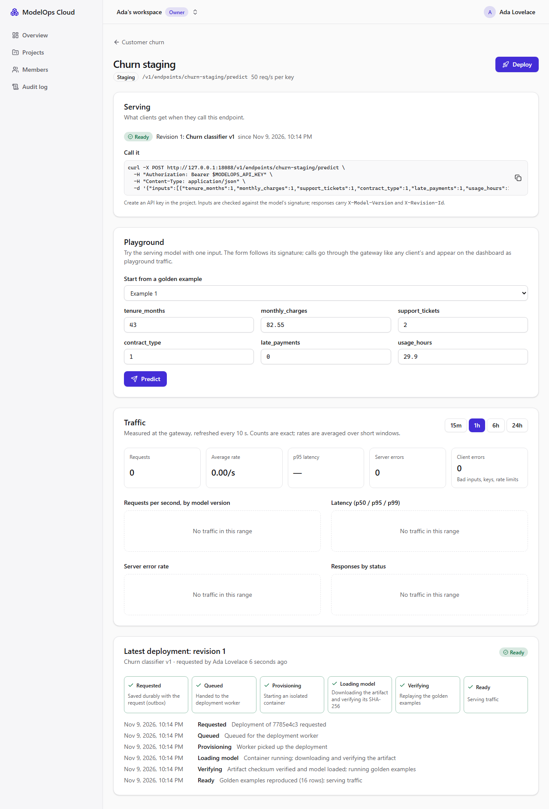

# Milestone 5 — Inference Deployment Pipeline

> **Status: done (2026-11-04).** Verified locally on Windows 11 with Docker Desktop, and in CI on Linux: [run 42692477539](https://github.com/Kartavya1905/modelops-cloud/actions/runs/42692477539). All five jobs passed on the first run, including the model-server image tests and the stack job, which deploys real containers through the socket proxy.



## A. Problem being solved

A validated model is still only a file. M5 turns it into a running service that clients can call. It has to work without hand-written glue, and it has to behave correctly when things fail half-way:
- the worker crashes mid-deploy
- Redis loses its queue
- a user double-clicks "Deploy"
- a container dies
- someone swaps the artifact in storage

**Acceptance (roadmap):** click Deploy → READY → `curl` with an API key returns the correct prediction, tagged with the model version. Verified by the e2e test and the integration suite (sections H and K).

## B. Architecture decisions

| Decision | Why |
|---|---|
| **Revision state machine** (`REQUESTED → QUEUED → PROVISIONING → LOADING → VERIFYING → READY`, plus DEGRADED/DRAINING/RETIRED/FAILED/CANCELLED) in one table (`state-machine.ts`) | A single definition of what is legal. The unit test walks all 144 state pairs against an independent copy of docs/05 §2 |
| **Compare-and-set on `state_version`** for every transition, with the timeline event in the same transaction; a DB trigger insists the counter increments and terminal states stay terminal | Duplicate or late workers can't move a revision twice. A lost CAS is a no-op, never an error loop |
| **Transactional outbox** (ADR-0004): the deploy request commits the revision, its first event, an outbox row, the audit row and the idempotency record together; the relay (`FOR UPDATE SKIP LOCKED`) moves it to QUEUED, then enqueues `deploy-<id>` | Once the API says 202, the request survives any single crash or a Redis wipe. The API never writes to Redis for a deploy |
| **Idempotency-Key** (required): `INSERT … ON CONFLICT DO NOTHING` inside the deploy transaction; the stored response points at the revision | 10 concurrent identical requests → 1 revision, 1 outbox row, 9 replays (tested). Same key + different body → 409 |
| **Partial unique index**: at most one in-progress revision per endpoint | Two different users deploying at once can't race (second gets 409 `DEPLOYMENT_IN_PROGRESS`) |
| **SEC-6 trigger**: a revision can only reference a `VALIDATED` model version of the same org | The worker checks too. Even code that bypasses the API cannot deploy an unvalidated model (tested by inserting directly) |
| **One container per revision**, created through **docker-socket-proxy** (containers + images APIs only) with a fixed hardened spec: non-root 10001, read-only rootfs, `cap_drop ALL`, `no-new-privileges`, 0.5 CPU / 512 MB / 128 pids, restart policy `no` | Isolation between versions and tenants. Restarts are the reconciler's decision, with a budget |
| **`inference` network is `internal: true`**: model servers can reach only the gateway and object storage | No internet egress, no path to Postgres or Redis. The model server holds no credentials, only a 10-minute presigned URL for one object |
| **Model server refuses to start on a bad artifact**: it downloads, verifies the SHA-256 and loads the model *before* opening a port; distinct exit codes (3 checksum, 4 load, 5 download) become failure codes | SEC-5: bytes swapped in storage after validation never serve. Tested by replacing the blob and deploying |
| **Functional check (VERIFYING)**: the running container must reproduce the golden examples (labels exact, probabilities ≤ 1e-4, never looser) | Proves the deployed artifact behaves exactly like the validated one, on the real runtime |
| **Blue/green switch at READY**: the new revision becomes stable in the same transaction that marks it READY; the previous one drains (warm) and retires after `MO_DRAIN_GRACE_MS` | Traffic never moves to an unverified revision. Canary weights and promote/rollback are M8 |
| **Reconciler** every 15 s (Redis lock as an optimisation only): deadlines → FAILED TIMEOUT; lost jobs re-enqueued; READY with a dead/unhealthy container → DEGRADED (out of routing) + restart, ≤ 3 restarts in 10 min then FAILED; DRAINING past grace → RETIRED; orphan containers removed; routing snapshot and key directory re-published | Liveness and self-healing. Every action is idempotent and CAS-guarded |
| **Data plane reads only Redis**: a full routing snapshot (never deltas) + pub/sub invalidation + 15 s poll; an API-key directory of HMACs | The gateway hot path never calls the API or Postgres, and keeps its last table if Redis blips |
| **Gateway** (Fastify): API key (HMAC-SHA256 + pepper, constant-time compare, ≤ 30 s cache, immediate eviction on revocation via pub/sub), project-scoped routing, per-key rate limit (Redis, fails open, counted), signature validation (exact feature names, finite numbers, batch ≤ 64, body ≤ 256 KB), circuit breaker, 2 s upstream timeout, Prometheus metrics labelled by model version, problem+json errors, inputs never logged | docs/04 §4, ADR-0006, SEC-10/11/13/14 |
| **Instance label** (`modelops.instance`) on every container; each reconciler only manages its own instance | The integration suite runs its own instance and gateway next to a running dev stack without either removing the other's model servers |

### Deviations from the design (honest list)

- **The worker probes model servers through the gateway's internal admin API** (separate port, token-protected, only `mo-rev-<uuid>` targets) instead of directly. The `inference` network is internal, and in local dev the worker is a host process, so it cannot reach containers on it. The gateway is the only component on both networks.
- **Docker socket proxy:** the containers API is enabled, so a process that reaches 127.0.0.1:12375 could create a privileged container. That is root-equivalent on the Docker host. This is the accepted local-dev risk named in ADR-0005.
  - **Limited by:** binding to 127.0.0.1, `EXEC`/`VOLUMES`/`NETWORKS`/`BUILD`/`SECRETS`/`SWARM` off (smoke-tested: 403), and only the worker using it.
  - **Proxy quirk:** creating an exec instance falls under the containers API; *starting* one is blocked.
  - **Fixed in M10:** the Kubernetes driver removes this risk.
- **Production endpoints** need four-eyes approvals, which are M8. Creating one returns 422 `PRODUCTION_REQUIRES_APPROVALS`.
- **The gateway runs in a container even in dev**, while API and worker run on the host. It needs the internal network. The image builds from the workspace with `pnpm dev:up`.
- **`api_keys.last_used_at` is not updated yet.** The gateway never writes to Postgres. Usage tracking will come with the M6 metrics/usage pipeline.
- **No load test yet:** latency and throughput are benchmarked in M12 (k6). This milestone only shows correctness.

## C. Dependencies (all ≥ 7 days old at install)

- **Gateway:** fastify 5.12.7 (5.12.8 was 2 days old), prom-client 15.1.3, ioredis 6.0.0; image `node:24.22.2-slim` (pushed exactly 7 days before).
- **Model server** (`services/model-server`, `uv.lock`, `exclude-newer = 2026-10-28`): fastapi 0.162.0, uvicorn 0.54.0, pydantic 2.14.1, numpy 2.5.4, onnxruntime 1.31.1 (same as training and validation). Dev: pytest, ruff, httpx, onnx (test models only).
- **Docker socket proxy:** `tecnativa/docker-socket-proxy:v0.5.0` (2026-07-27).
- **API:** `@aws-sdk/s3-request-presigner` 3.1161.0 (same version as the S3 client).

## D/E. Repository changes and file paths

```text
services/model-server/                        one revision per container: download -> verify SHA-256 -> load -> serve
  model_server/loader.py, app.py, __main__.py   exit codes 2/3/4/5; /healthz /readyz /metadata /v1/predict
  tests/                                      14 tests incl. tampered bytes, oversize, NaN, the real entry point
apps/gateway/                                 Fastify data plane (public :8080, admin :8081)
  src/keys.ts guards.ts routing.ts app.ts     API keys, validation, rate limit, breaker, routing, metrics
  test/gateway.spec.ts                        12 tests
  Dockerfile (+ .dockerignore)                workspace build, prod deps only, user node
apps/api/prisma/migrations/*_deployments, *_deployment_invariants
                                              endpoints, revisions, events, outbox, idempotency, api_keys;
                                              one-in-progress index, SEC-6 trigger, terminal/CAS guard, stable guard
apps/api/src/modules/deployments/
  state-machine.ts transition.ts              transitions, deadlines, CAS + event
  endpoints.service.ts / controller / dto     endpoints, deploy (outbox + Idempotency-Key), revisions, cancel
  outbox.relay.ts deploy.queue.ts deploy.processor.ts reconciler.ts deploy.worker.ts
  runtime/runtime-driver.ts docker.driver.ts  ADR-0005 interface + Docker Engine API via the proxy
  probe.ts dataplane.ts                       presigned URLs, golden check, gateway admin probes, Redis snapshots
apps/api/src/modules/api-keys/                create (secret shown once), list, revoke
apps/api/test/integration/deployments.int.spec.ts   13 end-to-end tests with real containers
apps/api/test/unit/state-machine.spec.ts      144 transition pairs + golden comparison
apps/web/src/features/deployments/            endpoints + API keys sections, endpoint page (live stepper, timeline,
                                              deploy dialog, curl example, history)
tests/e2e/specs/m5-deploy.spec.ts             the acceptance journey in a real browser
infra/compose/docker-compose.yml              docker-proxy, gateway, model-server image, internal `inference` network
scripts/smoke.mjs                             +3 checks (proxy permissions, gateway, admin API)
```

## G. Setup commands

```bash
pnpm env:init     # adds MO_GATEWAY_INTERNAL_TOKEN, MO_API_KEY_PEPPER, gateway/proxy ports to .env
pnpm dev:up       # also builds the gateway + model-server images, starts the socket proxy and gateway
pnpm db:deploy
pnpm dev          # API + worker (validation + deployments) + web
# then in the UI: project -> New endpoint -> Deploy -> New API key, and run the curl shown
pnpm dev:clean    # removes model-server containers first, then the stack
```

Ports: gateway `127.0.0.1:18088` (public), `127.0.0.1:18089` (internal admin + `/metrics`), socket proxy `127.0.0.1:12375`. Port 18080 is avoided because another local project uses it.

## H. Tests

- **Unit:**
  - State machine: 144 pairs, deadlines, exit codes, golden comparison.
  - Gateway (12): key parsing and HMAC, revocation eviction, expiry, SEC-11 404, 503 with no revision, SEC-13 inputs (missing/unknown/typed/batch/malformed → 400, body over 256 KB → 413), per-key rate limit with `Retry-After`, 504 timeout, circuit opening, admin token and SSRF guard, metrics labels.
  - Model server (14): checksum mismatch, swapped bytes, unloadable bytes, download failure, size limit, bad config, the real process exiting with code 3 before listening, predictions equal to ORT, invalid inputs.
- **Integration (real Docker):**
  - **Lifecycle:** a validated sklearn model goes REQUESTED → READY with all six timeline events. The container's actual settings are inspected: user, read-only, caps, no-new-privileges, network, memory, CPU, pids, restart policy, instance label. The gateway's outputs equal the golden ONNX Runtime outputs.
  - **Redeploy:** traffic switches to the new revision; the old one drains, then retires and its container is removed.
  - **Idempotency:**
    - 10 concurrent identical deploys → 1 revision, 1 outbox row, 9 replays.
    - Same key with a different body → 409; a parallel deploy → 409.
    - Two concurrent processor runs → 1 container.
  - **Validation of deploy requests:** no key → 400; unvalidated version → 422; viewer → 403; **SEC-6** direct insert blocked by the trigger.
  - **Failure handling:**
    - **Worker crash mid-deploy:** resumes from LOADING without a second container.
    - **SEC-5 artifact swap:** FAILED `ARTIFACT_CHECKSUM_MISMATCH`, cleaned up, never routed.
    - **Deadline passed:** FAILED `TIMEOUT`, container removed.
    - **Container dies:** DEGRADED (gateway 503) → restarted → READY. Once the budget is spent: FAILED `RESTART_BUDGET_EXHAUSTED`, endpoint unrouted.
    - **Cancel:** no container is ever created.
    - **Lost queue job:** re-enqueued by the reconciler.
  - **API keys:** only an HMAC is stored; the secret is never listed; **SEC-10** revocation reaches the gateway in < 5 s; **SEC-11** another project's key → 404.
  - **Permission matrix:** 9 new routes × 4 roles, including "ML engineers cancel only their own".
- **E2E (Playwright + axe):** upload → Validated → New endpoint → Deploy → the stepper shows every step done → API key shown once → a real HTTP request to the gateway with that key returns the golden labels with `X-Model-Version: 1`; a wrong key → 401.

### Actual results (2026-11-04, Windows 11)

```text
API unit           214 passed (incl. 144 state-machine pairs)
Gateway unit        12 passed
Web component       35 passed
Model server        14 passed (host) / 14 passed in the image, read-only rootfs
API integration    221 passed (9 files, 159 s; the deployments file alone: 13 tests, 69 s)
E2E (Playwright)     7 passed (M5 journey ~20 s)
Smoke               23/23
ESLint (strict), Prettier, ruff ×3, tsc ×5, next build, contract regenerated: all pass
```

**Measured:** a model-server container uses **~52 MiB** idle (limit 512 MiB). Images: model server 641 MB (mostly ONNX Runtime + numpy, shared by every revision), gateway 356 MB. In the e2e run, a deploy took **< 10 s** from the Deploy click to READY on this laptop. No latency or throughput claims until the M12 benchmarks.

### Bugs and problems found during M5 (all fixed)

| Found by | Problem | Fix |
|---|---|---|
| Design review before coding | The worker (a host process) can't reach containers on an `internal: true` network | Probe through the gateway's token-protected admin API (deviation above) |
| Design review | A running dev reconciler would treat the test suite's containers as orphans and delete them (and the reverse) | `modelops.instance` label; the test run uses its own instance id and its own gateway container on the test Redis DB |
| Smoke check | The proxy let `POST /containers/{id}/exec` through (it belongs to the containers API) | Verified that *starting* an exec is 403; documented as part of the accepted proxy risk |
| My first SEC-5 test | It would have tampered with a content-addressed blob shared with other tests (and later runs), and had a silent early `return` | Unique-but-valid ONNX per test (an appended `doc_string` field); no early exits |
| Integration test | `POST …/cancel` answered 201 (Nest's POST default) | `@HttpCode(200)` |
| Integration test | A SEC-11 test passed `undefined` as the key and silently fell back to the default key | Explicit-key helper that refuses an empty key; the real cause (a 1-char key name, rejected by validation) fixed |
| Permission matrix | Generated idempotency keys contained `@`, which the key format rejects | UUID keys |
| Gateway unit test | The 3 rps test limit was exhausted before the validation assertions ran (the rate limit correctly comes first) | Per-test limits |
| ESLint (strict) | Returning a thenable Fastify reply from inside `try/catch` (`return-await`) | Error handling restructured so replies are sent outside `try` |
| Web typecheck | Optional DTO fields with an OpenAPI `default` were generated as *required* | Defaults moved to descriptions; contract regenerated |
| Screenshot review | The endpoint page overflowed by 9 px (a long curl line widened a grid column) | `min-w-0` on the page grid and the copy field |
| Screenshot review | The project's endpoint list said "Nothing deployed" after a deploy (stale cache) | The deploy mutation invalidates project lists; the list refetches on mount |
| axe (e2e) | The now-scrollable curl block wasn't keyboard-reachable (`scrollable-region-focusable`) | Focusable, labelled region |
| E2E | Read `page.url()` before navigation finished | Wait for the project heading first |

## I. Expected behaviour

- **Project page:** new **Endpoints** and **API keys** cards. The keys card is visible to Owners and Admins only.
- **New endpoint:** opens its page with the message "Nothing deployed yet: calls return 503".
- **Deploy:** a dialog lists only validated versions of the project's models. After Deploy:
  - the stepper advances live, from Requested to Ready (2 s polling only while a deployment is in progress)
  - the timeline shows each step's message
  - *Serving* switches to the new revision and shows a ready-to-run `curl`
- **Failures:** a failed revision shows its code and detail, and its container is gone. Cancel is offered while it's still Requested, Queued, Provisioning or Loading.
- **New API key:** shows the key once, with a copy button. Revoked keys stop working at the gateway within seconds.

## J. Debugging

| Symptom | Cause → fix |
|---|---|
| Revision stuck in REQUESTED | The worker isn't running (`pnpm dev` starts it). The reconciler fails it with `TIMEOUT` after 10 minutes |
| FAILED `RUNTIME_START_FAILED` "image … not found" | Run `pnpm dev:up` again (it builds `modelops/model-server:dev`) |
| FAILED `RUNTIME_START_FAILED` "Docker API unreachable" | The socket proxy is down or `MO_DOCKER_PROXY_URL` is wrong. Check `pnpm dev:ps` |
| Stuck in LOADING, then `TIMEOUT` | The gateway is down (the worker probes through it), or the container can't reach SeaweedFS. Check `docker logs mo-rev-<id>` |
| FAILED `ARTIFACT_CHECKSUM_MISMATCH` | The stored bytes don't match the validated hash. Treat it as a security event; re-upload as a new version |
| Gateway 401 for a new key | A key is usable once the API publishes it (instant), or after the next reconcile (≤ 15 s) if Redis was briefly down |
| Gateway 503 `NO_READY_REVISION` | Nothing is READY: never deployed, DEGRADED while healing, or FAILED |
| `pnpm dev:clean` fails on the network | An old cleanup script removed containers last. Run it again; model servers are now removed first |

## K. Acceptance criteria (roadmap M5)

| Criterion | Status |
|---|---|
| Click Deploy → READY → curl with an API key returns the correct prediction tagged with the model version | ✅ e2e (UI + real HTTP) and integration (outputs == golden ORT outputs) |
| State-machine unit tests (every valid and invalid transition) | ✅ 144 pairs |
| Lifecycle integration test (request → READY) | ✅ with the real container inspected |
| Duplicate submit (same key × 10 concurrent → one revision, one container) | ✅ |
| Worker-kill-mid-deploy test | ✅ resume from LOADING, one container |
| Inference correctness (gateway output == local ONNX Runtime output) | ✅ against the golden outputs recorded by ORT at training |
| Deadline / timeout test | ✅ reconciler `TIMEOUT`, plus gateway upstream 504 (unit) |
| API keys UI | ✅ |
| CI green on Linux | ✅ [run 42692477539](https://github.com/Kartavya1905/modelops-cloud/actions/runs/42692477539) |

## L. Completion checklist

- [x] Endpoints, revisions, events, outbox, idempotency, API-key tables and invariants
- [x] State machine with CAS, deadlines and terminal states
- [x] Outbox relay, deploy processor, reconciler (timeouts, lost jobs, self-healing, draining, orphans)
- [x] RuntimeDriver + Docker driver via the socket proxy; hardened model-server containers
- [x] Model-server image (checksum verify, `/readyz`, `/v1/predict`)
- [x] Functional golden check before traffic
- [x] Gateway: API keys, rate limit, signature validation, routing snapshot, proxying, metrics
- [x] Web: endpoints, deploy dialog, live timeline, API keys
- [x] Unit, integration (real Docker), e2e + axe, smoke
- [x] CI: model-server job, worker + gateway in the stack job
- [x] Green CI run on Linux
