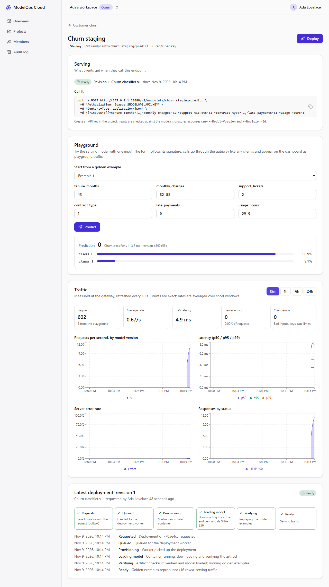

# Milestone 6 — Prediction Playground and Operational Dashboard

> **Status: implemented and verified locally (2026-11-09, Windows 11 + Docker Desktop).** CI on Linux has not run yet: `PROGRESS.md` ticks M6 only after a green CI run.



## A. Problem being solved

After M5 a model can serve traffic, but nobody can *see* it. Before trusting a deployment, a team needs four things:
1. **Try it** on a real input without writing a client or creating an API key.
2. **Watch it**: how many requests, how fast, how many errors, and which model version answered.
3. **See the whole organization at a glance**: what exists, what serves, what changed recently.
4. **Trust the numbers.** A dashboard that disagrees with the load generator is worse than none.

This milestone completes the Tier 1 vertical slice (docs/08): train → register → validate → deploy → try → observe.

## B. Architecture decisions

| Decision | Why |
|---|---|
| **Prometheus now** (`prom/prometheus:v3.15.1`, `127.0.0.1:19090`, scrape every 5 s, 2-day retention, 256 MB limit) instead of in M10 | Dashboards need a time-series store. Grafana, OpenTelemetry and tracing stay in M10 |
| **Gateway metrics carry `endpoint_id`** (slugs are only unique per project) **and `source`** (`api` / `playground`) | Exact per-endpoint queries; playground traffic is visible but separable from client traffic |
| **Allow-listed metrics only (SEC-15):** the API accepts `range` ∈ {15m, 1h, 6h, 24h} and `series` ⊆ {rps, latency, errorRate, status}; any other parameter is a 400 | Every PromQL string is a server-side template. The only variable is an endpoint id that has already been validated as a UUID, so no user text can reach Prometheus |
| **Exact counts, not `increase()`:** requests in a range = counter now − counter `range` ago (`offset`) | `increase()` extrapolates and would not match a load generator. A counter that didn't exist at the start counts from 0. A gateway restart can only undercount, never overcount |
| **Rates are honest approximations:** fixed time grid, explicit `null` gaps, `or vector(0)` for the error numerator | 0 errors reads as 0%, not "no data", while no traffic at all still reads as no data |
| **Playground goes through the gateway's internal route** (`POST /internal/endpoints/:id/predict`, token-protected, user id in `X-Playground-Actor`) | The same validation, routing, breaker and metrics as real clients. No stored API-key secret is needed, and each user is limited to 5 req/s |
| **Signature-driven form:** one numeric field per feature, prefilled from the serving version's golden examples; values shown with 7 significant digits (float32 noise hidden, same float32 value) | Anyone can try the model correctly the first time; the gateway still re-validates everything |
| **Org overview** at the organization root: counts from Postgres, requests (24 h) from Prometheus | It still renders when Prometheus is down (`requests24h: null`, "Metrics are unavailable") |
| **k6 in Docker** (`grafana/k6:2.3.0`) behind `pnpm demo:traffic`, constant arrival rate, JSON summary | A known number of requests, nothing to install, and the same tool CI uses for the acceptance check |

### Deviations from the roadmap (honest list)

- **Prometheus moved from M10 to M6** (above). M10 still adds Grafana, OpenTelemetry/Tempo and the `file_sd` targets for model servers.
- **The playground uses the gateway's internal route, not "an internal API key"** as the M5-era API table said. The design table is updated; the security properties are equal or better (no secret stored anywhere).
- **No CPU/memory series per container yet** (docs/04 listed `cpu, mem`). They need cAdvisor or the Docker stats API, which comes with the M10 observability stack.
- **The deployment timeline with live polling** was already delivered in M5.

## C. Dependencies (all ≥ 7 days old at install)

- `prom/prometheus:v3.15.1` (2026-10-21; v3.16.0 was 4 days old).
- `grafana/k6:2.3.0` (2026-10-24).
- No new npm or Python packages: Recharts (M3) draws the charts and the API calls Prometheus with `fetch`.

## D/E. Repository changes and file paths

```text
infra/compose/prometheus/prometheus.yml        scrape config: dev gateway + the integration tests' gateway
infra/compose/docker-compose.yml               prometheus service + volume
apps/gateway/src/app.ts                        shared predict pipeline; endpoint_id + source labels;
                                               internal playground route (per-user 5 req/s)
apps/gateway/src/guards.ts routing.ts          injectable clock for the rate limiter; lookupById
apps/api/src/modules/metrics/                  series.ts (allow-list + templates), prometheus.ts,
                                               metrics.service.ts (exact counts), controller (metrics, overview)
apps/api/src/modules/deployments/playground.ts info (features, golden examples) + predict via the gateway
apps/web/src/features/deployments/             dashboard.tsx, playground.tsx, hooks in api.ts
apps/web/src/features/org/overview-page.tsx    organization overview (new org home page)
scripts/demo-traffic.mjs, tests/load/predict.js  k6 load generator (`pnpm demo:traffic`)
apps/api/test/integration/observability.int.spec.ts   playground, SEC-15, k6 == dashboard, Prometheus down
apps/api/test/unit/metrics.spec.ts             allow-list and template tests
apps/web/test/playground.test.tsx              form validation, field-error mapping, chart helpers
tests/e2e/specs/m6-playground-dashboard.spec.ts  login -> deploy -> playground -> k6 -> dashboard -> overview
scripts/smoke.mjs                              +1 check (Prometheus ready, gateway target up)
```

## G. Setup commands

```bash
pnpm env:init      # adds MO_PORT_PROMETHEUS, MO_PROMETHEUS_URL
pnpm dev:up        # now also starts Prometheus
pnpm dev
# after deploying an endpoint and creating an API key in the UI:
pnpm demo:traffic --endpoint churn-staging --key mo_XXXXXXXXXX_... --rps 10 --duration 60s
```

The default request bodies are the churn fixture's golden inputs, which match the demo models; pass `--body file.json` for another model.

## H. Tests

- **Unit (API):** the allow-list accepts the documented ranges and series and rejects `series=sum(up)`, `query=…`, `promql=…`, unknown ranges, `step`, injection-shaped selectors and array parameters (SEC-15). Every query is a template whose only variable is the endpoint UUID. The error rate uses `or vector(0)`.
- **Unit (gateway):** metrics carry `endpoint_id` and `source`. The playground route needs the internal token and a user id, runs the same pipeline (signature checked), is limited to 5 req/s per user even when the endpoint allows 100, and is counted as `source="playground"`. The rate-limit tests now use a frozen clock (they were timing-dependent before).
- **Component (web):** `parseRow` (required, finite numbers, signature order); the form prefills from a golden example, switches examples, blocks invalid input without sending it, and maps the gateway's `inputs[0].<feature>` errors back onto the fields; the "nothing deployed" state; float32 display; chart data pivoting with gaps; the screen-reader summary.
- **Integration (real Prometheus, gateway container, k6):**
  - **Playground:** info lists the signature's features and the golden examples. Predictions equal the golden labels, viewers can use it, unknown fields are rejected with the field path, and another tenant gets 404.
  - **SEC-15:** four kinds of disallowed query return 400 over HTTP.
  - **Acceptance:** k6 sends 10 req/s for 6 s through the test gateway. Afterwards the dashboard's request count minus playground calls equals k6's count *exactly*. Zero server errors, one `v1` traffic series, p50/p95/p99 present. The org overview reports the same total.
  - **Prometheus down:** metrics answer 503 `METRICS_UNAVAILABLE`, and the overview still renders with `requests24h: null`.
  - **Permission matrix:** 4 new routes × 4 roles.
- **E2E (Playwright + axe):** register → validated upload → endpoint → deploy → the playground form is prefilled and predicts the golden label → invalid input is blocked in the browser → an API key and real k6 traffic through the dev gateway → the dashboard shows k6's count + 1 playground call → the overview shows the same total and "1 / 1" endpoints serving.

### Actual results (2026-11-09, Windows 11)

```text
API unit           229 passed
Gateway unit        13 passed (3 consecutive runs)
Web component       43 passed
API integration    242 passed (10 files, 140 s)
E2E (Playwright)     8 passed
Smoke               24/24
ESLint (strict), Prettier, tsc ×5, next build, contract regenerated: all pass
```

**Measured in the screenshot run:** k6 sent 15 req/s for 40 s (600–601 requests). The dashboard showed the same count plus 1 playground call, 0 server errors and p95 4.9 ms at the gateway, on this laptop. This is not a benchmark: M12 does load testing properly.

### Bugs and problems found during M6 (all fixed)

| Found by | Problem | Fix |
|---|---|---|
| Gateway unit test | The 3 req/s rate-limit test passed only when the burst didn't cross a one-second boundary | The limiter's clock is injectable; tests freeze it and assert exact status sequences |
| Gateway unit test | The metrics assertion depended on Prometheus label order | Checks each label separately |
| Integration test | My chart assertion assumed a rate peak > 1 req/s; a new series loses the increase before its first scrape (Prometheus has no earlier sample) | The exact count is the acceptance check; the chart is only checked for having the series; documented above |
| Screenshot review | The playground showed float32 noise (`82.55000305175781`) | 7 significant digits (round-trips to the same float32; tested) |
| Screenshot review | "Server error rate" said "No traffic" when there were simply no errors | `or vector(0)` for the error numerator |
| Screenshot review | The error-rate axis auto-scaled to 400% | Fixed 0–100% domain |
| Web typecheck | The overview cast revision states; the playground result's `model` was an open object | Typed enums and a DTO class in the API, so the generated client matches |
| ESLint | `__ENV` / `__VU` (k6 globals) flagged as undefined | Declared as globals in the k6 script |
| My first draft of the "Prometheus down" test | It never actually reached the 503 path | Rewritten: a user of the misconfigured API instance creates an endpoint and gets 503 |
| E2E (once, environment) | Windows Smart App Control briefly blocked a scikit-learn DLL in `ml/.venv` during the M3 training test | Transient; the rerun passed. Nothing in the repo changed |

## I. Expected behaviour

- The sidebar starts with **Overview**: six tiles and the latest deployments, refreshed every 30 s.
- An endpoint page shows **Serving**, then the **Playground** (fields from the signature, example picker, Predict → class and probability bars, latency, revision), then **Traffic** (range buttons; five stat cards; four charts), then the latest deployment and the history.
- `pnpm demo:traffic` prints k6's count; within ~10 s the dashboard's *Requests* matches it (plus any playground calls, shown under the number).
- With Prometheus stopped, the traffic card shows an error with a retry button and the overview shows "—" for requests.

## J. Debugging

| Symptom | Cause → fix |
|---|---|
| Traffic card: "Metrics are unavailable" | Prometheus is down. Run `pnpm dev:ps`, then `pnpm dev:up` |
| Dashboard stays at 0 after traffic | Check the gateway target at <http://127.0.0.1:19090/targets>. `gateway:8081` must be **up** (`modelops-gateway-test` is normally down; that's fine) |
| `demo:traffic` prints `401` failures | Wrong or revoked key, or the key belongs to another project |
| `demo:traffic` says "network modelops-backend not found" | The stack isn't running (`pnpm dev:up`) |
| Playground: 429 | More than 5 predictions per second from one user, by design |
| Rate charts lower than expected right after traffic starts | A new series loses the increase before its first scrape; the counts are still exact |

## K. Acceptance criteria (roadmap M6)

| Criterion | Status |
|---|---|
| Signature-driven playground form | ✅ component + integration + e2e |
| Deployment timeline with live polling | ✅ (M5) |
| Prometheus queries behind allow-listed series; metrics API allow-list test (SEC-15) | ✅ unit + integration |
| Dashboard cards + charts (rps, p50/p95/p99, error rate, traffic by version) | ✅ |
| Org overview dashboard | ✅ |
| Playwright full slice (login → deploy → playground predict) | ✅ plus k6 traffic, dashboard and overview |
| Dashboard numbers move with `demo-traffic` and match k6's counts within tolerance | ✅ **exactly equal** in the integration test and the e2e test |
| CI green on Linux | ⏳ pending the next push |

## L. Completion checklist

- [x] Prometheus in the stack, scraping the gateways
- [x] Gateway: `endpoint_id` / `source` labels, internal playground route
- [x] API: allow-listed metrics, exact counts, playground, org overview
- [x] Web: dashboard, playground, overview
- [x] `pnpm demo:traffic` (k6)
- [x] Unit, component, integration (k6 == dashboard), e2e + axe, smoke
- [ ] Green CI run on Linux
