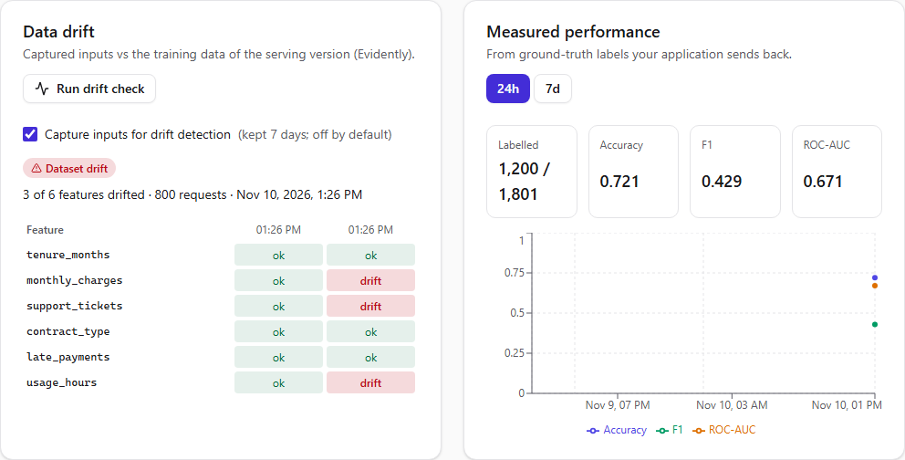

# Milestone 7 — Drift Monitoring and Model Evaluation

> **Status: done (2026-11-10).** Verified locally on Windows 11 and in CI on Linux: [run 42836362934](https://github.com/Kartavya1905/modelops-cloud/actions/runs/42836362934). All five jobs passed on the first run; the stack job (integration incl. the drift and gate scenarios, smoke, e2e) took 8.1 minutes, well inside the new 45-minute limit.



## A. Problem being solved

After M6 a team can see that a model *answers*, quickly and without errors. That isn't the same as answering *correctly*. Models decay in two different ways, and they need different responses:

1. **Data drift:** the inputs move away from what the model was trained on (prices go up, usage patterns change). The model may still be fine, or not. You can see it immediately, without labels.
2. **Concept drift:** the inputs look exactly the same, but the relationship between inputs and outcome has changed. Only ground truth reveals it, usually days later.

A single "model health" number hides both stories. Separately, the registry needs a rule for **which version is the champion**. "Whoever clicked last" is not a rule. A new version should become champion only after it has been measured against the current one on data neither was trained on.

## B. Architecture decisions

| Decision | Why |
|---|---|
| **One gateway event stream** (`mo:events`, Redis Stream, `XADD MAXLEN ~ 200000`) for predictions *and* feedback | One stream keeps the order "prediction before its label". Prediction events are fire-and-forget (a Redis hiccup never fails a prediction, `gateway_events_dropped_total` counts losses). Feedback is awaited: `202` means it is on the stream, `503` means try again |
| **Input capture is opt-in per endpoint** (`captureInputs`, off by default, PATCH with `If-Match`) | Inputs can be personal data (docs/06). Without capture the gateway sends only the output summary (class, score), never inputs |
| **Worker consumer group** (`XREADGROUP`, group `platform`): reads its own pending entries first, then new ones; acknowledges only after Postgres and S3 writes succeed | At-least-once with idempotent writes (`createMany … skipDuplicates`, feedback `ON CONFLICT DO UPDATE`). A crash replays, never loses or doubles |
| **Feedback is joined in SQL** (`INSERT … SELECT … WHERE endpoint matches`) | A key of project A can't label predictions of another endpoint. Unknown and expired ids are counted as ignored |
| **Captured inputs as JSONL in S3** (`drift-captures/<org>/<endpoint>/<day>/<first-stream-id>.jsonl`), prediction records in Postgres; both kept **7 days** (hourly purge) | Postgres holds the small rows to join with late labels; bulky inputs go to object storage |
| **Datasets become stored, content-addressed objects** (`blobs/sha256/<hash>`), uploaded as CSV or ingested from the MLflow run (`dataset/train.csv`, hash verified) | Drift needs the *exact* training data of the serving version, and evaluation needs held-out data. Same bytes = same dataset version |
| **Drift = Evidently `DataDriftPreset`** in the ml-worker (`POST /v1/drift`), reference = the serving version's training dataset, current = up to 5000 captured inputs of the last 24 h (≥ 100) | Evidently picks the test per column by type and size: with more than 1000 reference rows (true for every reference here) it uses the normed Wasserstein distance for numeric and the Jensen–Shannon distance for categorical columns, both with threshold 0.1 (K-S / chi-square p-values for smaller references). ≤ 5 distinct integers count as categorical. Our wrapper only reads the per-column results and applies Evidently's own thresholds; dataset drift = ≥ 50% of features drifted |
| **Measured performance from feedback** (accuracy, F1, ROC-AUC via Mann–Whitney) per hour/day, computed in the API from joined rows | Shown *next to* drift, never merged with it |
| **Evaluation gate (FR-32):** candidate vs the *current champion* on a held-out dataset, scored by the ml-worker (`POST /v1/evaluate`, ONNX Runtime), judged by the project's policy: `minRocAuc` 0.70, `maxRocAucDrop` 0.01, `maxLogLossIncrease` 0.02 | The caller can't choose the baseline. The policy is snapshotted into every report, and reports are append-only (trigger) |
| **`champion` only through a passed gate**, enforced twice: the API (row lock, 422/409) **and** a Postgres trigger (`registered_models_champion_guard`: the evaluation must be COMPLETED + passed, for this model and candidate, against the champion being replaced, and the version must be VALIDATED) | Even a bug or a manual SQL update can't crown an unevaluated version. Mirrored to MLflow's `champion` alias (best effort; Postgres is the truth) |
| **Seeded scenarios** from the platform's own generator (`ml/modelops_ml/datasets.py`, now `churn-v2`): `--charge-shift/--usage-scale` move inputs, `--concept-shift` changes the label relationship but not the inputs | Every test and the demo (`pnpm demo:drift`) are reproducible; the "concept drift" really leaves inputs untouched (tested) |

### Deviations from the roadmap (honest list)

- **Evaluations and drift checks run synchronously** in the API request (seconds for 2000 rows), not as queued jobs. Each call appends one immutable report, so retries are harmless and no `Idempotency-Key` is needed. Scheduled drift checks (hourly, `MO_DRIFT_INTERVAL_MS`) run in the worker. If evaluation datasets grow large this moves to BullMQ.
- **No Evidently HTML reports.** Drift results are rows in Postgres (method, threshold, score per feature) and the UI draws them. The `reports` bucket stays reserved.
- **Evidently needs pandas < 3.** 0.7.23 calls a pandas function removed in 3.0, so the ml-worker pins pandas 2.3.3 (the training environment keeps 3.1.0). Telemetry is disabled. The ml-worker image grew from 0.9 GB to **2.8 GB**, mostly Evidently's dependencies (risk R5 updated).
- **The generator moved to `churn-v2`.** v1's concept knob only flipped two weak effects; the base rate fell, so *accuracy rose* while ROC-AUC fell. v2 reverses the main effects (tickets, late payments, contract, tenure). With the knob at 0 the data is byte-identical to v1 (fixture hashes unchanged).
- **No UI to edit the gate policy** yet; it is a JSON column with defaults (admins can change it via SQL; an API comes with approvals in M8/M9).
- **`challenger` alias** comes with canaries (M8).
- **Endpoint settings (`PATCH`) are open to ML Engineers**, not only Owners/Admins as docs/04 planned. Staging vs production restrictions arrive with approvals.

## C. Dependencies (all ≥ 7 days old at install)

- `evidently==0.7.23` (ml-worker only), `pandas==2.3.3` (ml-worker, pinned `<3`), `scikit-learn==1.9.1` (ml-worker, for metrics; same version as training).
- No new npm packages. The heatmap is a table; the performance chart uses Recharts.

## D/E. Repository changes and file paths

```text
apps/gateway/src/events.ts                      prediction/feedback events; feedback parsing (≤ 1000 items, labels ∈ classes)
apps/gateway/src/app.ts, main.ts                 POST /v1/endpoints/:slug/feedback (scope feedback); XADD pipeline
services/ml-worker/ml_worker/drift.py            Evidently wrapper -> per-feature method/threshold/score/drifted
services/ml-worker/ml_worker/evaluate.py         dataset reader + accuracy/F1/ROC-AUC/log loss with ONNX Runtime
services/ml-worker/ml_worker/app.py              POST /v1/drift, POST /v1/evaluate (token, SHA-256 checked inputs)
ml/modelops_ml/datasets.py                       churn-v2 concept knob; CLI (--format csv|jsonl)
apps/api/prisma/migrations/20261109200000_monitoring_evaluation/   tables, columns, policy default
apps/api/prisma/migrations/20261109200100_monitoring_invariants/   champion guard, append-only reports
apps/api/src/modules/monitoring/                 capture-store, events.consumer (stream -> Postgres/S3, purge),
                                                 ml-worker client, monitoring.service (drift, performance), scheduler
apps/api/src/modules/evaluation/evaluation.ts    gate (judge), evaluations, champion
apps/api/src/modules/registry/datasets.ts        dataset upload + ingest from MLflow runs
apps/api/src/modules/deployments/endpoints.*     PATCH settings with If-Match; snapshot reads (see H)
apps/web/src/features/monitoring/                monitoring panel (capture toggle, drift heatmap, performance),
                                                 evaluations card, datasets section
scripts/demo-drift.mjs                           `pnpm demo:drift --phase normal|data|concept` (journey J3)
apps/api/test/integration/monitoring.int.spec.ts the M7 scenarios (below)
tests/e2e/specs/m7-monitoring-evaluation.spec.ts the browser slice
```

## G. Setup commands

```bash
pnpm dev:up && pnpm db:deploy && pnpm dev      # rebuilds the ml-worker image (Evidently)
# in the UI: deploy a version that records its training data (registered from an MLflow run,
# or uploaded with "Trained on"), turn on "Capture inputs", create an API key, then:
pnpm demo:drift --endpoint churn-staging --key mo_XXXXXXXXXX_... --phase normal
pnpm demo:drift --endpoint churn-staging --key mo_XXXXXXXXXX_... --phase data      # data drift
pnpm demo:drift --endpoint churn-staging --key mo_XXXXXXXXXX_... --phase concept   # concept drift
# press "Run drift check" between phases
```

## H. Tests

- **Python (ml-worker, 10 new):** same-distribution samples (several seeds) don't drift; monthly charges shifted ±30 (both directions) drift while tenure doesn't; a strong shift flags the dataset, reports every feature and treats `contract_type` as categorical; too few rows or missing columns are refused; evaluation scores match scikit-learn and rank a better model higher; bad datasets (missing label, one class, too few rows) are rejected; both HTTP routes work, and a stored object whose bytes changed is refused (422).
- **Python (generator):** the concept knob changes labels but leaves every input column identical; the CLI writes CSV and JSONL; v1 hashes unchanged.
- **Unit (API):** gate rules (floor, drop, log loss; the first champion only needs the floor) with explanations; ROC-AUC against hand-computed values with ties; accuracy and F1; CSV header/row checks; stream replies in both RESP2 and RESP3 shapes; the permission scan covers the new controllers.
- **Unit (gateway):** prediction events carry inputs only when capture is on; feedback needs the `feedback` scope, validates labels against the classes, and answers 503 when the stream is down.
- **Integration (real Postgres, Redis, S3, MLflow, ml-worker, gateway container):**
  - datasets are content-addressed and deduplicated;
  - **normal traffic:** no drift, ROC-AUC > 0.7 from feedback;
  - **shifted inputs:** `monthly_charges` and `usage_hours` drift, `tenure_months` doesn't;
  - **concept drift:** no feature drifts, while accuracy falls by > 0.08 and ROC-AUC by > 0.2;
  - missing samples / reference produce explanations (422/409), not guesses;
  - feedback for another endpoint's prediction is ignored; viewers can read but not run;
  - `If-Match` (428, 412), and a conditional GET is never 304;
  - retention purges records and captures per organization;
  - **gate:** first champion via the floor; a worse candidate fails and can't be crowned through the API *or* by an UPDATE in the database; only Owners/Admins crown; an evaluation against an older champion is stale;
  - permission matrix: 8 new routes × 4 roles.
- **E2E (Playwright + axe):** datasets → upload with "Trained on" → validated → evaluation passes → **Make champion** → deploy → capture on → `demo-drift --phase data` (300 rows + labels) → the endpoint shows 300 / 300 labelled → **Run drift check** → `monthly_charges` drifted, `tenure_months` not; axe on every page.
- **Smoke:** +1 check (`/v1/drift`, `/v1/evaluate` need the token), and the gateway check now also covers feedback without a key.

### Actual results (2026-11-10, Windows 11)

```text
API unit           255 passed
Gateway unit        17 passed
Web component       43 passed
ML (training)       34 passed
ml-worker           40 passed, 1 skipped (Linux-only sandbox test)
Model server        14 passed
API integration    285 passed (11 files, 161 s)
E2E (Playwright)     9 passed (parallel workers, 1.0 min)
Smoke               25/25
ESLint (strict), Prettier, ruff, tsc ×5, contract regenerated (unchanged): all pass
(next build was not run locally while the dev server used .next; CI runs it)
```

**Measured in the screenshot run** (2026-11-10): the real PyTorch model from the M3 training (8000 rows, seed 7), deployed, with `demo:drift` sending 400 predictions + labels per phase. These are the stored rows and reports, not estimates, and two consecutive runs gave identical values (seeded data and training):

| | Normal (seed 13) | Data drift (charges +40, usage ×1.6) | Concept drift (labels flipped, inputs normal) |
|---|---|---|---|
| Accuracy from feedback | 0.823 | 0.798 | **0.543** |
| Churn rate in the labels | 0.235 | 0.340 | 0.363 |
| Drift check | 400 requests: no feature drifted (largest score 0.075, `usage_hours`) | 800 requests (normal + shifted): **dataset drift**, 3 of 6 features: `monthly_charges` 0.962, `usage_hours` 0.948, `support_tickets` 0.219 | not checked in this run; the integration test checks it: 0 of 6 features drift |

- `support_tickets` drifting with the data shift is real, not a false positive: the generator draws tickets from a Poisson rate that rises with monthly charges above 70, so raising charges by 40 also raises tickets. A drift monitor should catch that.
- The evaluation on the 2000-row held-out set (seed 11): ROC-AUC 0.8622, log loss 0.3748, accuracy 0.823. That passed the floor of 0.70, and v1 became the first champion.
- The two signals tell different stories, which is the point of keeping them apart. The data shift is loud on the inputs, but accuracy fell only 0.025. Concept drift leaves the inputs unchanged, but accuracy fell 0.28.

### Bugs and problems found during M7 (all fixed)

| Found by | Problem | Fix |
|---|---|---|
| ml-worker tests | Evidently 0.7.23 crashes with pandas 3 (`infer_dtype_from_object` was removed) | ml-worker pins pandas 2.3.3; documented under R5 |
| Integration test (concept drift) | With generator v1, "concept drift" *raised* accuracy: the knob lowered the churn rate, so predicting "no churn" got easier, while ROC-AUC fell. **Accuracy alone can hide decay when the base rate moves** | Generator `churn-v2` reverses the main effects; the test checks accuracy *and* ROC-AUC |
| Integration test | `XREADGROUP` replies come as one `[stream, entries]` pair (RESP3) or a list of them (RESP2), depending on the protocol | One parser for both shapes, unit-tested |
| My first gate test | It assumed the PyTorch fixture passes a relaxed policy; on the held-out set its ROC-AUC is 0.688, below the 0.70 floor | The test uses that *natural* failure (scikit-learn: 0.827) instead of a tuned policy |
| OpenAPI review | A default on `labelColumn` made the field required in the generated client | Default moved into the description |
| E2E | After **Deploy**, the endpoint page stayed on "Nothing deployed yet". The new `ETag` (settings version) let the browser revalidate with `If-None-Match`, Express answered **304**, and the cached body hid the new revision | `Cache-Control: no-store` and `If-None-Match` ignored on endpoint responses; integration regression test |
| E2E (parallel run) | Under load, the endpoint read could land between "revision READY" and "stable pointer set": two separate READ COMMITTED reads saw neither a stable nor an in-progress revision, so the UI stopped polling. A latent **M5** bug | Endpoint detail and list read in one REPEATABLE READ snapshot |
| Full integration run | The shared event stream held earlier test files' predictions, so a count was 418 instead of 400 | The monitoring tests drain the stream before starting |
| E2E | Playwright's `check()` on a controlled checkbox (it flips after the PATCH returns) | `click()` + `toBeChecked()` |
| Screenshot review | The performance chart was empty when all labels fell in one hour: empty hours are gaps, so a lone point had no line and (with `dot={false}`) no mark | Points get dots |
| Screenshot review | The first monitoring screenshot showed 840 / 1,801 labelled: taken before the worker had stored the last phase's feedback | The script waits for all 1,200 labels |
| My first draft of this document | Said Evidently uses K-S for numeric columns; the stored reports show the normed Wasserstein distance (references > 1000 rows) | Corrected from the real reports |
| Lint | ESLint scanned the generated Playwright HTML report | Ignored (it is gitignored) |
| Screenshot script | "Churn classifier" matched a version badge in the runs table before the model card | Navigates via the version's back link |
| Environment (Windows) | Smart App Control blocked a freshly created `pytest.exe` once | `uv run python -m pytest`; nothing in the repo changed |

## I. Expected behaviour

- **Project page:** a *Datasets* card (training data from runs and uploads, "Stored" when the bytes are available) with **Upload dataset**.
- **Model page:** the champion badge, and an *Evaluations* card: pick a candidate and a held-out dataset → **Evaluate** → report with ROC-AUC, log loss, accuracy, row count and one line per gate rule. **Make champion** appears only on a passed, current evaluation and only for Owners/Admins.
- **Endpoint page:** *Data drift* (capture toggle, **Run drift check**, latest result, heatmap of features × last 10 checks; hover a cell for method, score and threshold) next to *Measured performance* (labelled / total, accuracy, F1, ROC-AUC, chart; 24 h / 7 d).
- With capture off, a drift check explains that there are no captured inputs (422) instead of reporting "no drift".

## J. Debugging

| Symptom | Cause → fix |
|---|---|
| Drift check: "Not enough captured inputs" | Capture is off, or fewer than 100 captured requests in 24 h. Turn it on, send traffic, wait a few seconds for the worker |
| Drift check: "no stored training dataset" (409) | The serving version doesn't record its training data. Register from an MLflow run (ingested automatically) or upload with "Trained on" |
| Drift check: 503 | ml-worker down: `pnpm dev:ps`, `pnpm dev:logs` |
| Performance stays at "No labelled predictions" | Feedback needs the key scope `feedback` (keys created before M7 have only `predict`), and prediction ids from the same endpoint |
| **Make champion** missing | The gate failed, the evaluation is older than the current champion (evaluate again), or you are not an Owner/Admin |
| `demo-drift` 401 | Wrong or revoked key, or a key from another project |

## K. Acceptance criteria (roadmap M7)

| Criterion | Status |
|---|---|
| Opt-in input capture (gateway → Redis Stream → worker → S3 JSONL) | ✅ unit + integration + e2e |
| ml-worker `/drift` (Evidently `DataDriftPreset` vs the training dataset version) | ✅ |
| `/evaluate` candidate vs baseline; promotion policy + gate | ✅ |
| Feedback endpoint + measured performance | ✅ |
| UI: drift heatmap, performance chart, evaluation report | ✅ |
| Drift detects an injected shift and doesn't fire on a same-distribution sample | ✅ Python + integration + e2e |
| Evaluation gate pass/fail cases | ✅ integration (API and database) |
| Concept drift lowers measured performance while data drift stays low | ✅ integration: 0 of 6 features drift; accuracy and ROC-AUC fall |
| **Data drift and concept drift are separate signals** | ✅ two cards, two data sources (inputs vs labels) |
| **`champion` cannot be set without a passed gate** | ✅ API + Postgres trigger, tested both ways |
| CI green on Linux | ✅ [run 42836362934](https://github.com/Kartavya1905/modelops-cloud/actions/runs/42836362934) |

## L. Completion checklist

- [x] Gateway event stream, opt-in capture, feedback endpoint
- [x] Worker: stream consumer, captures in S3, retention, hourly drift
- [x] ml-worker: drift (Evidently) and evaluation
- [x] Datasets stored and content-addressed; ingest from MLflow runs
- [x] Evaluation gate, champion alias (API + DB trigger + MLflow mirror)
- [x] UI: datasets, evaluations, champion, capture toggle, drift heatmap, performance
- [x] `pnpm demo:drift`
- [x] Unit, component, integration, e2e + axe, smoke
- [x] Green CI run on Linux
