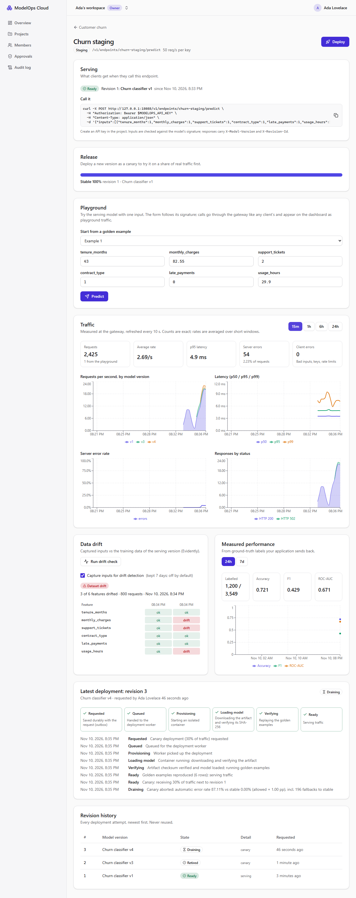

# Milestone 8 — Canary Deployment and Rollback

> **Status: done (2026-11-10).** Verified locally on Windows 11 and in CI on Linux: [run 42899758376](https://github.com/Kartavya1905/modelops-cloud/actions/runs/42899758376). All five jobs passed on the first run; the stack job (integration incl. the 10 000-request split and the broken-canary abort, smoke, e2e) took 7.1 minutes.



## A. Problem being solved

Validation (M4) proves a model is safe to load and reproduces its golden examples. It cannot prove the model behaves on *real* traffic. A version can pass every check and still fail on inputs nobody thought to test. After M7 the platform can see such problems, but releasing is still all-or-nothing: a new revision takes 100% of traffic once it is READY.

M8 makes releases gradual and reversible:
1. **Canary:** a new version first gets a share of real traffic next to the stable one.
2. **Evidence before promotion:** the platform compares canary and stable on error rate and latency, and only a passing comparison lets you promote.
3. **Automatic abort:** a canary that fails is taken out of traffic without anyone watching.
4. **Rollback in one click:** the previous revision stays warm, so going back takes milliseconds, not a redeploy.
5. **Four eyes for production:** nobody ships to production alone.

## B. Architecture decisions

| Decision | Why |
|---|---|
| **Rollout strategy per deploy:** `IMMEDIATE` (M5 blue/green, the default) or `CANARY` with an initial share of 0–50 %. A canary becomes READY *next to* stable (`endpoints.canary_revision_id`, `canary_weight`) | Deploying and starting the canary is one approved action (production). The share can be changed afterwards (`PUT …/canary`) |
| **Sticky split at the gateway:** `fnv1a(X-Routing-Key ?? request id) % 100 < weight` → canary | Deterministic on every gateway, with no shared state. A routing key (e.g. a customer id) keeps one customer on one model for the whole canary. The response says `X-Traffic-Role: stable \| canary` |
| **Fallback, not retry:** if the canary's circuit is open, stable answers and `gateway_canary_fallback_total` counts it. A failed request is never retried | A broken canary stops hurting clients as soon as its circuit opens (5 failures), and the error metrics stay honest because nothing hides a failure by retrying it |
| **Analysis in the worker every 15 s** (and on demand): exact canary vs stable counts since the canary started (counter differences, M6), 5xx, fallbacks, p95 from the histogram. Policy per project: `minRequests` 200, `minDurationSeconds` 300, `maxErrorRateIncrease` 1 pp, `maxLatencyRatio` 1.25 | **Bad news acts fast:** once there are enough requests, a breach FAILS and aborts at once. **Good news needs patience:** a PASS also needs 5 minutes. Fallbacks count as canary failures, so a canary can't look healthy by being skipped |
| **Promote only after a PASS** (`409 CANARY_NOT_ELIGIBLE`); the old stable drains, still warm | The evidence is the gate, like the evaluation gate in M7 |
| **Release actions use `If-Match`** on the endpoint (`row_version`), not an Idempotency-Key | They are synchronous state changes. A retry or double click with the same ETag gets 412 and can't act twice. Each action is one transaction: lock the endpoint row, CAS the revisions, bump the version, then publish the full routing snapshot |
| **Rollback:** fast path when the target is still DRAINING and its container answers (one transaction swaps the pointers); slow path when it is RETIRED (a new revision of the same version through the normal pipeline) | The fast path is the common case thanks to the 30-minute warm grace. The slow path still works days later |
| **Rollback targets = revisions that served as stable** (`stable_at`) | Found while writing the browser test: choosing by `ready_at` made an *aborted canary* the default rollback target |
| **Four-eyes approvals:** a PRODUCTION deploy waits in `AWAITING_APPROVAL`; a different Owner/Admin approves (→ QUEUED, outbox) or rejects with a reason (→ CANCELLED). Undecided approvals expire after 24 h | Enforced three times: the API (`403 SELF_APPROVAL`), a CHECK constraint (`decided_by_id <> requested_by_id`), and a trigger that refuses to queue a production revision without an APPROVED row |
| **Production endpoints:** created by Owners/Admins only; traffic changes on them are Owner/Admin only | Staging stays fast for engineers; production needs more authority |
| **A realistic broken canary** for tests and the demo: `tests/fixtures/bundles/latent-nan`, the real scikit-learn bundle whose probabilities become NaN when `late_payments` is 0 (55 % of normal traffic). Its golden examples only contain rows with late payments, so it passes V1–V11 | Validation cannot catch this bug, and only real traffic shows it, which is the case canaries exist for. The model server now answers an explicit 500 for non-finite outputs instead of crashing while encoding the JSON |

### Deviations from the roadmap and docs/05 (honest list)

- **The deploy request carries the initial canary share.** docs/05's flow had "deploy → READY at 0 % → set canary". Both work: `canaryWeight: 0` gives exactly that flow.
- **Weights are capped at 50 %.** More than half the traffic is a promotion, not a canary.
- **Release actions use `If-Match`, not `Idempotency-Key`** (docs/04 listed promote/rollback/canary under idempotency keys). This is updated in docs/04.
- **Only deployments need approval.** Canary weight, promote, abort and rollback on production are restricted to Owners/Admins, without a second person. A slow rollback redeploys an already-approved version, so it needs no new approval (the trigger checks that the version really served on that endpoint).
- **No UI to edit the canary policy** (as with the M7 gate policy). It is a per-project JSON column; tests set it directly.
- **No `challenger` MLflow alias** (the M7 doc said it would come with canaries). A canary is a revision of an endpoint, with its own analysis and audit trail; mirroring it as a registry alias would add a second source of truth for no reader.
- **No new smoke checks.** The environment is unchanged; the gateway/API behaviour is covered by unit, integration and e2e tests.

## C. Dependencies

None added. FNV-1a is 10 lines in `apps/gateway/src/split.ts` (checked against the reference vectors).

## D/E. Repository changes and file paths

```text
apps/api/prisma/migrations/20261110200000_canary_releases/   canary columns, strategy, approvals, canary_checks
apps/api/prisma/migrations/20261110200100_canary_invariants/ weight CHECKs, canary guard, four eyes, approval gate
apps/api/prisma/migrations/20261110200200_stable_history/    stable_at (+ backfill)
apps/api/src/modules/deployments/releases.ts         canary weight, promote, abort, rollback (fast/slow)
apps/api/src/modules/deployments/canary-analysis.ts  judgeCanary (pure), CanaryAnalyzer, scheduler, checks route
apps/api/src/modules/deployments/approvals.ts        four-eyes approvals
apps/api/src/modules/deployments/endpoints.service.ts  strategy, production approvals, insertRevision
apps/api/src/modules/deployments/deploy.processor.ts   CANARY -> READY next to stable
apps/api/src/modules/deployments/dataplane.ts         canary + weight in the routing snapshot
apps/api/src/modules/deployments/reconciler.ts        approval expiry
apps/gateway/src/split.ts, app.ts                     weighted sticky split, fallback, X-Traffic-Role
services/model-server/model_server/app.py             explicit 500 for non-finite outputs
ml/modelops_ml/fixtures.py --latent-nan               the broken canary bundle
apps/web/src/features/deployments/releases.tsx        traffic split, canary evidence, promote/abort, rollback
apps/web/src/features/deployments/approvals-page.tsx  approvals queue (+ nav item)
apps/api/test/integration/releases.int.spec.ts        the M8 scenarios (below)
tests/e2e/specs/m8-canary-rollback.spec.ts            the browser slice
```

## G. Setup commands

```bash
pnpm dev:up && pnpm db:deploy && pnpm dev     # rebuilds the gateway and model-server images
# in the UI: deploy a version, then Deploy -> Rollout "Canary" -> share, send traffic:
pnpm demo:traffic --endpoint churn-staging --key mo_XXXXXXXXXX_... --rps 20 --duration 60s
# to see an automatic abort, upload tests/fixtures/bundles/latent-nan as a version and deploy it as a canary
```

## H. Tests

- **Unit (gateway, +5):** FNV-1a reference vectors; 10 000 random request ids at 10 % → 10 % ± 1.5 %; a routing key always lands in the same bucket; requests route by `X-Routing-Key` and say which track answered; a broken canary returns 502 for its first 5 requests, then stable serves the canary's share (fallback counted), and stable requests never see an error.
- **Unit (API, +16):** 8 canary-verdict tests and 8 more from the permission scan, which now covers the 3 new controllers. The verdict tests: pass; fail fast on a breach before the duration; patience for a young healthy canary; nothing decided below `minRequests`; error budget relative to stable; latency ratio, with no stable latency not counting as a failure; fallbacks explained.
- **Unit (model server, +1):** a model that is fine on its golden rows but NaN elsewhere answers 500, never NaN.
- **Component (web, +7):** rollback targets (newest first, never stable, canary or an aborted canary); the split in words, not only colours; promote disabled until a passing check; actions send the ETag; the rollback dialog warns that it aborts a canary and says whether the target is warm; engineers see no release actions on production.
- **Integration (real gateway container, Prometheus, model servers), 14 tests:**
  - the broken bundle passes validation;
  - a canary is READY next to stable with its share;
  - **10 000 real requests at 10 %** → 10 % ± 1.5 %, all 200, each answered by the revision its track says;
  - routing keys are sticky;
  - weight changes need If-Match (428/412), stay within 0–50, are refused to viewers and allowed to engineers on staging;
  - one canary at a time; a canary needs a stable revision;
  - promote: 409 before a passing check, 412 with a stale ETag, then the canary serves everything and the old stable drains;
  - **fast rollback, timed**;
  - slow rollback of a retired revision (new revision, `rollbackOfId`);
  - **acceptance:** a broken canary at 20 %: stable-bound customers never see an error, errors stay within the canary-bound share, the analysis FAILS and aborts it (audit actor SYSTEM), the aborted canary is not a rollback target, and afterwards 500 requests see no error;
  - production four eyes: engineers can't create or deploy; the deploy waits; `canDecide` per user; self-approval 403; the same shortcut refused by the database (CHECK and trigger); another Admin approves → READY; rejection needs a reason; expiry after 24 h; release actions refused to engineers on production.
  - Permission matrix: 8 new routes × 4 roles.
- **E2E (Playwright + axe):** two blue/green deploys → **Roll back** through the confirm dialog → the broken version as a 50 % canary → real traffic through the dev gateway (errors ≤ the canary share) → **Run check** until the analysis aborts it → stable 100 %, the canary row DRAINING, the rollback dialog offers only the previous stable revision → the approvals page; axe on each.

### Actual results (2026-11-10, Windows 11)

```text
API unit           271 passed
Gateway unit        22 passed
Web component       50 passed
Model server        15 passed
API integration    331 passed (12 files, 275 s)
E2E (Playwright)    10 passed (parallel workers, 1.4 min)
Smoke               25/25
ML training         34 passed (ml-worker unchanged in M8: 40 passed in M7)
ESLint (strict), Prettier, ruff, tsc ×5, contract regenerated: all pass
```

**Measured** (integration tests against the local Docker stack; two runs each):

| | Run 1 | Run 2 |
|---|---|---|
| Canary share of 10 000 requests at 10 % | 9.75 % | 10.06 % |
| Fast rollback: request → gateway answers with the old revision | 85 ms | 87 ms |
| Broken canary at 20 %, 1100 requests: client errors | 13 | 14 |
| …of 216 canary-bound requests, served by stable through the fallback | 198 | 197 |

In the screenshot run (dev stack, k6 at 30 req/s, canary at 30 %), the **worker's scheduled analysis** aborted the broken canary on its own while the traffic was still running (nobody pressed a button): *"error rate 86.52 % vs stable 0.00 % (allowed + 1.00 pp), incl. 182 fallbacks to stable"* (an earlier run: 81.56 %, 137 fallbacks). The endpoint's 15-minute window showed 66 server errors in 2,424 requests (2.7 %; earlier run 63 in 2,425), all on the canary's share. These numbers come from this laptop and are not a benchmark (M12 does load testing).

### Bugs and problems found during M8 (all fixed)

| Found by | Problem | Fix |
|---|---|---|
| Writing the browser test | Rollback chose its target by `ready_at`, so after an aborted canary the default rollback target was that broken canary | `stable_at`: only revisions that served as stable are targets (migration with backfill); unit, component and integration tests |
| Code review while writing the gateway change | The circuit breaker's `canPass()` hands out the half-open trial; asking it twice per request (canary check, then the normal check) would turn a recovering canary into a 503 | Asked once per request and revision |
| Integration test (my expectation) | I expected the broken canary's errors in the measured batch; the warm-up had already opened its circuit, so all 196 canary-bound requests were served by stable (0 errors) | The test counts every request, warm-up included, and checks errors ≤ canary share and fallbacks > 0 |
| Integration test | Rollback on production by an engineer returned "no target" instead of 403 (the role was checked after the target lookup) | Role checked first |
| API unit test | `Cannot access 'EndpointRefDto' before initialization`: decorator metadata reads a class declared later in the file | Declared before use |
| Model server review | NaN outputs crashed JSON encoding (an accidental 500 with no reason) | Explicit 500 "model produced non-finite values" |
| Screenshot review | The production deploy in the demo picked the dialog's default, the newest (broken) version | The script selects v1 |
| Test output | Vitest prints console output only for failing tests by default, hiding the timing lines | `--silent=false` when measuring |
| Lint | Non-null assertions, a useless escape, an unnecessary assertion | Fixed |
| Environment (Windows) | After the dev servers had been idle for an hour, Docker Desktop stopped forwarding host ports to healthy containers (smoke 17/25, "fetch failed") | Restarting the containers restored it; smoke 25/25. Nothing in the repo changed |

## I. Expected behaviour

- **Deploy dialog:** with something serving, a **Rollout** choice: "Replace when ready (blue/green)" or "Canary: a share of traffic first" with a share (0–50 %). Production: a note that a second Owner/Admin must approve.
- **Endpoint page, Release card:** a split bar with words (stable %, canary %); the canary's evidence table (requests, error rate, p95 for canary and stable) and one line per rule; **Set share**, **Run check**, **Promote** (only after a passing check), **Abort canary**; **Roll back** opens a confirm dialog naming the target and whether it is warm.
- **Timeline:** canary start, weight changes, "Canary aborted: automatic: …", "Promoted", "Rollback: serving again".
- **Approvals** (sidebar): pending production deployments; Approve / Reject (with a reason) for other Owners/Admins, an explanation for the requester.

## J. Debugging

| Symptom | Cause → fix |
|---|---|
| Promote stays disabled | No passing check yet: a PASS needs ≥ 200 canary requests **and** 5 minutes (project policy) |
| Canary shows "Collecting evidence" forever | Weight 0, or no client traffic (`source="api"`; playground calls don't count) |
| `409 CANARY_IN_PROGRESS` on deploy | Promote or abort the current canary first |
| `409 NO_STABLE_REVISION` | A canary needs something to compare with: deploy IMMEDIATE first |
| `412 ETAG_MISMATCH` | Someone (or the worker's analysis) changed the endpoint; reload |
| Production deploy stuck in "Awaiting approval" | Another Owner/Admin must approve it on the Approvals page; with one admin, invite a second |
| Rollback says there is no target | Only revisions that served as stable qualify; an aborted canary never does |

## K. Acceptance criteria (roadmap M8)

| Criterion | Status |
|---|---|
| Canary weight with ETag/If-Match | ✅ unit + integration + e2e |
| Sticky hashing | ✅ unit + integration (40 keys × 10) |
| Canary analysis scheduler + auto-abort | ✅ integration + e2e + the dev worker in the screenshot run |
| Promote; fast and slow rollback | ✅ integration; rollback dialog in e2e |
| Approvals (four-eyes) for production | ✅ API + CHECK + trigger, tested both ways |
| UI: traffic split bar, approvals queue, rollback with confirm dialog | ✅ |
| Split accuracy: 10 000 requests at 10 % → 10 % ± 1.5 % | ✅ 9.75 % and 10.06 % through the real gateway |
| Stickiness | ✅ |
| Auto-abort with a deliberately broken canary | ✅ `latent-nan` bundle |
| Rollback timing | ✅ 85–87 ms (fast path) |
| Self-approval blocked | ✅ API 403 + database CHECK |
| **A bad canary is rolled back automatically with no client-visible errors beyond the canary share** | ✅ stable-bound clients: 0 errors; errors ≤ the canary-bound requests, most absorbed by the fallback |
| CI green on Linux | ✅ [run 42899758376](https://github.com/Kartavya1905/modelops-cloud/actions/runs/42899758376) |

## L. Completion checklist

- [x] Schema, invariants (CHECK + triggers), migrations
- [x] Gateway: weighted sticky split, fallback, `X-Traffic-Role`
- [x] API: canary, promote, abort, rollback (fast/slow), analysis, approvals, production rules
- [x] Worker: canary scheduler, approval expiry
- [x] Web: release card, deploy rollout choice, approvals page, production endpoints
- [x] Broken-canary fixture; model server non-finite check
- [x] Unit, component, integration, e2e + axe
- [x] Green CI run on Linux
