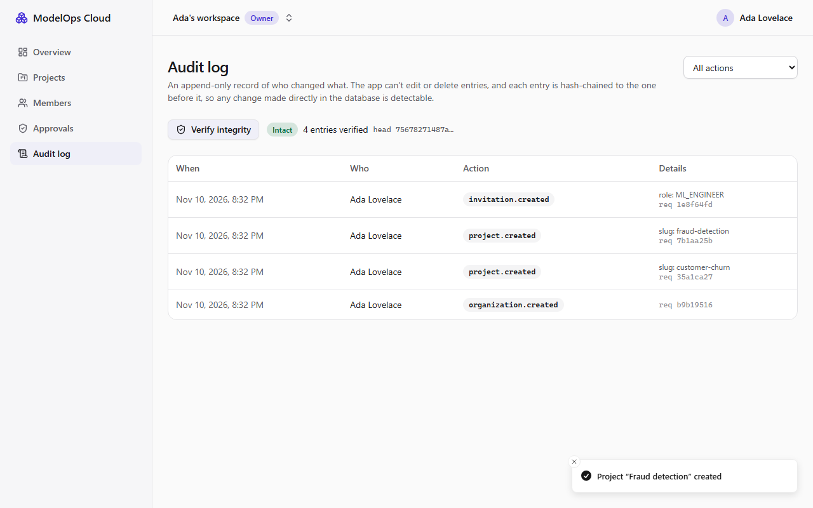

# Milestone 9 — Reliability Testing and Security Hardening

> **Status: done.** Verified locally on 2026-11-11 (Windows 11), then on Linux in CI: [run 43080634686](https://github.com/Kartavya1905/modelops-cloud/actions/runs/43080634686) (green).



## A. Problem being solved

Milestones 1–8 built the platform and tested the paths their authors thought of, mostly with simulated failures (`stopAfter`, a fake crashed job). M9 asks the harder questions:

1. **Does it survive real faults?** A killed process, a database that freezes, a cache that forgets everything, a model server that dies.
2. **Are the security promises in docs/06 actually tested?** All of SEC-1…SEC-16, not just the ones that were convenient.
3. **Is what Docker runs as hardened as the compose file claims?** Check the running containers, not the YAML.
4. **Can someone with database access rewrite history?** The append-only audit log stops the app, not a DBA.
5. **Do we ship known vulnerabilities or committed secrets?**

The acceptance criterion is a written reliability report with real outputs. It is section H below, and the raw outputs are in [`docs/reliability/chaos-report-2026-11-11.json`](../reliability/chaos-report-2026-11-11.json).

## B. Architecture decisions

| Decision | Why |
|---|---|
| **Chaos as a test suite** (`pnpm test:chaos`, `apps/api/test/chaos/`) on the same throwaway database and test gateway as the integration tests, with the deployment worker as a **real OS process** (`node dist/worker.js`) | Real faults, repeatable, and safe to run next to a dev stack. SIGKILL of a separate process is a crash; `stopAfter` in the same process is not. It runs in CI too |
| **Database outages are transient, never the revision's fault** (`isDatabaseUnavailable`: Prisma P1001/P1002/P1008/P1017/P2024/P2028, dropped connections) | Found by the chaos suite: a 15 s Postgres pause expired an interactive transaction (P2028), and the deploy was marked FAILED. Now the job retries; if every attempt fails, the reconciler re-enqueues it, and the state deadline still bounds it |
| **Deploy job lock 30 s** (was 60 s, now `MO_DEPLOY_LOCK_MS`), renewed every 15 s while the job runs | A crashed worker's job comes back when its lock expires. 60 s plus the stalled check came close to the 120 s state deadline; 30 s leaves a margin |
| **Tamper-evident audit log:** a hash chain per organization, computed by a `BEFORE INSERT` trigger. Each entry gets its chain position, the previous hash, and `sha256(prev ‖ every column)` (canonical: jsonb text, UTC microseconds, unit separators). A per-chain advisory lock prevents forks. `audit_chain_verify(org)` recomputes it in SQL; `GET /orgs/{id}/audit-events/verify` and a **Verify integrity** button use it | No code path can skip it, and the hashing rule exists in one place. Existing entries were backfilled (all 1,380 entries of the dev database verified after the migration). Edits and deletions are detected even when made by the table owner with the append-only trigger disabled |
| **Hardening checked on the running containers** (`pnpm check:hardening`, `docker inspect`): non-root, read-only root, `cap_drop: ALL`, no-new-privileges, CPU/memory/pids limits, healthcheck, ports on 127.0.0.1, docker.sock only in the proxy (read-only), model servers on the internal network only | The YAML can say one thing while an image's `USER` or an entrypoint says another. Exceptions are written in the script with their reason |
| **Postgres, Redis and SeaweedFS** now run as their image's own non-root user (999, 999, 1000), read-only, without capabilities; **pids limits** on every service | The biggest gap the check found (19 before, 0 after) |
| **Security job in CI:** gitleaks over the full git history, `pnpm audit --prod --audit-level high`, `pip-audit` for all three Python projects; **Trivy** fails the stack job on a CRITICAL vulnerability with a fix in any of our four images | Free tools, pinned to versions ≥ 7 days old: gitleaks v8.30.1, Trivy 0.76.1 (0.76.2 was 5 days old), pip-audit 2.10.1 |
| **SEC-14 (no inputs in logs)** tested end to end: a sentinel value through the public predict route, the playground and a rejected request; then the gateway's and model server's logs (the test gateway now logs at `info`, one line per request), this process's own output, the event stream and the audit log are searched | It was the one SEC test without a test |

### Deviations from the roadmap (honest list)

- **Postgres row-level security was not built.** The roadmap marks it Tier 3, and the risk register ranks it second to cut. Prisma's pooled connections would need a transaction around every query (`SET LOCAL app.org_id`) and a separate role for the worker's cross-tenant work. That is a refactor of every service for defence in depth over controls that already exist and are tested: an `org_id` filter on every query, 404 across tenants (SEC-7), and the permission matrix. I chose the audit hash chain (also Tier 3) instead, which closes a gap nothing else covered.
- **Base images are pinned by exact tag, not digest; no Dependabot.** Both are supply-chain items that M11 (CI/CD) owns; the threat model now says so.
- **The chaos scenarios run against the local Docker stack**, not a cluster. The kind version of these faults comes with M10.
- **Bundle uploads stay direct multipart** to the API with hard size limits (PROGRESS said "revisit in M9" for presigned URLs). The limits plus the sandboxed validator cover the risk at this scale; presigned uploads would mainly help very large models, which this platform caps anyway.
- **The Docker socket proxy stays root with a writable root filesystem.** That is a documented exception: it reads the root-owned socket and renders its config at start-up; it has no capabilities and a read-only socket mount.

## C. Dependencies

None in the product. CI tools (run as containers or `uvx`): `zricethezav/gitleaks:v8.30.1`, `aquasec/trivy:0.76.1`, `pip-audit==2.10.1`.

## D/E. Repository changes and file paths

```text
apps/api/test/chaos/faults.chaos.spec.ts             the five fault scenarios (real worker process)
apps/api/vitest.chaos.config.mts                     `pnpm test:chaos`
apps/api/src/common/prisma/prisma.service.ts          isDatabaseUnavailable
apps/api/src/modules/deployments/deploy.processor.ts  database outages are retried, never FAILED
apps/api/src/modules/deployments/deploy.worker.ts     configurable job lock (30 s)
apps/api/src/modules/deployments/runtime/docker.driver.ts  tolerate "removal already in progress"
apps/api/prisma/migrations/20261111100000_audit_hash_chain/  chain columns, trigger, backfill, verify()
apps/api/src/modules/audit/                           GET /orgs/{id}/audit-events/verify
apps/web/src/features/audit/audit-page.tsx            Verify integrity
apps/api/test/integration/audit-chain.int.spec.ts     chain, concurrency, edit and delete detected
apps/api/test/integration/security.int.spec.ts        SEC-14
infra/compose/docker-compose.yml                      non-root Postgres/Redis/SeaweedFS, cap_drop, read-only, pids
scripts/hardening.mjs                                 `pnpm check:hardening`
.github/workflows/ci.yml                              security job, Trivy, chaos, hardening check
.gitleaksignore                                       two reviewed false positives
docs/reliability/chaos-report-2026-11-11.json         raw outputs of the chaos run
```

## G. Setup commands

```bash
pnpm dev:up                # (existing stacks: see docs/10 "Upgrading a stack created before M9")
pnpm check:hardening
pnpm test:chaos            # builds the API, then runs the fault scenarios (~3 min)
```

## H. Reliability report (real outputs)

Each scenario runs against the real stack: Postgres 18, Redis 8, the gateway container, model-server containers through the Docker socket proxy, and a worker process started with `node dist/worker.js`. Traffic is two concurrent clients sending one prediction every ~20 ms through the test gateway. Each scenario must end in the correct terminal state within its deadline (docs/05 §7). The two most recent passing runs (2026-11-11, Windows 11 + Docker Desktop):

| Fault | Expected | Observed | Recovery (run 1 / run 2) | Deadline |
|---|---|---|---|---|
| **Worker killed** (SIGKILL) while the revision was PROVISIONING | A new worker finishes it; exactly one container | No progress while no worker ran (still PROVISIONING after 3 s); a new worker picked the job up when its lock expired → **READY, 1 container** | 67.5 s / 73.0 s | 120 s (LOADING) |
| **Redis flushed** (FLUSHDB) with a revision QUEUED and traffic running | The queued revision is deployed; clients keep being served | The job, the routing snapshot and the API-key directory were gone (0 BullMQ keys). The reconciler re-enqueued the revision and re-published the data plane → **READY**; **1,162 / 1,027 requests, all 200** | 14.9 s / 15.5 s | 10 min (QUEUED) |
| **Redis restarted** (container restart) with traffic running | No client errors; the next deploy works | Redis down ~0.8–1.2 s; **420 / 522 requests, all 200** (rate limiter fails open, keys cached, routing in memory); redeploy **READY** | 6.4 s / 9.3 s | 120 s |
| **Postgres paused 15 s** (container paused) with a deploy in flight and traffic running | No client errors (the data plane never reads Postgres); readiness 503 then 200; the deploy finishes | **1,009 / 904 requests, all 200**; `/health/ready` **503** during, **200** after; deploy **READY** | 0.3 s / 0.5 s after unpause | 120 s |
| **The serving model server killed** (`docker kill`) with traffic running | DEGRADED, restarted within the budget (3 / 10 min), READY again; errors only until then | DEGRADED after 0.4–0.6 s (routing stopped at once), 1 restart, **READY**. Clients saw errors for **2.9 s / 4.5 s** (503 while degraded, 2 timeouts), then 200 again | 3.1 s / 4.7 s | 60 s |

What the numbers mean:
- **The data plane is independent of the control plane.** Through a Postgres freeze and a Redis restart, not one prediction failed.
- **A killed model server is the one fault clients notice**, because only one revision was serving. That matches the documented non-guarantee "zero dropped in-flight requests during a model-server crash" (docs/05 §7). With a warm previous revision, an operator could roll back in ~85 ms (M8). Automatic failover to a warm revision is not built.
- **Worker crash recovery is bounded by the job lock**, not by detection: ~30 s lock + up to 30 s until the next stalled check + the remaining deploy steps. Safe, but not fast; documented.
- **The first run found a real bug:** before the fix, the Postgres pause turned the in-flight deploy into FAILED (`RUNTIME_START_FAILED`, *"Transaction API error: … expired transaction … 15207 ms passed"*). That is the reason for `isDatabaseUnavailable` (section B).

## SEC-1…SEC-16 (docs/06 §7)

| ID | Attack | Proved by | Status |
|---|---|---|---|
| SEC-1 | Pickle disguised as ONNX | `services/ml-worker/tests/test_validate.py` (sentinel file never created); e2e M4 | ✅ |
| SEC-2 | External-data path traversal | `test_validate.py` | ✅ |
| SEC-3 | Custom operator domain | `test_validate.py` | ✅ |
| SEC-4 | Oversized artifact | `test_validate.py` (V2 size limits) | ✅ |
| SEC-5 | Artifact swapped after validation | `deployments.int.spec.ts` (checksum mismatch, never serves) | ✅ |
| SEC-6 | Deploy an unvalidated version | `deployments.int.spec.ts` (API 422 and DB trigger) | ✅ |
| SEC-7 | Cross-tenant IDOR | `tenancy.int.spec.ts` (404 both ways) | ✅ |
| SEC-8 | Role escalation | `members.int.spec.ts` (Admin cannot grant Owner); `releases.int.spec.ts` (an ML engineer cannot approve) | ✅ |
| SEC-9 | Self-approval | `releases.int.spec.ts` (API 403, CHECK constraint, trigger) | ✅ |
| SEC-10 | Revoked / expired key | `deployments.int.spec.ts` (revocation reaches the gateway in seconds) | ✅ |
| SEC-11 | Another project's key | `deployments.int.spec.ts`, gateway unit tests | ✅ |
| SEC-12 | CSRF | `auth.int.spec.ts` (missing and wrong token) | ✅ |
| SEC-13 | Oversized / malformed inference | gateway unit tests (413/400; the model server never sees it) | ✅ |
| SEC-14 | Log leakage | **`security.int.spec.ts` (new)**: a sentinel through every path is in no log, event or audit row | ✅ |
| SEC-15 | PromQL injection | `metrics.spec.ts`, `observability.int.spec.ts` | ✅ |
| SEC-16 | Brute-force login | `auth.int.spec.ts` (429 after 5) | ✅ |

Tests for SEC-8, 9, 12 and 16 existed without their ID; they are now named with it, so `grep SEC-` finds every one.

## Hardening (running containers, `pnpm check:hardening`)

| | Before M9 | After |
|---|---|---|
| Unexpected gaps | **19**: no pids limit anywhere; Postgres, Redis and SeaweedFS as root with all capabilities and a writable root; Prometheus with capabilities | **0** |
| Documented exceptions | — | 2, both the Docker socket proxy (root; writable root filesystem) |

Checked on the 8 platform containers and every model server: non-root, read-only root, `cap_drop: ALL`, no-new-privileges, CPU/memory/pids limits, healthcheck, ports only on 127.0.0.1, docker.sock only in the proxy (read-only), model servers on the internal network only.

## Supply chain and secrets (local runs, 2026-11-11)

| Check | Result |
|---|---|
| gitleaks, full history (11 commits) | 2 findings, both false positives: column definitions of a UI table whose `key` field names a latency metric. Suppressed by fingerprint in `.gitleaksignore`; then **no leaks** |
| `pnpm audit --prod` | **No known vulnerabilities** (dev tooling: 1 moderate, `minimatch` via build tools; not shipped, below the gate) |
| `pip-audit` (ml-worker, model server, training) | **No known vulnerabilities**. `torch 2.14.1+cpu` comes from PyTorch's index and is skipped (training only, never in a serving image) |
| Trivy (our 4 images) | runs in CI (Linux); result recorded with the CI run |

### Actual results (2026-11-11, Windows 11)

```text
API unit           282 passed
Gateway unit        22 passed
Web component       50 passed
API integration    340 passed (14 files, 446 s), on the hardened stack
Chaos                5 passed (real faults; report above)
E2E (Playwright)    10 passed (parallel, 1.3 min), on the hardened stack (see the note below)
Smoke               25/25 on the hardened stack
Hardening check     0 unexpected gaps
ESLint (strict), Prettier, tsc, contract regenerated: all pass
```

**E2E note (honest):** the first full parallel run after hardening had 5 failures, and the second had 2 (M6, M7: a page heading not visible within 5 s, then a step that never finished). Both runs happened while the machine was busy: dev servers recompiling, pip-audit, 52 model servers left over from the day's runs (2.7 GB). M6 and M7 then passed serially (1.2 min), and the third full parallel run passed 10/10 in 1.3 min, the same as before M9. No M9 change explains a timing-only failure (pids peaked at 48 of 512), but the suite is sensitive to a loaded laptop. CI runs on a clean machine.

### Bugs and problems found during M9 (all fixed)

| Found by | Problem | Fix |
|---|---|---|
| **Chaos: Postgres paused** | A 15 s freeze expired the worker's interactive transaction (P2028), and the deploy was marked FAILED, blaming the model for an infrastructure outage | Database-unavailable errors are retried, never terminal; unit-tested classifier |
| Chaos: worker killed | Recovery depended on a 60 s job lock, close to the 120 s deadline | Lock 30 s (configurable) |
| Chaos: model server killed | The reconciler and the failing worker both removed the container: Docker answered 409 "removal already in progress", logged as an error | Treated as success |
| Hardening check | 19 gaps on the running stack (above) | Non-root users, read-only roots, no capabilities, pids limits |
| Upgrading the dev stack | SeaweedFS as user 1000 cannot write directories it created earlier as root | One-time `chown` of the volume, documented in docs/10; fresh volumes (CI) need nothing |
| Compose | `pids_limit` conflicts with `deploy.resources.limits` | `pids` inside the resource limits |
| SEC-14 test (first run) | API key named `k` was too short, so the key was never created and the test sent `Bearer undefined` (401) | A valid name |
| SEC-14 test (full run) | The shared test gateway's info log of the whole run is bigger than `execFileSync`'s 1 MB buffer | `maxBuffer` 512 MB |
| gitleaks | 2 false positives in a UI table definition | Reviewed, suppressed by fingerprint |
| Environment (Windows) | DNS failed for a while: pip-audit and the image builds could not reach their registries; Smart App Control blocked a fresh `pip-audit.exe` | Retried when the network returned; `python -m pip_audit`. Nothing in the repo changed |

## I. Expected behaviour

- **Audit log page:** **Verify integrity** → "Intact · N entries verified · head …", or, after tampering, "The audit log was changed. Entry #N: event content changed / missing event."
- `pnpm check:hardening` prints one row per container and exits 0.
- `pnpm test:chaos` prints one `[chaos]` line per scenario and writes `apps/api/test-results/chaos-report.json`.

## J. Debugging

| Symptom | Cause → fix |
|---|---|
| SeaweedFS restarts with "please verify /data is writable" | A pre-M9 volume: see docs/10 "Upgrading a stack created before M9" |
| `pnpm check:hardening` exits 2 | The stack is not running: `pnpm dev:up` |
| A chaos test leaves Postgres paused | It unpauses in `afterAll`; if the process was killed: `docker unpause modelops-postgres-1` |
| Verify integrity reports a break | Someone changed or deleted audit rows directly in the database; the entry number says where |

## K. Acceptance criteria (roadmap M9)

| Criterion | Status |
|---|---|
| Chaos scripts: kill worker, restart Redis, pause Postgres, kill a model server | ✅ plus a Redis FLUSHDB scenario |
| Every chaos scenario ends in a correct terminal state within its deadline | ✅ 5/5, two runs |
| Remaining adversarial tests; SEC-1…SEC-16 green | ✅ SEC-14 added; every ID mapped to its test |
| Container hardening checklist | ✅ checked on the running containers, 0 unexpected gaps |
| gitleaks, Trivy, `pnpm audit`, `pip-audit` in CI | ✅ (CI result pending) |
| Audit hash chain | ✅ |
| Postgres RLS (Tier 3) | ❌ deferred, reasons above |
| Threat model review | ✅ docs/06 §1, with a status column |
| **Written reliability report with real outputs from the chaos runs** | ✅ section H and `docs/reliability/` |
| CI green on Linux | ⏳ after the next push |

## L. Completion checklist

- [x] Chaos suite with a real worker process; report
- [x] Database outages never fail a deploy
- [x] SEC-14; SEC IDs on every security test
- [x] Audit hash chain (DB trigger, backfill, verify route, UI)
- [x] Hardened containers; `pnpm check:hardening`
- [x] CI: gitleaks, pnpm audit, pip-audit, Trivy, chaos, hardening
- [x] Threat model review
- [x] Green CI run on Linux: [run 43080634686](https://github.com/Kartavya1905/modelops-cloud/actions/runs/43080634686)
